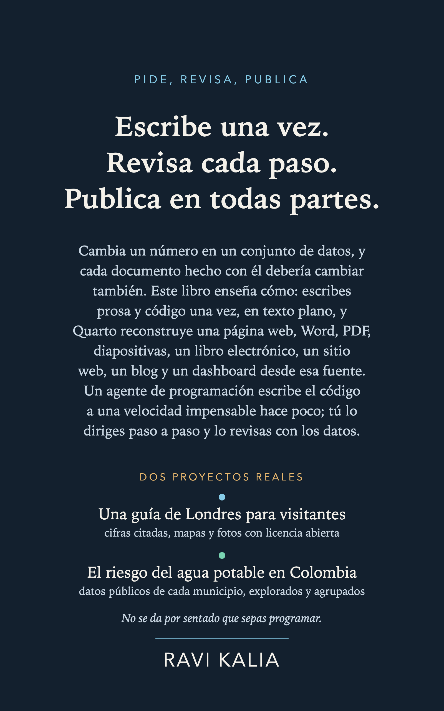

# Contracubierta {#back-cover .unnumbered .back-cover}

{.back-cover-image fig-alt="La contracubierta. Escribe una vez. Revisa cada paso. Publica en todas partes. Cambia un número en un conjunto de datos, y cada documento hecho con él debería cambiar también. Este libro enseña cómo: escribes prosa y código una vez, en texto plano, y Quarto reconstruye una página web, Word, PDF, diapositivas, un libro electrónico, un sitio web, un blog y un dashboard desde esa fuente. Un agente de programación escribe el código a una velocidad impensable hace poco; tú lo diriges paso a paso y lo revisas con los datos. Dos proyectos reales: una guía de Londres para visitantes, con cifras citadas, mapas y fotos con licencia abierta; y el riesgo del agua potable en Colombia, con datos públicos de cada municipio, explorados y agrupados. No se da por sentado que sepas programar. Ravi Kalia."}
