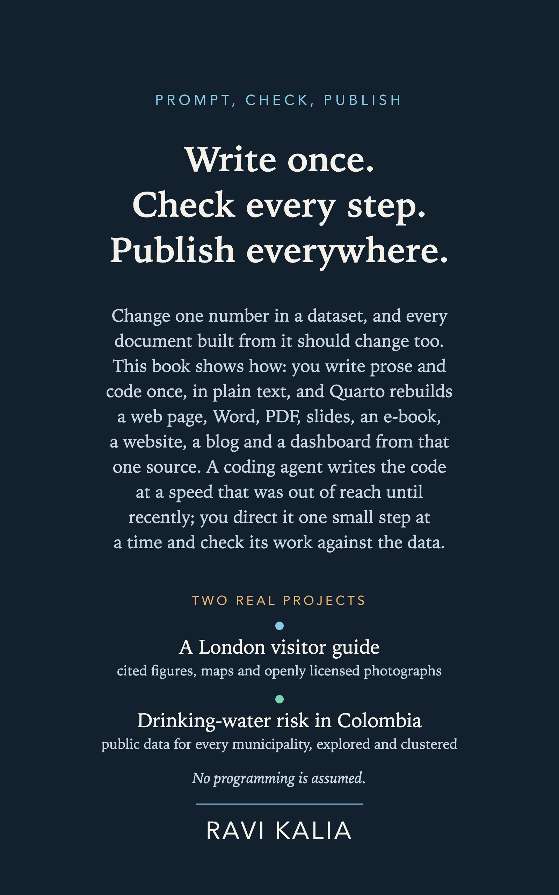

# Back Cover {#back-cover .unnumbered .back-cover}

{.back-cover-image fig-alt="The back cover. Write once. Check every step. Publish everywhere. Change one number in a dataset, and every document built from it should change too. This book shows how: you write prose and code once, in plain text, and Quarto rebuilds a web page, Word, PDF, slides, an e-book, a website, a blog and a dashboard from that one source. A coding agent writes the code at a speed that was out of reach until recently; you direct it one small step at a time and check its work against the data. Two real projects: a London visitor guide, with cited figures, maps and openly licensed photographs; and drinking-water risk in Colombia, with public data for every municipality, explored and clustered. No programming is assumed. Ravi Kalia."}
