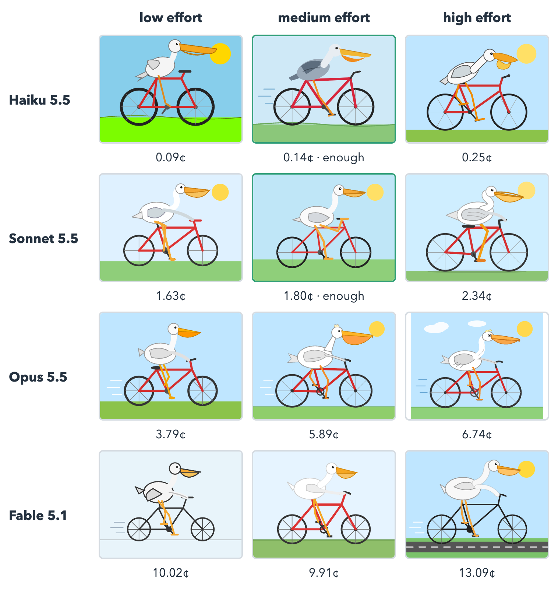
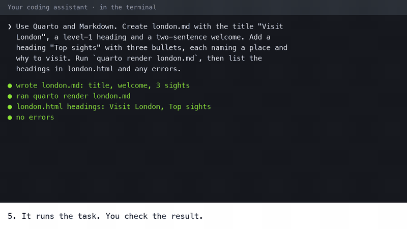
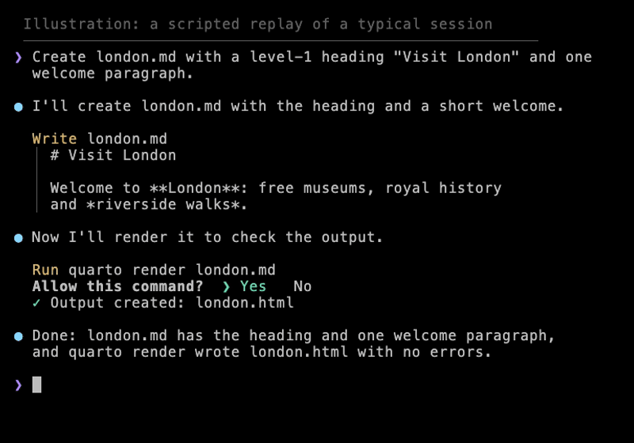

# Working With a Coding Assistant {#sec-assistant}

```{python}
#| label: ch2-setup
from scripts.prose import alt_text_holds
# The pelican experiment's costs, from the deck's record of Simon Willison's runs.
import re
from pathlib import Path

readme = Path("../assets/pelicans/README.md").read_text()
pelican_cost = {m.group(1): float(m.group(2)) for m in re.finditer(
    r"\| `([a-z]+-[a-z]+)\.svg` \|.*\| ([\d.]+) \|\s*$", readme, re.M)}
cheapest_ok = pelican_cost["haiku-medium"]
dearest = max(pelican_cost.values())
ratio = dearest / cheapest_ok

# The grid (@fig-pelicans) is a Markdown table in HTML and a picture in the EPUB, so its cell
# costs and its alt text are typed. Stop the render if they no longer match the README.
QUOTED_CENTS = {"haiku-low": 0.09, "haiku-medium": 0.14, "haiku-high": 0.25,
                "sonnet-low": 1.63, "sonnet-medium": 1.80, "sonnet-high": 2.34,
                "opus-low": 3.79, "opus-medium": 5.89, "opus-high": 6.74,
                "fable-low": 10.02, "fable-medium": 9.91, "fable-high": 13.09}


alt_text_holds(pelican_cost == QUOTED_CENTS, "fig-pelicans")
```

Simon Willison, a developer, has asked most major new models the same question since 2024:
"Generate an SVG of a pelican riding a bicycle". Four Claude models, each at three effort
levels, answered it with `{python} len(pelican_cost)` drawings, and every one is recognisably
a pelican on a bicycle. The dearest cost `{python} f"{dearest:.2f}"` cents, about
`{python} f"{ratio:.0f}"` times as much as the cheapest that was good enough, at
`{python} f"{cheapest_ok:.2f}"` cents (@fig-pelicans).

Choosing between those drawings is the first of many judgements this chapter teaches. A
*coding assistant* is a program that writes and edits files and runs commands at your
request: you write the *Prompt*, it does the typing, and you *Check* whether the result is
right. It can produce in a minute what would take an hour by hand, and it can produce
plausible, confident, wrong work just as quickly. How do you get the first kind of work
without being fooled by the second?

::: tryit
No installation needed. Paste Simon Willison's prompt,
`Generate an SVG of a pelican riding a bicycle`, into a web chat in your browser (Claude,
ChatGPT and Gemini each have a free plan, checked 2026-11-12), then paste it again in a new
conversation and compare the replies.

::: done
the two replies differ, although the prompt was the same. Quarto, given the same source,
never does that (@sec-not-ai).
:::
:::

## Model plus harness {#sec-model-harness}

A coding assistant is two programs working together (@fig-agent-loop).

The **model** is a large language model, such as Anthropic's Claude, OpenAI's GPT or
Google's Gemini. It runs on the vendor's servers. It reads text and writes text, and it can
reply with a structured request to use a tool: "read this file", "run this command".

The **harness** is the program on your computer that surrounds the model. Claude Code,
Codex and Antigravity are harnesses. The harness gives the model its tools (reading and
writing files, running commands, searching), carries out the model's tool requests, asks you
before it does anything consequential, and sends the results back to the model. That loop
repeats until the model replies with an answer instead of another request.

{#fig-agent-loop .on-light fig-alt="You give the harness a prompt, and it shows you results and asks you to approve commands. The harness (Claude Code, Codex or Antigravity) sends the conversation and tool results to the model (Claude, GPT or Gemini), which runs on the vendor's servers and replies with text or a request to use a tool. The harness carries out tool requests in the project folder, its root: it reads AGENTS.md first, then reads and edits files and runs commands there. The model decides, the harness does, and you direct and check."}

A short way to remember the split: **the model decides, the harness does, you direct and
check.** It has a practical consequence. Many harnesses can run several models, so the same
harness behaves differently with a different model, and the same model behaves differently
inside a different harness. When an assistant disappoints you, the cause can be either half,
and the fix is different: a stronger model for reasoning that falls short, better rules or
permissions for a harness that does the wrong thing.

::: why
The model cannot touch your computer. Everything it "does" is a request that the harness
carries out, and the harness can show you each request before acting on it. That is the
basis of every safety habit in this chapter: you approve commands you have read, and you
review files after they change.
:::

## Choosing an assistant and a model {#sec-choose}

Three assistants are used and tested in this book. Each comes from the same company as its
default models:

| Assistant | You type | Made by | Default models |
|---|---|---|---|
| Claude Code | `claude` | Anthropic | Claude |
| Codex | `codex` | OpenAI | GPT |
| Antigravity | `agy` | Google | Gemini |

: The assistants this book was tested with. Antigravity replaced Gemini CLI for unpaid-tier and Google One users on 18 June 2026 (Gemini CLI installation page, checked 2026-11-12). {#tbl-assistants}

Other assistants exist; this book does not test them, so it does not list them. Every prompt
in the book is written to work in any of the three. A vendor's own pairing of harness and
model is the easiest to set up, but it is not automatically the best fit for a task: the
assistant and the model are separate choices.

### Pick a model by task, not by rank

Each vendor offers a family of models, from small and cheap to large and capable. They are
not simply better and worse versions of one thing. Larger, more recent models usually follow
longer instructions, plan multi-step work and recover from their own errors better. Small
models are faster and cheaper, and often good enough for short, well-specified edits such as
fixing a typo or reformatting a table. Joining two datasets or debugging a failed render
rewards the stronger model.

The prompts in this book are short and specific, so a mid-sized model at a moderate *effort*
setting (how long the model reasons before answering) is enough: Claude's Sonnet on medium
effort, or Haiku for small edits, or OpenAI's Sol on low. For unfamiliar, hard work, the
vendors' own advice starts higher: Anthropic suggests starting with Opus 5.5 for most
workloads, and OpenAI with GPT-6 Astra for complex reasoning and coding. Start small, and move
up only when a task keeps failing.

::: practice
**Prices change monthly; the principle does not.** The list prices below were correct on
2026-11-12 and will not be for long. Read them as a snapshot of the spread, not as numbers to
plan with.

| Model | What the vendor says it is for | Input / output, \$ per million tokens |
|---|---|---|
| Claude Haiku 5.5 | "high-volume, latency-sensitive tasks such as classification, extraction, and routing" | 0.10 / 0.50 |
| Claude Sonnet 5.5 | "the best combination of speed and intelligence" | 2 / 10 |
| Claude Opus 5.5 | "long-running agentic coding and knowledge work" | 4 / 20 |
| Claude Fable 5.2 | "demanding reasoning and long-horizon agentic work" | 8 / 40 |
| GPT-6 Luna | "focused, high-volume tasks" | 0.10 / 0.50 |
| GPT-6.1 Terra | "visual reasoning, precise computer use, and clear, natural writing" | 1 / 5 |
| GPT-6.1 Sol | "near-Astra performance for complex work at a lower cost" | 2 / 10 |
| GPT-6 Astra | "the most demanding work" | 10 / 50 |

Haiku's price is for prompts up to 100,000 tokens; longer ones cost five times as much. The
pelican runs below used Fable 5.2's predecessor, Fable 5.1, listed at 10 / 50.
Subscriptions count usage differently from API prices, and which models you can choose
depends on your plan and the assistant's version. Sources: Anthropic's models overview and
pricing pages and OpenAI's models pages (checked 2026-11-12).
:::

The cost of a fixed level of capability has been falling fast. Measuring the cheapest model
that reaches a given benchmark score, the venture firm a16z found the price falling about
tenfold a year, a thousandfold over the three years from November 2021, and Epoch AI found
falls of between 9 and 900 times a year depending on the benchmark (both checked
2026-11-07). Both warn that the pace may slow, and neither measures the frontier, where the
price of the most capable work may fall more slowly. The practical lesson is the same either
way: choose by what the task needs, not by today's price.

### One prompt, four models, three efforts

The pelicans this chapter opened with make the trade-off concrete. @fig-pelicans shows one
run of each of four Claude models at three effort levels, with each reply's cost at API list
prices.

::: {.content-visible when-format="html:js"}
::: {#fig-pelicans}

| Model | low effort | medium effort | high effort |
|---|---|---|---|
| **Haiku 5.5** | {width=160} 0.09¢ | {width=160} 0.14¢, enough | {width=160} 0.25¢ |
| **Sonnet 5.5** | {width=160} 1.63¢ | {width=160} 1.80¢, enough | {width=160} 2.34¢ |
| **Opus 5.5** | {width=160} 3.79¢ | {width=160} 5.89¢ | {width=160} 6.74¢ |
| **Fable 5.1** | {width=160} 10.02¢ | {width=160} 9.91¢ | {width=160} 13.09¢ |

One prompt, four models, three efforts: "Generate an SVG of a pelican riding a bicycle". Images from Simon Willison's pelican series, one run per cell; cost is each reply's tokens at API list prices (checked 2026-11-06).
:::
:::

::: {.content-visible when-format="epub"}
{#fig-pelicans .on-light fig-alt="A grid of twelve drawings of a pelican riding a bicycle: one row per model (Haiku 5.5, Sonnet 5.5, Opus 5.5, Fable 5.1) and one column per effort (low, medium, high), each with its cost. Every cell shows a recognisable pelican on a bicycle. Costs rise from 0.09 cents for Haiku on low effort to 13.09 cents for Fable on high effort. Haiku and Sonnet on medium effort, at 0.14 and 1.80 cents, are marked as enough."}
:::

Read the grid in two directions. Down the rows, the model grows and the price per token rises,
so costs climb from fractions of a cent to more than ten cents. Across the columns, effort
rises: the model reasons longer and writes more, so the cost usually rises while the picture
gains details rather than becoming correct. Haiku on low effort has the weakest frame; from
medium effort up, the frames are sound, which is consistent with, though no proof of, the
book's advice of medium effort.

Keep the evidence in proportion. It is one run per cell of one small, self-contained task,
not a benchmark: run it again and you get different birds, and Fable on medium effort even
cost less than Fable on low. More effort is not always better, either: at their maximum
effort, Sonnet 5.5 and Opus 5.5 each spent 128,000 tokens reasoning, the models' output limit,
and returned no drawing (Simon Willison's transcripts, checked 2026-11-12). A drawing
says little about a long job that joins datasets and recovers from errors, which is where
stronger models earn their price. Whether a `{python} f"{ratio:.0f}"`-fold difference in
price is worth paying depends entirely on the task.

## What a conversation costs {#sec-cost}

Models are paid for by the *token*, a fragment of text of a few characters. Three things
raise the cost of a session:

1. **A bigger model** costs more per token.
2. **A higher effort setting** makes the model write more reasoning tokens per reply.
3. **A longer conversation** costs more with every turn, because the model keeps no memory
   between requests: the harness sends the whole conversation again each time. Prompt caching
   makes the repeated part cheaper, not free, and caches expire.

The habits that follow are simple: a mid-sized model at moderate effort, one task per
conversation, and a fresh conversation as soon as a task is done. Three commands, typed at the
assistant's prompt rather than in the shell, cover them:

| Command | Claude Code | Codex | Use it when |
|---|---|---|---|
| `/model` | switches the model; arrows adjust the effort level where the model supports it | chooses the model and reasoning effort | a prompt keeps failing (go up) or the work is routine (go down) |
| `/clear` | starts a new conversation with empty context; the old one can be resumed | clears the terminal and starts a fresh chat | a task is finished and an unrelated one starts |
| `/exit` | exits; `/quit` is the same | exits; `/quit` is the same | you are done, or need to move to another folder |

: Three commands that control cost and context (Claude Code commands reference and Codex CLI reference, checked 2026-11-12). Type `/` alone to list your assistant's commands. {#tbl-slash}

`/clear` matters for quality as well as cost. Old instructions and files read earlier keep
steering the model while they remain in the conversation; a fresh conversation drops them.
Nothing on disk changes, and the project's rules file is read again.

::: practice
**Pause and think.** One task is finished and an unrelated one starts. Which command first?

`/clear`. The new task needs none of the old conversation, and carrying it along costs
tokens on every turn and can mislead the model.
:::

## The root folder is the assistant's world {#sec-root-folder}

An assistant treats the folder you start it in as its *root*: it reads and edits files there
and in the folders below, and runs commands from there. The first time you start one in a
new folder, it asks whether you trust it. Claude Code's prompt, captured on 2026-11-07,
warns that "Claude Code'll be able to read, edit, and execute files here"; Codex asks the same
question in a folder that is a Git repository, and says it can read, edit and run files
"subject to your permission settings".

That question deserves a real answer. Trust only a folder you created for the work. Never
start an assistant in your home folder, in Documents, or anywhere that holds other people's
projects, private documents or keys (such as `~/.ssh`). Project instructions in a trusted
folder are read and followed too, which is another reason to trust only your own folders.

Starting in a small project folder has three practical benefits. Paths in prompts stay short
(`data/attractions.csv`), the project's rules file is found, and a mistake stays inside one
folder that you can restore. It is not a guaranteed boundary, though: a command can still
name a path outside the folder, so read each command before you approve it.

::: pitfall
Two assistants writing the same files, or rendering in one folder at once, will collide;
@sec-sub-agents shows the safe split. To work on another project, leave with `/exit`, change
folder, and start the assistant again there.
:::

## Rules that persist: `AGENTS.md` {#sec-agents-md}

Everything you tell an assistant in conversation is forgotten when the conversation ends.
Rules that must hold in every session go in a file: `AGENTS.md`, a plain Markdown file at the
top of the project folder that the assistant reads at the start of each session. A good one
has three parts:

- **Scope:** what the project is, and what it is not.
- **Rules:** what must always hold ("every number comes from a cited file in `data/`").
- **Commands:** how to build and check the project.

All three assistants in this book read it (checked 2026-10-30). Codex reads `AGENTS.md` files
before doing any work. Antigravity reads `AGENTS.md` or `GEMINI.md` in the project's folders.
Claude Code reads `AGENTS.md` when there is no `CLAUDE.md` in the working folder or above
it, from version 2.1.277; a `CLAUDE.md` containing the line `@AGENTS.md` imports it, so one
file can serve all three (Claude Code memory documentation, checked 2026-11-12). The
repository behind this book works exactly that way: its `CLAUDE.md` imports its `AGENTS.md`.

::: pitfall
`AGENTS.md` is context, not enforcement. The assistant reads the rules and usually follows
them, but it can still slip. Write rules that are concrete enough to check ("call ALVA counts
'ALVA member attractions'"), and check them.
:::

Part II writes the London guide's rules in @sec-markdown, and Part III writes the water
analysis's in @sec-water-question.

## How to ask for work {#sec-prompting}

A *prompt* is the request you type into the assistant. Four habits make prompts reliable:

**Be specific.** Name the files, the columns, the chart type and the output. "Make a chart"
invites guessing; "add a horizontal bar chart of `visits_2025` by `attraction` from
`data/attractions.csv`" does not.

**One step at a time.** One task per prompt keeps each change small enough to review, and
tells you which step broke when one does.

**Ask it to run and check.** End with a check the assistant can perform: "render it and tell
me which file it wrote", "check that the PDF is one page". An assistant that verifies its own
work catches many of its own mistakes.

**Check what changed.** You are responsible for the result. Read the changed files (most
assistants can show you a *diff*, the lines added and removed) before moving on.

The prompts in this book were designed with AI assistance and refined to reduce errors, but
they are not magic, and assistants vary. When a prompt mentions something you do not
understand (a YAML key, a Markdown construct, a Python call), ask before you paste:

::: {.prompt}
```default
Explain what a Markdown table is and when to use it. Then name the official docs page where I can verify your answer.
```
:::

Asking for the documentation page matters: it turns the answer into something you can check.

### A web chat can draft your prompt

If you know what you want but not how to ask for it, a free web chat (Claude, ChatGPT or
Gemini in the browser) can turn a rough idea into a prompt. Describe the goal in plain words,
name your tools, and ask for a prompt of one to four lines, with one task, concrete file names
and a check (@fig-chat-prompt). The chat cannot see your files, so it guesses; the assistant
can see them, so it checks. Read the drafted prompt before you paste it, and fix any file name
that does not match your folder.

{#fig-chat-prompt .anim fig-alt="An animated example in five steps. A free web chat gets a request typed in plain words: a one-page London visitor guide, and a prompt for a coding assistant, naming the tools Quarto and Markdown, of one to four lines with one task, concrete file names and a check. The chat replies with a prompt: use Quarto and Markdown, create london.md with the title Visit London, a level-1 heading and a two-sentence welcome, add a heading Top sights with three bullets each naming a place and why to visit, run quarto render london.md, then list the headings in london.html and any errors. The prompt is copied and pasted into a coding assistant in the terminal, which writes london.md, renders it, lists the headings and reports no errors."}

::: pitfall
Paste only what you would be happy to publish. Web chats and assistants send your text to
the vendor: no passwords, keys, unpublished data or personal information.
:::

## How to read the assistant boxes {#sec-boxes}

Every hands-on step in this book uses the same three-part box. Here is the first one you will
meet in Part II:

::: {.prompt}
```default
Create london.md with a level-1 heading "Visit London" and one welcome paragraph.
```
:::

::: {.agent}
writes `london.md` · may run `quarto render london.md`
:::

::: {.you}
approve its commands · open `london.html` in your browser
:::

**Ask your coding assistant** holds the exact prompt to paste into the assistant (in the HTML
edition, with a copy button). **Expect it to run** lists what the assistant will probably do,
so you recognise it when it asks for approval; you do not type these yourself. **You do** lists
the few things only you can do: start the assistant, sign in to accounts, approve commands, run
a live preview, open results. The assistant occupies the terminal tab it runs in, so commands
in a **You do** box go in a second terminal tab opened in the same folder.

Together the boxes are one turn of the loop in the book's title. **Ask your coding
assistant** is the *Prompt*. **Expect it to run** and **You do** are where you *Check*,
recognising each command before you approve it and opening the result yourself. The render
is the *Publish*. Each exercise closes the loop with **You're done when**: the check, stated
so that you can see whether it passed.

The prompts are examples, not transcripts. Assistants vary from version to version and run to
run, so the files they write will differ in detail from the ones shown. What should not vary
is the result you check. @fig-agent-session shows what a session looks like.

{#fig-agent-session .anim fig-alt="A terminal replay of a coding-assistant session, labelled as an illustration. The prompt asks for london.md with a level-1 heading Visit London and one welcome paragraph. The assistant says it will create the file and shows the lines it writes: the heading and a welcome sentence about free museums, royal history and riverside walks. It says it will render the file to check it, shows the command quarto render london.md, and asks Allow this command, with Yes selected. The output reads Output created: london.html, and the assistant reports that london.md has the heading and one welcome paragraph and that the render had no errors."}

## Using AI in research: say it, own it {#sec-ai-policy}

If your work is research, using an assistant raises obligations beyond getting the code
right. Journals and funders differ in detail, so read your venue's own policy, but the
International Committee of Medical Journal Editors (ICMJE), whose recommendations many
journals follow, states a common core (checked 2026-11-12):

- **An AI tool is never an author.** Chatbots and other AI-assisted tools "should not be listed
  as authors because they cannot be responsible for the accuracy, integrity, and originality
  of the work".
- **You are responsible for what it produced.** Humans are responsible for any submitted
  material that used AI-assisted technologies, and should review and edit AI output, which
  "can be incorrect, incomplete, or biased". That includes references: AI-generated material
  is not an acceptable primary source.
- **Disclose the use.** Authors describe their use of AI-assisted technologies at submission,
  in the cover letter and in the appropriate section of the work.

Two further rules follow from ordinary research ethics rather than from any one policy. Keep
unpublished manuscripts, participant data and other confidential material out of public AI
tools. And never let a tool generate or alter primary data or images: presenting generated
data as observed is fabrication.

A useful disclosure names the tool and version, the tasks it performed and the checks you
made. The statement for this book, on its copyright page, is written that way. Where it goes
depends on the use: code and analysis belong in the Methods, with enough detail to reproduce
them, which in a Quarto project means the code itself and the project's `AGENTS.md`.

::: practice
**Pause and think.** Which needs a statement: fixing a typo, or computing a table?

Computing a table is analysis: describe it in the Methods, in enough detail to reproduce.
Venues differ on whether language editing needs a statement; ICMJE's recommendations make no
exception for it, so when in doubt, disclose.
:::

## Summary {.unnumbered}

A coding assistant is a model that decides and a harness that acts, with you directing and
checking in between. Choose the model by the task: as the pelicans showed, a cheaper model at
medium effort is often enough for a small, well-specified step. Cost grows with model size,
effort and conversation length, so keep one task per conversation. Start the assistant only
in a folder you created for the work, and put durable rules in `AGENTS.md`, remembering that
rules are context, not enforcement. Good prompts are specific, single-step and end in a
check, and every change they cause is yours to review. In research, the assistant is never an
author, and its use is disclosed.

All of this assumes a computer on which an assistant, Quarto and Python are installed and
working together. Is yours? @sec-setup gets it there in six checked steps.

## Further reading {.unnumbered}

- Claude Code, [commands reference](https://code.claude.com/docs/en/commands) and
  [memory and `AGENTS.md`](https://code.claude.com/docs/en/memory) (checked 2026-11-12).
- OpenAI, [Codex CLI](https://learn.chatgpt.com/docs/codex/cli) and
  [`AGENTS.md`](https://learn.chatgpt.com/docs/agent-configuration/agents-md) (checked
  2026-11-12 and 2026-10-30).
- Google, [Antigravity rules](https://antigravity.google/docs/rules) (checked 2026-10-30).
- Anthropic, [models overview](https://platform.claude.com/docs/en/about-claude/models/overview)
  and [pricing](https://platform.claude.com/docs/en/about-claude/pricing); OpenAI,
  [models](https://developers.openai.com/api/docs/models) (checked 2026-11-12).
- Free plans for web chats: [Claude](https://claude.com/pricing),
  [ChatGPT](https://chatgpt.com/pricing) and [Gemini](https://gemini.google/subscriptions/)
  (checked 2026-11-12).
- Gemini CLI, [installation](https://geminicli.com/docs/get-started/installation), on its
  replacement by Antigravity CLI (checked 2026-11-12).
- Guido Appenzeller, [LLMflation](https://a16z.com/llmflation-llm-inference-cost/), a16z,
  2024; Epoch AI, [LLM inference price trends](https://epoch.ai/data-insights/llm-inference-price-trends),
  2025 (checked 2026-11-07).
- Simon Willison, [pelican riding a bicycle](https://simonwillison.net/tags/pelican-riding-a-bicycle/)
  series (checked 2026-11-06).
- ICMJE, [Use of AI by authors](https://www.icmje.org/recommendations/browse/artificial-intelligence/ai-use-by-authors.html)
  (checked 2026-11-12).
