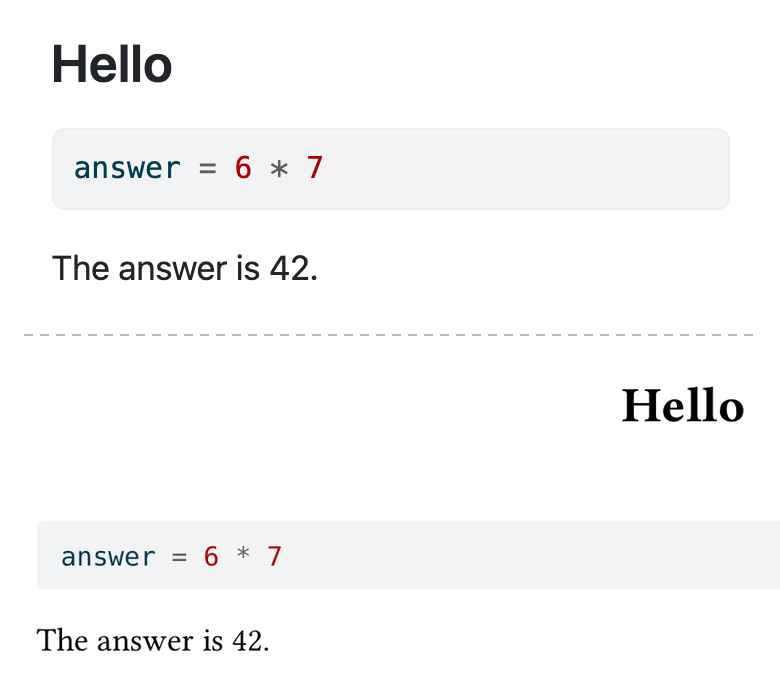

# Setting Up Your Machine {#sec-setup}

```{python}
#| label: ch3-setup
# Facts that change (costs, free routes, spending caps), from facts.yml (Appendix K), with the
# dates they were checked.
from scripts.facts import checked, checked_span, fact
```

This chapter ends with a number: 42, printed in a web page and a PDF that your own computer
built. Getting it there proves that the agent, Python, Quarto and Typst work together.
That is all the hands-on parts need, because everything in them happens on your machine: the
agent writes files in your folders, Quarto renders them there, and you open the results
in your own browser and word processor. It takes six steps, and each ends with a check
you can see, so you always know whether a step worked before you move on.

Do the setup somewhere calm, with a good connection, and allow about an hour. Mac and Linux
readers can follow this chapter straight through. Windows readers first install Ubuntu, a
version of Linux, inside Windows with WSL, the Windows Subsystem for Linux; @sec-windows walks
through that one step at a time, and from then on they follow this chapter inside Ubuntu.

::: opener
- Install Git, a coding agent, Quarto, uv and `gh`, checking each step before the next.
- Move around the terminal, and tell the terminal from the agent when you type.
- Run the setup check and read its report.
- Render a test document to HTML and PDF, and confirm that both say 42.

Start from
: a computer you can install software on, a good connection and the accounts listed in
  @sec-before-setup; on Windows, Ubuntu set up with @sec-windows.

You build
: the tools, installed and signed in; `~/quarto-workshop`, the workshop's files with their
  checkpoints; and a throwaway `~/quarto-test` whose `hello.html` and `hello.pdf` say 42.

Checkpoint
: none, because setup builds no project to catch up to. The workshop's files arrive in Step 5,
  with the checkpoints and the starter that @sec-first-report opens: a real report you can
  read.
:::

::: payoff
{#fig-hello-42 width=85% fig-alt="Two crops, one above the other, divided by a dashed line. Above, the web page hello.html at a phone's width: the title Hello, the code answer = 6 * 7 in a grey box, and the sentence The answer is 42. Below, the left of the first page of hello.pdf, typeset: the same title, code and sentence."}
:::

## Before you start {#sec-before-setup}

Six steps, each ending in a check you can see:

| Step | It worked when |
|------------|--------|
| [1. Get the computer ready](#sec-step-ready) | `git --version` prints a version |
| [2. Move around the terminal](#sec-step-terminal) | after `cd ~` the prompt shows `~` |
| [3. Install a coding agent](#sec-step-assistant) | it answers, signed in |
| [4. Let the agent install the tools](#sec-step-tools) | it prints every version |
| [5. Run the setup check](#sec-step-check) | every check reports OK |
| [6. Do the test run](#sec-step-test) | the PDF says 42 |

: The setup steps and their checks. {#tbl-setup-map}

Before Step 1, make sure of these:

::: cards
A good connection

:   Nearly every step downloads something, and the agent sends each request to its model
    online, so a weak connection shows as pauses, timeouts and half-finished installs that look
    like your own errors. Use a wired connection or strong Wi-Fi. Avoid a *VPN*, a virtual
    private network that routes your traffic through another, where you can; on a company
    network, a *proxy*, a server all web traffic must pass through, may block downloads.

Two accounts

:   A free [GitHub account](https://github.com/signup), to publish in the hands-on parts, and
    an account with one coding agent, which may not be free:
    `{python} fact("agents.claude_code_cost")`. @sec-facts lists what each agent accepts.
    Sign-up and email verification can take hours, so do them first.

It can cost nothing

:   `{python} fact("agents.antigravity_free", capital=True)`, and
    `{python} fact("agents.opencode_free")`. None was tested on this book's prompts, so check
    each result as the book teaches, and read the terms first: some keep what you send
    (@sec-at-work-flow).

Or pay for what you use, capped

:   An *API key* is a secret string that identifies your account to the vendor's programming
    interface, which bills each request; keep it out of files you share. Set a monthly cap
    first: `{python} fact("agents.claude_spend_limit")`, and
    `{python} fact("agents.openai_spend_limit")`.

No install rights?

:   On a locked-down work laptop, or a Windows computer where WSL is not allowed, use the
    workshop's ready-made environment in your browser instead (@sec-codespace) and skip Steps
    1 and 4.

:::

On any route, choose a small model at medium effort (@sec-cost), and start a fresh
conversation for each task.

**A plan for when a step fails.** Errors during setup are normal: each step depends on your
system, your network and that week's versions. An error tells you what to fix:

1. Look the message up in @sec-troubleshooting, whose Setup table lists failures seen in
   practice, with tested fixes.
2. If it is not there, ask a web chat in your browser (`{python} fact("chats.free_chats")`),
   not the agent, which may be what failed. Paste the command, the *whole* error message,
   your system ("Mac", or "Windows with Ubuntu on WSL") and the step you are on.
3. Try one suggested fix at a time, and read each suggested command before you run it. Never
   paste passwords, keys or private data.
4. If two suggestions fail, ask a person: your group's help channel, or a colleague.

Checked `{python} checked_span("agents.claude_code_cost", "agents.antigravity_free", "agents.opencode_free", "agents.claude_spend_limit", "agents.openai_spend_limit", "chats.free_chats")`;
@sec-facts has each source.

## Step 1: Get the computer ready {#sec-step-ready}

The later steps assume two small programs: `git`, for version control, and `curl`, which
downloads a file from a web address. Open a terminal, the window for typing commands that
Step 2 explains (on a Mac: Command-Space, type `Terminal`, Enter; on Ubuntu: Ctrl+Alt+T), and
run the line for your system.

On a **Mac**, install Apple's Command Line Tools, which include `git`:

```bash
xcode-select --install
```

A dialog asks to install them: click Install and wait. Doing this deliberately now matters,
because otherwise the dialog appears the first time anything uses `git`, which would be in
the middle of Step 4 while the agent is waiting. "Already installed" is fine.

On **Ubuntu or Debian** (including Ubuntu on Windows):

```bash
sudo apt update && sudo apt install -y curl git
```

`apt` is Ubuntu's *package manager*, the program that installs software from Ubuntu's own
collection and keeps it up to date; `apt update` refreshes its list, and `apt install` installs.
`sudo` runs a command as the administrator and asks for your Linux password, which stays
invisible as you type. On other Linux distributions, install `curl` and `git` with your usual
package manager. On **Windows**, follow @sec-windows first: it ends with this same command,
run inside Ubuntu.

::: story
<!-- source: book/PLAN.md lines 602–603 (§15, item 4: "no alternatives as inline # comments
in copyable commands (zsh passes them as arguments)") -->
An early draft of this book put a note after a `#` on the same line as a command to copy. In
a script, that is a comment. Pasted into zsh, the Mac's default shell, it was not: the shell
handed the `#` and the words after it to the command as arguments. So every command here
stands alone on its line, and a choice between systems is made in the sentence above it.
:::

::: tryit
Run `git --version` in the terminal.

::: done
it prints a version number. On Windows, you are in Ubuntu and `wsl -l -v`, run in
PowerShell, shows Ubuntu with VERSION 2.
:::
:::

## Step 2: Move around the terminal {#sec-step-terminal}

The rest of the book happens in a *terminal*, a window where you type commands instead of
clicking. When it is ready for a command it shows a *prompt*, a line ending in `$` (or `%` on
a Mac), which tells you who and where you are (not to be confused with a prompt you give an
agent):

```text
ana@laptop:~/demo$
```

`ana` is the user, `laptop` the computer, and `~/demo` the current folder: `~` is your
*home folder*, so this is a folder called `demo` inside it. Eight commands are enough to move
around (`pwd` is short for *print working directory*):

| Command | Does |
|---|---|
| `pwd` | prints the folder you are in |
| `date` | prints the date and time |
| `ls` | lists this folder |
| `mkdir name` | makes a folder |
| `cd name` | goes into a folder |
| `cd ..` | goes up one folder |
| `cd ~` | goes home, from anywhere |
| `rmdir name` | removes an empty folder |

: Moving around the terminal. {#tbl-terminal}

{#fig-terminal-basics .anim fig-alt="A terminal session with the prompt ana@laptop. pwd prints the home folder. date prints the date and time. mkdir demo makes a folder, and ls lists it. cd demo goes in, and the prompt now ends in tilde slash demo. mkdir notes and cd notes go one folder deeper, and pwd prints the full path ending in demo slash notes. cd dot dot goes up one level, cd tilde goes straight home, and rmdir demo slash notes demo removes both empty folders."}

@fig-terminal-basics runs them in order. Type them yourself rather than pasting: the hands
remember.

Two keys save most typing mistakes: **Tab** completes a file or folder name, and the **up
arrow** brings back the previous command. Copying and pasting work differently in a terminal:
select the text, then **Ctrl+Shift+C** copies and **Ctrl+Shift+V** pastes (Command-C and
Command-V on a Mac), because **Ctrl+C** on its own stops the running program
(@tbl-terminal-keys). Two commands start most projects in this book, one line each:

```bash
mkdir -p london-guide
cd london-guide
```

The first makes the folder, and `-p` makes `mkdir` quietly accept a folder that already
exists, so running it twice does no harm. The second goes into it. Later chapters often join
the two lines into one with `&&`, which means "and then, if that worked":

```bash
mkdir -p london-guide && cd london-guide
```

If `mkdir` fails, `cd` does not run. @sec-terminal has more keys and habits.

::: tryit
From your home folder, type the commands in @tbl-terminal in the order
@fig-terminal-basics shows.

::: done
`rmdir` raised no error, and the prompt shows `~`.
:::
:::

## Step 3: Install a coding agent {#sec-step-assistant}

Pick one agent and run its installer, the command its vendor documents (Further reading
links each page). Run only the line for your agent.

**Claude Code:**

```bash
curl -fsSL https://claude.ai/install.sh | bash
```

**Codex:**

```bash
curl -fsSL https://chatgpt.com/codex/install.sh | sh
```

**Antigravity:**

```bash
curl -fsSL https://antigravity.google/cli/install.sh | bash
```

**OpenCode:**

```bash
curl -fsSL https://opencode.ai/v2/install | bash
```

`curl … | bash` downloads a small install script and runs it immediately. That is normal
for these tools, and it is also exactly why you should only do it with links you trust, such
as each vendor's documented command.

Then **open a new terminal tab** (Ctrl+Shift+T on Ubuntu, Command-T on a Mac, Ctrl+Shift+D
in Windows Terminal). A terminal learns where programs are when it starts, from its *PATH*,
the list of folders it searches for programs, so it cannot find one installed a moment ago,
which is the usual cause of `command not found` straight after an install. On a Mac, a new
tab is not enough for Claude Code: its installer puts it in `~/.local/bin`, a folder the PATH
leaves out, and prints the fix under "Setup notes". Paste that fix into the terminal, press
Enter, then open the new tab.

Start the agent in a fresh folder. Type the three lines one at a time: make the folder `setup`
in your home folder (`-p`: no complaint if it exists), go into it, and start the agent:

```bash
mkdir -p ~/setup
cd ~/setup
claude
```

That last line starts Claude Code; type `codex` for Codex, `agy` for Antigravity, or
`opencode` for OpenCode. OpenCode does not ask you to sign in: type `/connect` inside it and
choose a provider. Unlike the other three, it does not ask before it edits files or runs
commands (@sec-root-folder). To make it ask, add rules with the effect `ask` for its `edit`
and `shell` actions to `opencode.jsonc`, as its
[permissions documentation](https://opencode.ai/docs/permissions/) shows.

<!-- The three screens as Claude Code 2.1.319 printed them on 2026-11-07, in an empty folder,
with folder names changed; Codex 0.167.0 the same day. -->

The first start walks through three screens, shown below as captured from Claude Code 2.1.319
in November 2026; wording changes between versions. Before them, Claude Code asks for a text
style: press Enter to keep the one selected.

**Sign in.** Choose the option for your account: the first for a subscription, the second
for an Anthropic Console account billed by API use. The agent opens your browser; where
there is none, as in WSL, it prints a link to copy into your browser, and then a code to
paste back into the terminal. Codex's first screen offers "Sign in with ChatGPT", which works
the same way, and "Sign in with Device Code", a one-time code to use when the browser sign-in
fails.

::: transcript
```text
 Select login method:

 ❯ 1. Claude account with subscription · Individual, Team, or Enterprise
   2. Anthropic Console account · API usage billing
   3. 3rd-party platform · Amazon Bedrock, Microsoft Foundry, Google Vertex AI
```
:::

**Trust the folder.** The pointer starts on "No, exit", so pressing Enter straight away quits.
Press the down arrow first. Quitting by mistake is harmless: type `claude` again. Codex asks
nothing in a plain folder like `~/setup`; it asks the same question later, in a project that
is a Git repository. The screen below is trimmed at the …, where it explains whom to trust.

::: transcript
```text
 Accessing workspace:

 /home/ana/setup

 Quick safety check: Is this a project you created or one you trust?
 …

 Claude Code'll be able to read, edit, and execute files here.

 ❯ No, exit
   Yes, I trust this folder

 Enter to confirm · Esc to cancel
```
:::

**Ready.** The agent shows its version, the model and plan of the account you signed in
with, and the folder, then waits for a prompt on the line marked `❯`. In this capture the
logo beside the first lines is left out, and the model and plan are those of the account
that captured it; yours shows your own.

::: transcript
```text
 Claude Code v2.1.319
 Opus 5.5 with xhigh effort
 Claude Max
 ~/setup
────────────────────────────────────────────────────
❯ Try "write a test for <filepath>"
────────────────────────────────────────────────────
```
:::

::: tryit
Install one agent, start it in `~/setup`, sign in and trust the folder (in OpenCode, type
`/connect` and choose a provider: it asks nothing about the folder).

::: done
the agent answers when you type `hello`. Then type `/exit` (in OpenCode, press Ctrl+C at the
empty prompt).
:::
:::

### Two places to type {#sec-two-places}

Now that an agent is installed, there are two places to type, and mixing them up costs
beginners more time than anything else.

```text
ana@laptop:~/setup$ pwd                  <- the terminal: commands
❯ Which tools are missing?                <- the agent: requests in plain language
```

The agent takes over the terminal tab it runs in: what you type there goes to the
agent, not to the *shell*, the program behind the terminal that runs your commands, until
you leave with `/exit` (in OpenCode, which has none, Ctrl+C at its empty prompt). Commands in
this book's **You do** boxes, such as `quarto preview`, go in the terminal; prompts in **Ask
your coding agent** boxes go to the agent. When the agent is busy and you need the terminal,
open a second tab, as after the install.

Typing in the wrong place is usually harmless: a prompt typed at `$` gives `command not
found`, and a command typed into the agent is read as a request. Look at the line you are
on and try again.

::: think
The agent is running and the book says to type `gh auth login`, the GitHub sign-in of
Step 5. Where do you type it?

In a second terminal tab: `gh auth login` is an interactive sign-in that needs you, and the
agent is using the first tab. Leaving the agent with `/exit` also works, but ends the
conversation.
:::

## Step 4: Let the agent install the tools {#sec-step-tools}

The remaining tools are Quarto itself, uv, Git and the GitHub command-line tool `gh`. Each has
its own official install method for each system, which is exactly the kind of detail an
agent handles well. Start it again in the setup folder, now as one line joined with `&&`
(with `codex`, `agy` or `opencode` in place of `claude` if that is your agent, here and in the
next steps):

::: {.you}
```bash
mkdir -p ~/setup && cd ~/setup && claude
```
:::

::: {.prompt .long}
```default
Check which of `git`, `curl`, `uv`, `quarto` (1.10 or newer) and the GitHub CLI `gh` are missing on this computer. Install only those, using each tool's official method for my system. Never run `sudo`, or an installer that asks for a password, yourself: print each such command alone in a code block, using full paths, then wait until I say done. Then print every version.
```
:::

::: {.agent}
installs uv with its official installer · Quarto from its release page (or with Homebrew, a package manager for the Mac, if you have it) · `gh` from GitHub's own package source · prints versions
:::

Before each command it wants to run, the agent stops and asks, as in @fig-agent-session:
read the command (the pitfall in @sec-boxes says what to look for), then approve it.

The prompt is written around one limitation: an agent cannot type your password. So it
asks the agent to hand back any command that needs one, with full paths, because the
second tab you paste it into starts in your home folder. Copy the command (Ctrl+Shift+C, or
Command-C on a Mac), paste it in a second tab, type your password when `sudo` asks (it stays
invisible), and then type `done` in the agent's tab. On a Mac, the password is your login
password.

::: why
Quarto has no Ubuntu package in the standard repositories, and Ubuntu's own `gh` package is
discouraged by GitHub, so a generic `apt install` would get one tool wrong and the other
missing. The prompt's "each tool's official method" sends the agent to the right source
for each (Quarto's download page and GitHub's install instructions for Linux).
:::

::: think
The agent has installed uv. In a terminal tab you opened before that, you type
`uv --version`, and the terminal answers `command not found`. Did the install fail?

Probably not. uv's installer puts it in `~/.local/bin`, which a terminal adds to its PATH only
when it starts, so a tab opened earlier cannot find it. Open a new tab and try again; only if
it fails there is the install at fault.
:::

::: tryit
Paste the prompt, approve the commands you have read, and run any `sudo` command it hands
you in a second tab.

::: done
it prints a version for all five tools. Then type `/exit`: uv and Quarto are only found by
a terminal started after they were installed.
:::
:::

## Step 5: Run the setup check {#sec-step-check}

Open a new tab and start the agent again, so that it sees the newly installed tools:

::: {.you}
```bash
cd ~/setup && claude
```
:::

::: {.prompt .long}
```default
Print the versions of `quarto` (1.10 or newer), `uv`, `gh` and this agent, and run `quarto check` (no Jupyter or LaTeX yet is fine: count it as OK). If `git config --global user.name` or `user.email` is unset, ask me for my name and my GitHub email, then set them. Clone https://github.com/project-delphi/quarto-workshop.git to `~/quarto-workshop` (if it exists, `git pull` only when its working tree is clean) and list its `checkpoints/`. Run `gh auth status`. Run every check even if one fails, then report each as OK or not.
```
:::

Three parts of this check deserve a word.

`quarto check` reports Quarto's own components, including Pandoc and Typst. Its Python and
Jupyter lines may say they are missing, and that is fine: each project in this book gets its
own Python environment from uv, so there is nothing to install for Python now. No LaTeX is
needed either, because PDFs are made with the Typst engine bundled in Quarto.

A fresh Git has no identity, and `git commit` refuses to run without one. The prompt makes
the agent ask you for your name and email, so you type your own; check that what it set
is yours, not a placeholder.

To *clone* is to copy a repository, with its history, to your computer: here the workshop's,
into `~/quarto-workshop`. It holds the finished examples, the water dataset, the starter
report for @sec-first-report and the *checkpoints*: snapshots of each project at the end of
each hands-on block, which you will use to catch up if you fall behind.

::: {.you}
if `gh` is not "Logged in": in a **second tab**, `gh auth login` → GitHub.com → HTTPS → Yes → log in with a web browser; copy the one-time code to github.com/login/device; then ask the agent to check `gh` again
:::

::: tryit
Run the setup check.

::: done
the agent reports every check as OK, including `gh` "Logged in".
:::
:::

## Step 6: The test run {#sec-step-test}

The setup check proves the tools are installed. The test run proves they work together:
the agent can write a file and run commands you approve, uv can build a project
environment, Quarto can run Python through it, and Typst can write a PDF.

::: {.you}
```bash
mkdir -p ~/quarto-test && cd ~/quarto-test && claude
```
:::

::: {.prompt}
```default
Run `uv init --bare` and `uv add ipykernel nbclient nbformat pyyaml`. Create hello.qmd (html and typst formats): a Python cell computing `6 * 7` and an inline-code sentence showing it. Render it with `uv run quarto render hello.qmd`; check hello.html and hello.pdf both say 42.
```
:::

::: {.agent}
`uv init --bare` · `uv add …` · writes `hello.qmd` · `uv run quarto render hello.qmd` → `hello.html`, `hello.pdf`
:::

::: {.you}
`/exit`, then open the folder: `open .` (Mac), `xdg-open .` (Linux) or `explorer.exe .` (WSL), and open both files
:::

Its file is the one @sec-what-quarto showed. The test run is a check that the tools work
together, not a lesson: you need not understand the file to pass it.

::: pitfall
Every render prints a line such as `[IPKernelApp] WARNING | Kernel is running over TCP
without encryption`. It is harmless: Quarto talks to the Python *kernel*, the running Python
process that executes the cells, over a local connection on your own computer, and in every
dry run the warning came with a successful render and changed nothing in the output.
:::

::: tryit
Run the test run and open both outputs.

::: done
`hello.html` and `hello.pdf` both say 42. The folder is disposable: delete `~/quarto-test`
afterwards. If a file is missing or says something else, the Python and Jupyter table in
@sec-troubleshooting has the fixes.
:::
:::

## Without installing anything: a codespace {#sec-codespace}

A *codespace* is a computer that GitHub runs for you, opened in your browser: a terminal, a
file browser and an editor, with nothing installed on your own machine. The workshop's
repository describes one in a *dev container* file, `.devcontainer/devcontainer.json`, which
lists what to install: Quarto 1.10.20, uv, Git and the GitHub CLI. So in a codespace,
Steps 1 and 4 are already done.

::: {.you}
on github.com/project-delphi/quarto-workshop: **Code** → **Codespaces** → **Create codespace on main** · wait while it builds · then, in its terminal, `cd ~`
:::

The repository appears in your home folder as `~/quarto-workshop`, so every path in this book
works unchanged. From there, follow Step 2, Step 3 with the agent's Linux command, Step 5 and
Step 6 in the codespace's terminal. Three things differ from a computer of your own:

- **Previews.** Start them with `quarto preview --port 4848 --host 0.0.0.0 --no-browser`;
  the codespace offers to open the page in a new browser tab.
- **Signing in to GitHub.** If `gh auth login` says that `GITHUB_TOKEN` is in use, run
  `unset GITHUB_TOKEN` first: the codespace's own token reaches only the workshop's
  repository, not repositories you create.
- **Cost.** `{python} fact("github.codespaces_free", capital=True)`. Stop the codespace when
  you finish (the **Codespaces** page lists it), because a running one uses the allowance.

The environment was built from its dev container file and checked on a local computer, not on
GitHub's own.

Checked `{python} checked("github.codespaces_free")`; @sec-facts has the source.

## Summary {.unnumbered}

::: keyideas
- Everything in the hands-on parts happens on your own machine, so setup proves that the
  agent, Python, Quarto and Typst work together there.
- Each step ends with a check you can see; move on only when it passes.
- Commands go at the terminal's prompt and requests to the agent; when the agent is
  busy, open a second tab.
- A terminal finds only programs it knew of when it started, so after an install, open a new
  tab before suspecting the install.
- The agent cannot type your password: it hands commands that need one back to you, and
  you read every command before you approve it.
- When a step fails, look in @sec-troubleshooting, then ask a web chat with the command and the
  whole error, one fix at a time, and never paste secrets.
:::

The test run was a black box: a file you did not write, settings you have not met, code you
have not read. @sec-first-report puts your hands on a real report before any agent does: you
render it yourself, find its wrong number and record it with Git. Part II then explains what
was in the box, building the London guide one Markdown construct at a time.

## Further reading {.unnumbered}

- Quarto, [Get Started](https://quarto.org/docs/get-started/) and
  [download page](https://quarto.org/docs/download/) (checked 2026-10-30).
- Astral, [Installing uv](https://docs.astral.sh/uv/getting-started/installation/) (checked
  2026-10-30).
- GitHub, [GitHub CLI](https://cli.github.com/) and
  [installing on Linux](https://github.com/cli/cli/blob/trunk/docs/install_linux.md) (checked
  2026-10-30).
- [Claude Code setup](https://code.claude.com/docs/en/setup),
  [Codex CLI](https://learn.chatgpt.com/docs/codex/cli) and
  [Antigravity CLI](https://antigravity.google/docs/getting-started?tab=cli) (checked
  2026-10-30), and [OpenCode](https://opencode.ai/docs/) (checked 2026-11-20): each agent's
  install command.
- Claude Code, [installation troubleshooting](https://code.claude.com/docs/en/troubleshoot-install),
  on the Mac's PATH (checked 2026-11-06).
- OpenCode, [permissions](https://opencode.ai/docs/permissions/): the rules that make it ask
  before acting (checked 2026-11-20).
- Scott Chacon and Ben Straub, *Pro Git*,
  [Installing Git](https://git-scm.com/book/en/v2/Getting-Started-Installing-Git) (checked
  2026-11-06).
