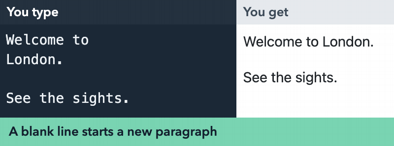
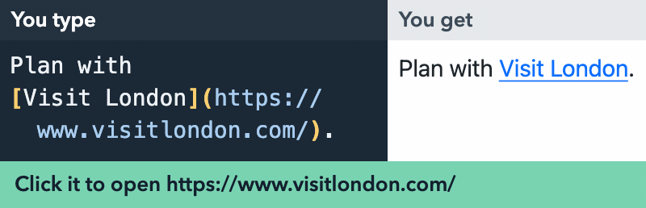
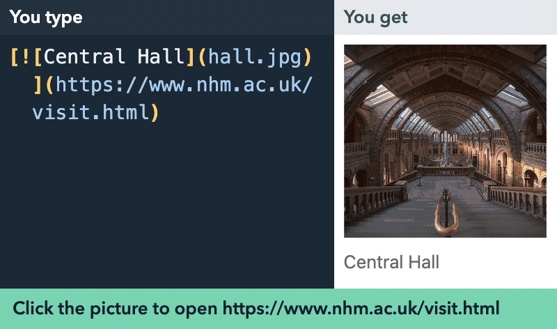

# Markdown, Rendering and Project Rules {#sec-markdown}

```{python}
#| label: ch4-setup
import pandas as pd
from scripts.prose import number_words, text_holds

ldn_sights = pd.read_csv("../examples/london/data/sights.csv")
ldn_att = pd.read_csv("../examples/london/data/attractions.csv")
n_sight_rows = len(ldn_sights)
n_sight_sources = ldn_sights["url"].nunique()
WORDS = number_words()


def word(n: int) -> str:
    """A count in words, as prose writes small numbers."""
    return WORDS[n] if n < len(WORDS) else f"{n:,}"


# Where the guide's first list of five sights stands among London's ALVA members in 2025.
five = ["British Museum", "Natural History Museum", "Tate Modern", "National Gallery",
        "Tower of London"]
by_visits = ldn_att.sort_values("visits_2025", ascending=False)["attraction"].tolist()
rank = {s: next(i for i, a in enumerate(by_visits, 1) if s in a) for s in five}
ordinal = ["first", "second", "third", "fourth", "fifth", "sixth", "seventh", "eighth",
           "ninth", "tenth"]
five_ranks = [ordinal[rank[s] - 1] for s in five]
five_ranks = ", ".join(five_ranks[:-1]) + " and " + five_ranks[-1]
n_att = len(ldn_att)
tower = rank["Tower of London"]
n_above_tower = tower - 1 - sum(rank[s] < tower for s in five)  # members not on the list
```

The tourism office wants a visitor guide it can stand behind: a page anyone can open on a
phone, every fact traced to a source, rebuilt rather than retyped when the facts change.
@fig-london-guide is where Part II ends: the guide on its own website, with links to the same
content in Word, PDF, PowerPoint, e-book and slide formats.

{#fig-london-guide fig-alt="A web page titled Visit London, under a navigation bar with Guide, Dashboard and a Downloads menu. Beneath the title, the author, London Tourism Office, and the date it was published. A welcome sentence with London in bold and riverside walks in italics; a numbered list, Five sights to start with: British Museum, Natural History Museum, Tate Modern, National Gallery and Tower of London; a bulleted list, Getting around: Tube, Bus and Santander Cycles; and the start of a Plan your visit section with a link to the TfL Journey Planner above a photograph. In the right margin, Other Formats: MS Word, PDF, Powerpoint, ePub and Slides."}

It starts as an empty folder and one plain-text file in Markdown, a way of writing structured
text with a few punctuation marks. The assistant writes most of it, but Markdown is what you
check: the layer you review, compare between versions and fix by hand when a sentence is wrong.

More is new here than in any other chapter: the assistant, the rules, the preview and the
environment. Work through it in order: read a section, paste its prompt and look at the result
before moving on; each *Try it* box says what you should see by then. When a step goes wrong,
nothing is lost: one line pasted into the assistant restores the chapter's finished state
(@sec-catch-up).

::: opener
- Write a Markdown page: headings, lists, links, images, tables, fences.
- Render a file, and keep a live preview running beside it.
- Write project rules concrete enough to check.
- Set up a project's own Python environment with uv.

Start from
: an empty `~/london-guide/` folder

You build
: `london.md`, its rules and a uv environment

Checkpoint
: `checkpoints/01-london-markdown/`
:::

## Markdown at a glance {#sec-md-basics}

Markdown is plain text in which a few symbols mean formatting. A `#` at the start of a line
makes a heading; two stars on each side of a word make it bold. You type the symbols; when
Quarto renders the file, turning it into a page, they become the formatting they stand for. A
Markdown file is an ordinary text file whose name ends in `.md`: any plain-text editor opens it,
and it reads well even before it is rendered.

This section shows the marks one at a time, before the first prompt; the sections after it use
each of them in the guide. Each animation pairs what you type, on the left, with what you get,
on the right. The right-hand side is not drawn: each step on the left was saved in a file and
rendered by Quarto 1.10.20, and the right shows that page, enlarged. Each animation opens on its
finished pair, which is all that a reader without animations shows, then types the source from
the beginning.

Two things make Markdown safe to learn by trying:

- **Nothing breaks.** A mark that is mistyped, or opened and never closed, usually shows on the
  page as an ordinary character, and at worst formats the wrong words. Either way the page still
  renders, the slip is easy to spot, and you fix it by editing the text.
- **Trying costs nothing.** Type a few lines into a new file named `try.md`, then run
  `quarto preview try.md` in the terminal, in that file's folder (@sec-md-commands). It opens
  the page in your browser, or prints an address to open, and updates the page every time you
  save the file; Ctrl+C in the terminal stops it.

### Headings, paragraphs and emphasis

A line that starts with `#` and a space is a *heading*, the title of a part of the page. One `#`
gives the largest heading, for the page's title. Each extra `#` makes a heading one level
smaller (@fig-md-headings), down to six.

{#fig-md-headings .anim fig-alt="Two panes, You type on the left and You get on the right, above a note. Finished, the source has three lines with blank lines between them: # London, ## Museums and ### Tate Modern, the # signs in yellow. The page shows London as a large heading, Museums smaller with a thin rule under it, and Tate Modern smaller again. The note reads: More # signs, a smaller heading. The animation types the lines one at a time, and each heading appears on the page once its line is complete."}

Ordinary text needs no mark. Lines that follow one another join into one paragraph, wherever you
break them, and a *blank line*, a line with nothing on it, starts a new paragraph
(@fig-md-paragraphs). So you can break a long sentence over several lines of the file without
changing the page.

{#fig-md-paragraphs .anim fig-alt="Two panes, You type and You get, above a note. Finished, the source reads Welcome to on one line and London. on the next, then a blank line and See the sights. The page shows two paragraphs: Welcome to London. on one line, and See the sights. The animation types the first two lines, which the page joins into one, then the blank line and the last line, which the page starts as a new paragraph. The note reads: A blank line starts a new paragraph."}

Stars round words emphasise them: two on each side for **bold**, one on each side for *italic*.
Two tildes (`~`) on each side ~~strike text through~~, for something no longer true. These
marks come in pairs. Until the closing pair is typed, the opening one shows as typed, as at the
start of @fig-md-emphasis.

{#fig-md-emphasis .anim fig-alt="Two panes, You type and You get, above a note. Finished, the source reads Walk by the **river** at *sunset*. over two lines, then a blank line and Go by ~~car~~ Tube., with the stars and tildes in yellow. The page shows river in bold, sunset in italics and car struck through. The animation first types Walk by the **river with no closing stars, and the page shows the two stars as typed. Once the closing pair is typed, river turns bold; then sunset turns italic and car is struck through. The note names each mark as it is typed."}

### Lists, quotations and lines

A line that starts with `-` and a space is an item in a bulleted list. A number and a full
stop, such as `1.`, then a space, start an item in a numbered list (@fig-md-lists). Leave a
blank line above a list: without one, its items run on as part of the paragraph before it.

{#fig-md-lists .anim fig-alt="Two panes, You type and You get, above a note. Finished, the source has - Tube and - Bus, a blank line, then 1. British Museum and 2. Tate Modern. The page shows a bulleted list of Tube and Bus and, below it, a numbered list of British Museum and Tate Modern. The animation types the bulleted items first, then the numbered ones, and each list appears on the page once it is typed. The note reads: Leave a blank line above a list."}

A `>` at the start of a line makes a *block quote*: a quotation, set off from the text beside a
bar (@fig-md-quote). Start each of its lines with `>`.

{#fig-md-quote .anim fig-alt="Two panes, You type and You get, above a note. Finished, the source reads Tip from a local:, a blank line, then two lines starting with a yellow >: Many big museums, and are free. The page shows the first line as plain text and, below it, the quotation in grey beside a vertical bar. The animation starts from the plain line and types the two quoted lines, then the quotation appears on the page. The note reads: > at the start of a line: a quotation."}

Three dashes on a line of their own, with a blank line above and below, draw a *horizontal
rule*: a line across the page that separates two parts of it (@fig-md-rule).

{#fig-md-rule .anim fig-alt="Two panes, You type and You get, above a note. Finished, the source reads Day one: museums., a blank line, three yellow dashes, a blank line and Day two: parks. The page shows the two sentences with a thin grey line across the page between them. The animation starts from the first sentence, types the dashes, after which the line appears on the page, then types the second sentence below it. The note reads: --- between blank lines: a line across."}

### Links and pictures

A link has two parts: the words to click, in square brackets, then the address they open, in
round brackets, with no space between the two (@fig-md-link). Square brackets on their own show
as typed. An address is often too long for one row of the screen, so the editor *wraps* it,
showing the rest on the next row, as on the left of @fig-md-link. It is still one line, typed
without pressing Enter.

{#fig-md-link .anim fig-alt="Two panes, You type and You get, above a note. Finished, the source reads Plan with on one line, then Visit London in square brackets followed by https://www.visitlondon.com/ in round brackets, wrapped onto a third row. The page shows Plan with Visit London., with Visit London in blue and underlined. The animation starts from the plain text, adds the square brackets, which the page shows as typed, then types the address in round brackets, and the words become a link. The note reads: Click it to open https://www.visitlondon.com/."}

A picture is written like a link with a `!` in front: its caption in square brackets, then its
file in round brackets (@fig-md-image). Here the file, `hall.jpg`, is in the same folder as the
Markdown file. @sec-md-link-image adds what a published picture also needs: a size, and alt
text, a description for readers who cannot see it.

{#fig-md-image .anim fig-alt="Two panes, You type and You get, above a note. Finished, the source reads . The page shows a photograph of the Natural History Museum's Central Hall, a vaulted hall seen from the top of a staircase, captioned Central Hall. The animation types the line, and the photograph appears once it is complete. The note reads: A picture, with its caption below."}

A picture can be a link too. Put the whole picture where a link's words go, inside its square
brackets: `[](address)` (@fig-md-image-link). The page looks the same, but a
click on the photo opens the address, here the museum's own page for visitors.

{#fig-md-image-link .anim fig-alt="Two panes, You type and You get, above a note. Finished, the source reads  inside square brackets, followed by https://www.nhm.ac.uk/visit.html in round brackets, wrapped over three rows. The page shows the same captioned photograph of the Central Hall as the picture without a link. The animation starts from the picture alone, types an opening square bracket in front of it and the closing bracket and address after it, and the page stays the same. The note reads: Click the picture to open https://www.nhm.ac.uk/visit.html."}

### All the marks together

@tbl-md-text and @tbl-md-blocks gather the marks this book uses, those above and a few more,
each with the section where the guide first needs it. Come back to them as you write.

| You type | You get |
|:-----------|:-----------|
| `# Visit London` | a heading; `##` is the next level down (@sec-md-heading) |
| a blank line between lines | a new paragraph (@sec-md-heading) |
| `\` at the end of a line | a line break inside the paragraph |
| `*italic*`, `**bold**` | *italic*, **bold** (@sec-md-heading) |
| `~~Car~~` | ~~Car~~ |
| `- Tube` | a bulleted item (@sec-md-lists) |
| `1. British Museum` | a numbered item (@sec-md-lists) |
| `- [ ] Umbrella` | an item with an empty box; `[x]` ticks it |

: Markdown for text and lists. {#tbl-md-text}

To break a line without starting a new paragraph, end it with `\`. Two spaces at the end work
too, but "the backslash is easier to see, and editors that strip trailing whitespace on save
won't remove it" (Quarto, *Markdown Basics*).

| You type | You get |
|:-----------|:-----------|
| `[TfL](https://tfl.gov.uk/)` | a link, [TfL](https://tfl.gov.uk/) (@sec-md-link-image) |
| `` | the picture, captioned "Big Ben" (@sec-md-link-image) |
| `> Book ahead.` | a quotation (@sec-md-link-image) |
| `` `quarto render` `` | `quarto render`, in code type |
| lines between ```` ```text ```` and ```` ``` ```` | a code block, shown exactly as typed (@sec-md-code-fence) |
| `| Sight | Price |` over `|---|---|` | a table with a header row (@sec-md-table) |
| `---` between blank lines | a horizontal rule |
| `\*free\*` | \*free\*, stars and all: `\` before a mark keeps it as typed |

: Markdown for links, pictures and blocks. {#tbl-md-blocks}

Here is every one of those marks in one file, `toy.md`, a short London note with no settings
and no code:

```{python}
#| label: ch4-toy-md
#| output: asis
import re
from pathlib import Path


def show_file(path: str, lang: str = "markdown") -> str:
    """A file's text, as it is, in a fence longer than any run of backticks inside it."""
    text = Path(path).read_text()
    ticks = "`" * max(4, 1 + max(map(len, re.findall("`+", text)), default=0))
    return f"{ticks}{lang}\n{text}{ticks}"


# toy.md types two price bands: stop if sights.csv no longer gives them.
price = ldn_sights[ldn_sights["fact"] == "price_band"].set_index("sight")["value"]
text_holds(price["British Museum"] == "Free" and price["Tower of London"] == "Paid",
           "toy.md's price bands")
print(show_file("media/examples/toy.md"))
```

`quarto render toy.md` turns it into `toy.html`, @fig-toy-md. Compare the two line by line:
the lines of each paragraph have joined, except where a `\` broke one; "Car" is struck
through; the escaped stars round "free" and the stars inside the fence have stayed stars.

{#fig-toy-md width=50% fig-alt="A web page at a phone's width. The heading A day in London; a sentence with British Museum in bold and free in italics, then, on a new line, Get there by, over a bulleted list: Tube, Bus and Car, with Car struck through. A quotation with a grey bar: Tip: book a free timed ticket. A smaller heading, Two sights, over a numbered list and a two-column table of the two sights and their prices, Free and Paid. A horizontal rule, then a small photo of Big Ben captioned Big Ben. One paragraph: the photo's credit, a blue TfL link, quarto render in code type, and free between two asterisks. A ticked box for Contactless card and an empty one for Umbrella. Last, a line in typewriter type in which the asterisks round marks are shown, not applied."}

::: think
A line of text, and straight under it, with no blank line between, a line of three dashes.
Does the page show a horizontal rule?

No: the line of text becomes a level-2 heading. A line underlined with dashes is another way
of writing one, in GitHub's Markdown and Quarto's alike, which is why the rule in
@tbl-md-blocks needs a blank line above it.
:::

### GitHub's Markdown and Quarto's

Markdown comes in dialects. *GitHub Flavored Markdown* (GFM) is the one GitHub uses for what
people write there, such as README files and issues. It is "a strict superset of CommonMark",
a precise specification of Markdown, with five extensions: tables, task lists, strikethrough,
automatic links and a ban on some raw HTML (GFM specification, version 0.29-gfm, checked
2026-11-12).

Quarto "is based on Pandoc and uses its variation of markdown as its underlying document
syntax" (Quarto, *Markdown Basics*, checked 2026-11-12). Pandoc's Markdown reads the same
core marks as GFM, takes its task lists from it, and adds more: attributes in braces,
footnotes, definition lists, citations and mathematics among them (Pandoc User's Guide,
checked 2026-11-12). Three differences catch people who learnt Markdown on GitHub:

- A list needs a blank line above it; without one, it runs on as part of the paragraph.
- Strikethrough needs two tildes, `~~Car~~`, because a single pair, `~2~`, makes a subscript.
- An image's text in square brackets is its caption in Quarto, where GitHub uses it as alt
  text; Quarto's alt text goes in `fig-alt` (@sec-md-link-image).

### Two commands: render and preview {#sec-md-commands}

Quarto turns a file into a page with either of two commands, typed in the terminal in the
file's folder (`quarto render --help` and `quarto preview --help`, Quarto 1.10.20, checked
2026-11-12):

`quarto render toy.md`
: writes the output once, here `toy.html`, and stops. `--to docx` picks another format. Use
  it to make a finished file, the one you send or publish.

`quarto preview toy.md`
: renders the file, serves the page on a local address and renders it again each time the
  file is saved; Ctrl+C stops it. Use it while you write, in a terminal tab of its own.

A plain `.md` file needs no settings to render, as `toy.md` shows. @sec-md-render runs both
commands on the guide.

## A folder for the guide {#sec-brief}

The guide gets its own folder in your home folder, beside the `quarto-workshop` repository (a
project folder with its Git history) that you cloned during setup (@sec-step-check), so that
its checkpoints are always at
`../quarto-workshop/checkpoints/`. By the end of the chapter your home folder, `~`, looks like
this:

```text
~
├── quarto-workshop/
└── london-guide/
    ├── AGENTS.md
    ├── london.md
    ├── london.html
    ├── data/
    ├── images/
    ├── pyproject.toml
    ├── uv.lock
    └── .venv/
```

- `AGENTS.md`: the rules the assistant reads first.
- `london.md`: the guide's source, the file you check; `london.html` is rendered from it.
- `data/` and `images/`: cited facts and credited photos, copied in and never edited.
- `pyproject.toml`, `uv.lock` and `.venv/`: the packages, their exact versions and the
  installed environment.

Make the folder and start the assistant in it:

::: {.you}
```bash
cd ~
mkdir -p london-guide
cd london-guide
claude    # or: codex, or: agy
```
:::

Claude Code first asks whether you trust the new folder (@sec-step-assistant): you made it for
this work, so say yes. Later prompts copy files from `../quarto-workshop/`, which is outside the
project folder, so the assistant asks your permission the first time it reads there. Approve
it, or start Claude Code with `claude --add-dir ../quarto-workshop` to allow it up front (Codex
has the same option, `--add-dir`).

## A first page: a title and a welcome {#sec-md-heading}

::: {.prompt}
```default
Create london.md with a level-1 heading "Visit London" and a welcome paragraph with one bold and one italic phrase.
```
:::

The assistant writes:

```markdown
# Visit London

Welcome to **London**: free museums, royal history and *riverside walks*.
```

`#` starts a heading, and the number of `#` signs sets its level: `##` is the next level down.
Double asterisks mark **bold** text and single asterisks *italic*. A blank line separates
paragraphs. That is already a complete document.

## Watch it become a web page {#sec-md-render}

::: {.prompt}
```default
Render london.md with quarto render and tell me which file it wrote.
```
:::

::: {.agent}
`quarto render london.md` → `london.html`
:::

::: {.you}
in a second terminal tab:

```bash
cd ~/london-guide
quarto preview london.md
```

open the address it prints · Ctrl+C stops it
:::

The render writes `london.html` once. The preview (@sec-md-basics) renders it again every time
`london.md` is saved, including when the assistant saves it, so the page in your browser
follows each change (@fig-preview-reload). It prints a line such as
`Browse at http://localhost:4200/` (the number varies) and usually opens that page in your
browser; if it does not, open the address yourself.

{#fig-preview-reload .anim fig-alt="Two panes. On the left, the source of london.md as the assistant saves it, with each new section highlighted: first the heading and welcome, then a numbered list of five sights, then a Plan your visit section with a link and a tip from a local, then a Before you go checklist. On the right, the page served by quarto preview reloads after each save and shows the new section, rendered as headings, a numbered list, a link, a quotation and a code block."}

Keep the preview running from now on. It is the fastest way to check what each prompt did.

::: pitfall
A preview and a render of the same file at the same moment collide: both write temporary files
with the same names, and one fails with an error such as `readfile 'london.quarto_ipynb'`.
While a preview is running, let it do the rendering. Before the assistant renders several
formats at once (@sec-formats), stop the preview with Ctrl+C, and restart it afterwards.
:::

::: tryit
Paste the two prompts above, then start the preview in a second tab.

::: done
`london.html` opens in your browser and updates whenever `london.md` changes.
:::
:::

## Rules for the guide {#sec-london-agents}

@sec-agents-md introduced `AGENTS.md`, the file of rules an assistant reads at the start of
every session. The guide needs one now, before any data or photos arrive, because every later
prompt relies on it:

::: {.prompt}
```default
Create AGENTS.md for this project. Scope: a London visitor guide for the tourism office, written once and reused for every audience. Rules: every number comes from a cited file in data/, photos are openly licensed, credited and show no people, never invent facts, keep data/ and images/ unchanged, and call ALVA counts "ALVA member attractions". Show me the file.
```
:::

::: {.agent}
writes `AGENTS.md`: a scope and a list of rules
:::

::: {.you}
approve · read it: does it say what you meant?
:::

Each rule is there for a reason the project will meet. *Every number comes from a cited
file*: the guide quotes visitor counts, and an assistant asked for a number it does not have
may produce a plausible one; a rule that every figure is computed from a file with a source
removes that temptation, and gives you something to check. *Openly licensed photos with no
people*: a published guide needs images it may reuse, and pictures of identifiable people
raise consent questions it does not need. *Keep `data/` and `images/` unchanged*: the inputs
are evidence, and edits belong in the analysis, not in the evidence. *"ALVA member
attractions"*: the counts come from the Association of Leading Visitor Attractions, which
lists only its members, so "London's most visited attractions" would overclaim.

The finished project's version reads, in part:

```markdown
## Rules

- Every number comes from a cited file in `data/`: each row carries `source`, `url` and
  `retrieved`. Never estimate or invent a figure or a fact.
- ALVA counts only its member sites: write "ALVA member attractions".
- Photos are openly licensed, credited from `images/ATTRIBUTION.md`, and show no people.
- Keep `data/` and `images/` unchanged.
```

Read what the assistant wrote and edit it yourself if the wording is off. It is your project's
contract with the assistant, and the rules work best when they are concrete enough to check.
Any plain-text editor will do, or the terminal's own: in a new tab, `cd ~/london-guide`, then
`nano AGENTS.md` opens the file; Ctrl+O and Enter save it, and Ctrl+X leaves (@sec-terminal).

## Five sights and how to get around {#sec-md-lists}

::: {.prompt}
```default
In london.md, add a "Five sights to start with" numbered list (British Museum, Natural History Museum, Tate Modern, National Gallery, Tower of London) and a "Getting around" bullet list: 🚇 Tube, 🚌 Bus, 🚲 Santander Cycles.
```
:::

```markdown
## Five sights to start with

1. British Museum
2. Natural History Museum
3. Tate Modern
4. National Gallery
5. Tower of London

## Getting around

- 🚇 Tube
- 🚌 Bus
- 🚲 Santander Cycles
```

`1.` starts a numbered list and `-` a bulleted one; leave a blank line before a list. The five
sights are the five attractions whose visits the guide charts later, from ALVA's data. The
list is a starting point, not a ranking. Among London's `{python} word(n_att)` most visited ALVA
member attractions in 2025, the five, in the order listed, stand `{python} five_ranks`;
`{python} word(n_above_tower)` attractions not on the list drew more visits than the Tower.

## Planning a visit: a link, a photo and a tip {#sec-md-link-image}

::: {.prompt}
```default
Copy ../quarto-workshop/examples/london/images here. In london.md, add "Plan your visit": a TfL Journey Planner link, images/big-ben.jpg at 30% width with alt text and a credit caption from images/ATTRIBUTION.md, and a "Tip from a local" blockquote.
```
:::

```markdown
Plan your route with the [TfL Journey Planner](https://tfl.gov.uk/plan-a-journey/).

{width=30% fig-alt="Big Ben's clock tower and the Palace of Westminster against a blue sky with white clouds."}

> **Tip from a local:** many big museums are free. Book a free timed ticket to skip the queue.
```

`[text](address)` is a link and `` an image; the text in square brackets
becomes the image's caption. The `{…}` after the image is a Quarto and Pandoc extension: `width`
sizes it and `fig-alt` holds its *alt text*, the description that screen readers announce and
that appears if the image cannot load. `>` starts a quotation. @fig-big-ben is that photo.

{#fig-big-ben width=40% fig-alt="Big Ben's clock tower and the Palace of Westminster against a blue sky with white clouds."}

::: why
Alt text is not decoration. Without it, an image in a web page or e-book is announced as
"image", or not at all, to a reader who cannot see it, and a caption alone often says who
took a photo rather than what it shows. Writing it is also a small test of whether a picture
says anything: if the alt text is hard to write, the image may not be needed.
:::

The photo was chosen by the rules: it is in the public domain (CC0), its licence and the
absence of people were checked on its Wikimedia Commons page (2026-10-30), and the credit
comes from `images/ATTRIBUTION.md`, which records each photo's author, licence and source.

## Sights at a glance, from cited data {#sec-md-table}

The guide's sights table needs facts: each sight's price band, its nearest Underground
station and its official page. They come from a file the assistant copies, not from its
memory:

::: {.prompt}
```default
Copy ../quarto-workshop/examples/london/data here. In london.md, add a "Sights at a glance" table from data/sights.csv: a photo from images/ (height=60, no unit; alt text), Sight, Price band, Nearest tube and a "Read more" link to its `official_page`. Credit the photos (images/ATTRIBUTION.md) and the sources.
```
:::

`data/sights.csv` is a *CSV* file (comma-separated values): a table in plain text, one line
per row, with commas between the columns. It holds one row per sight and fact, and every row
names its own source and the date it was retrieved: `{python} word(n_sight_rows)` facts from
`{python} word(n_sight_sources)` distinct pages. @tbl-sights-provenance shows three of them.

```{python}
#| label: tbl-sights-provenance
#| tbl-cap: "Three rows of `data/sights.csv`. Each fact also carries its `source` (a description) and `url`."
#| output: asis
rows = ldn_sights[ldn_sights["fact"].isin(["price_band", "nearest_tube"])].iloc[[0, 1, 5]]
print(rows[["sight", "fact", "value", "retrieved"]].to_markdown(index=False))
```

The table in `london.md` is plain Markdown:

```markdown
| Photo | Sight | Price band | Nearest tube | More |
|---|-----|---|-----|----|
| {height=60} | British Museum | Free | Tottenham Court Road | [Read more](https://www.britishmuseum.org/visit) |
```

Vertical bars separate columns, and the row of dashes under the header marks it as a header;
the relative number of dashes sets the relative column widths. A link or an image works inside
a cell.

The guide has no code yet, so the assistant reads the file and types its values into the
table: a cited *copy* of the facts, not a link to them. The next chapter makes numbers
compute, and @sec-london-change shows what a copy costs.

::: think
The assistant has filled in the sights table. How do you check that a price band came from
the file and not from the assistant's memory?

Find that sight's `price_band` row in `data/sights.csv`: its value, source and retrieval date
are there. For a whole table, ask the assistant to name the row behind each cell, then check a
few of them yourself.
:::

::: pitfall
Two traps in this one table. First, the PDF format made later (with Typst) rejects image sizes
in CSS pixels, so `{height=60px}` fails with "cannot parse length"; a number without a unit,
`{height=60}`, works everywhere, which is why the prompt says "no unit". Second, a PowerPoint
table cannot hold pictures, so the `pptx` version of the guide shows each photo's alt text in
its cell instead.
:::

Some official sites, including the British Museum's and Historic Royal Palaces', answer
automated requests with `403 Forbidden`, so an assistant that checks its links may report
those two as broken. Open them in a browser before you believe it.

## A checklist that keeps its shape {#sec-md-code-fence}

::: {.prompt}
```default
In london.md, add a "Before you go" section: a three-item checklist inside a plain text code block.
```
:::

````markdown
## Before you go

```text
[ ] Contactless card or Oyster card
[ ] Free museum tickets booked
[ ] Comfortable shoes and an umbrella
```
````

Three backticks open and close a *code fence*, and the word after the opening backticks names
the language: `text`, `python`, `bash`. Text inside a fence is shown exactly as typed, which is
why the brackets and line breaks survive. In the next chapter, writing `{python}` after the
backticks instead of `python` turns a fence that is displayed into one that runs.

::: tryit
Add the lists, the link, image and quote, the table and the code fence with the four prompts
above, watching each change arrive in the preview.

::: done
`london.html` shows both lists, the photo with its credit, the five-row table and the
checklist.
:::
:::

## An environment for the code to come {#sec-environments}

A Python *environment* is a folder holding one version of Python and the packages a project
uses, kept apart from every other project's. *Packages* are the add-on libraries that Python
code imports, such as pandas for tables or matplotlib for charts. The next chapter runs
Python, and code never runs in a vacuum: what it does depends on the Python version and on the
exact version of each package.

Getting all of that to agree used to be a lesson of its own: install conda or a system Python,
sometimes a compiler, fix the `PATH` (the list of folders where the terminal looks for
programs), register a Jupyter kernel, then debug it on every laptop. **uv** now does it in one
step, for one project at a time. It fetches the Python version a project needs, and its
*lockfile*, `uv.lock`, records the exact version of every package: it "captures the packages
that would be installed across all possible Python markers such as operating system,
architecture, and Python version" (uv documentation, checked 2026-10-31), so one file
reproduces the same environment on every Mac, Windows and Linux machine. Other languages pair
a project file with a lockfile in the same way: R's `renv.lock`, JavaScript's
`package-lock.json`, Rust's `Cargo.lock`.

::: why
Why does the lockfile need to know the computer? Many scientific packages contain compiled C,
C++ or Fortran, built separately for each operating system and processor (Intel and AMD
`x86_64`, or Apple and other ARM `arm64`). Each package file's *platform tag*, such as
`macosx_11_0_arm64`, names the system it fits (Python Packaging Authority, checked
2026-10-31), so the lockfile lists the right file for every system.
:::

::: {.prompt}
```default
Give this folder its own Python environment with `uv`: run `uv init --bare`, then `uv add ipykernel nbclient nbformat pyyaml pandas matplotlib plotly`. From now on run `quarto` and `python` through `uv run`, and add that rule to AGENTS.md. Show me the Python line of `uv run quarto check jupyter`.
```
:::

::: {.agent}
writes `pyproject.toml` (the packages), `uv.lock` (their exact versions) and `.venv/` (the installed environment) · adds a rule to `AGENTS.md`
:::

{#fig-uv-environment .anim fig-alt="A terminal session in the london-guide folder. uv init --bare creates the project. uv add with ipykernel, nbclient, nbformat, pyyaml, pandas, matplotlib and plotly resolves and installs the packages in moments from uv's cache. ls -a lists .venv, pyproject.toml and uv.lock. uv run quarto check jupyter reports Python 3.12 from the folder's own .venv, Jupyter installed, and the Jupyter engine render OK."}

The four packages `ipykernel`, `nbclient`, `nbformat` and `pyyaml` are what Quarto needs to run
Python cells; `pandas`, `matplotlib` and `plotly` are what the guide's code will use. The
larger `jupyter` package, with its notebook applications, is not needed.[^uv-speed]

[^uv-speed]: Measured in a dry run on 2026-10-30, on one fast connection, a cold install of
    Part III's larger package set took 8 seconds with uv and 31 seconds with pip plus
    `jupyter`. That compares the old route with the new one, not the two installers like for
    like, since the pip run also installed `jupyter`.

::: why
Why `uv run` in front of every command? Quarto refuses to run Python next to a `.venv` folder
that is not activated ("There is an unactivated Python environment in .venv"). `uv run`
activates the project's environment for that one command, and first brings `.venv` up to date
with `uv.lock`. So a copied project, or a checkpoint, rebuilds its own environment on its first
`uv run`, and the rule in `AGENTS.md` keeps the assistant using it after a restart.
:::

::: think
Which file tells you the exact version of pandas the guide uses: `pyproject.toml` or
`uv.lock`?

`uv.lock`. `pyproject.toml` lists the packages the project asked for, each with only a lowest
acceptable version (`pandas>=…`); `uv.lock` records the one version installed, for every
system. That is the file that makes a colleague's `uv run` build the same environment as yours.
:::

::: tryit
Run the environment prompt. Keep the preview running: `london.md` needs no Python yet.

::: done
`uv run quarto check jupyter` reports the Python in this folder's `.venv`.
:::

::: catchup
```default
Catch me up: follow ../quarto-workshop/checkpoints/01-london-markdown/README.md
```
:::
:::

## If you fall behind {#sec-catch-up}

The preface set the rule, and drew its steps in @fig-catch-up: stuck for two minutes, catch
up. The line at the end of the last *Try it* is this chapter's only catch-up, because its
checkpoint holds the end of the whole chapter, whichever step you were stuck on. Pasted into
the assistant, it:

::: {.agent}
backs up `london-guide/` to `../london-guide-backup-01-<time>` · copies the checkpoint in · renders `london.md` · checks `london.html`
:::

Then carry on with the next chapter (@sec-compute). The README was written for the workshop,
so the assistant may also point you to one of its slides; in this book, the next step is
always the one after the catch-up box. The README lists the same steps, which you can also run
by hand (@fig-catch-up-steps). Nothing is lost: each backup is a new folder named with
the date and time, so earlier backups are kept.

{#fig-catch-up-steps .anim fig-alt="A terminal in london-guide, which holds only a london.md with a typo in its heading. A tar command copies everything except .venv to a backup folder named london-guide-backup-01 with the date and time. cp copies checkpoint 01 into the folder. uv run quarto render london.md creates the virtual environment from uv.lock, installs 51 packages and renders, ending with Output created: london.html. ls shows the guide's files, and ls of the parent shows london-guide beside its backup."}

::: why
The backup leaves out `.venv/` because it can hold hundreds of megabytes and is rebuilt from
`uv.lock` on the next `uv run`. Copying it would be slow and pointless.
:::

## Summary {.unnumbered}

::: keyideas
- Markdown is plain text in which a few marks mean formatting; a mistyped mark breaks nothing
  and shows on the page, where you can see it and fix it.
- Markdown is the layer you read and check; Quarto reads Pandoc's, which accepts GitHub's
  marks and adds more.
- Plain Markdown renders with no settings; while a preview runs, let it render.
- `AGENTS.md` holds rules concrete enough to check, written before the data arrive.
- Facts come from cited files, never from the assistant's memory.
- uv pins the project's packages in `uv.lock`, and `uv run` uses them.
:::

The guide still has no visitor numbers, because so far a number could only be typed, and a
typed number goes stale the day its source is revised. The next chapter makes the guide
compute them.

## Further reading {.unnumbered}

- Quarto, [Markdown Basics](https://quarto.org/docs/authoring/markdown-basics.html) (checked
  2026-11-12).
- [GitHub Flavored Markdown Spec](https://github.github.com/gfm/), version 0.29-gfm, and
  [CommonMark](https://commonmark.org/) (checked 2026-11-12).
- [Learn Markdown in Y minutes](https://learnxinyminutes.com/markdown/) (checked 2026-10-30).
- Pandoc, [Pandoc's Markdown](https://pandoc.org/MANUAL.html#pandocs-markdown), the full
  syntax behind Quarto's (checked 2026-11-12).
- Quarto, [Virtual Environments](https://quarto.org/docs/projects/virtual-environments.html)
  (checked 2026-10-30).
- Astral, uv [project layout and the lockfile](https://docs.astral.sh/uv/concepts/projects/layout/)
  and [running commands](https://docs.astral.sh/uv/concepts/projects/run/) (checked 2026-10-31).
- Python Packaging Authority,
  [Platform compatibility tags](https://packaging.python.org/en/latest/specifications/platform-compatibility-tags/)
  (checked 2026-10-31).
