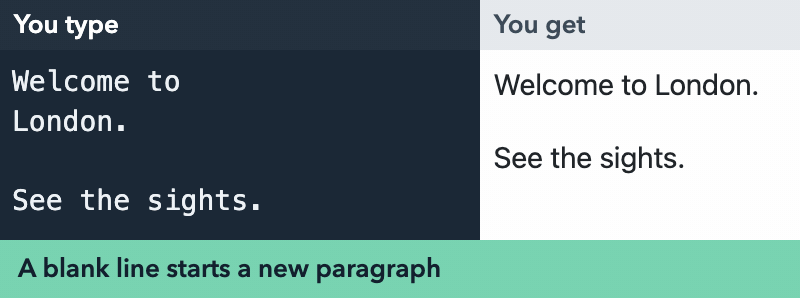
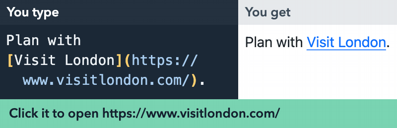
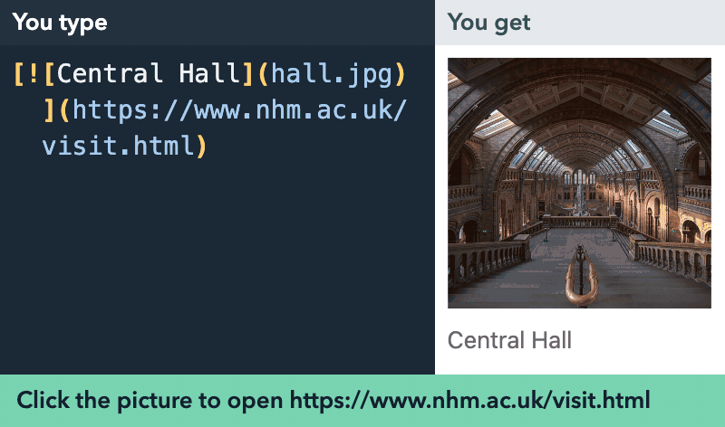

# Markdown, Rendering and Project Rules {#sec-markdown}

```{python}
#| label: ch4-setup
import pandas as pd
from scripts.prose import number_words, text_holds

ldn_sights = pd.read_csv("../examples/london/data/sights.csv")
ldn_att = pd.read_csv("../examples/london/data/attractions.csv")
n_sight_rows = len(ldn_sights)
n_sight_sources = ldn_sights["url"].nunique()
WORDS = number_words()


def word(n: int) -> str:
    """A count in words, as prose writes small numbers."""
    return WORDS[n] if n < len(WORDS) else f"{n:,}"


# Where the guide's first list of five sights stands among London's ALVA members in 2025.
five = ["British Museum", "Natural History Museum", "Tate Modern", "National Gallery",
        "Tower of London"]
by_visits = ldn_att.sort_values("visits_2025", ascending=False)["attraction"].tolist()
rank = {s: next(i for i, a in enumerate(by_visits, 1) if s in a) for s in five}
ordinal = ["first", "second", "third", "fourth", "fifth", "sixth", "seventh", "eighth",
           "ninth", "tenth"]
five_ranks = [ordinal[rank[s] - 1] for s in five]
five_ranks = ", ".join(five_ranks[:-1]) + " and " + five_ranks[-1]
n_att = len(ldn_att)
tower = rank["Tower of London"]
n_above_tower = tower - 1 - sum(rank[s] < tower for s in five)  # members not on the list
```

The tourism office wants a visitor guide it can stand behind: a page anyone can open on a
phone, every fact traced to a source, rebuilt rather than retyped when the facts change.
@fig-london-guide is where Part II ends: the guide on its own website, with links to the same
content in Word, PDF, PowerPoint, e-book and slide formats.

::: payoff
{#fig-london-guide width=50% fig-alt="A web page at a phone's width, under a bar with a menu button, Visit London and a search icon. The title Visit London; the author, London Tourism Office, and the date it was published; a welcome sentence with London in bold and riverside walks in italics; and a heading, Five sights to start with, over a numbered list: British Museum, Natural History Museum, Tate Modern, National Gallery and Tower of London."}
:::

It starts as an empty folder and one plain-text file in Markdown, a way of writing structured
text with a few punctuation marks. The agent writes most of that file, and you check it:
Markdown is the layer you read, compare between versions and fix by hand when a sentence is
wrong. Near the end of this chapter comes a scene in which the agent changes something you did
not ask it to change, and its report does not mention it. By then you will have the two
commands that show it.

Work in order: read a section, paste its prompt, look at the result, read the diff, commit.

::: opener
- Write a Markdown page: headings, lists, links, images, tables, fences.
- Render a file, and keep a live preview running beside it.
- Write project rules concrete enough to check, and hold each agent edit to them with
  `git diff`.
- Set up a project's own Python environment with uv.

Start from
: an empty `~/london-guide/` folder

You build
: `london.md`, its rules, a uv environment and the history of each step

Checkpoint
: `checkpoints/01-london-markdown/`
:::

## Markdown at a glance {#sec-md-basics}

Markdown is plain text in which a few symbols mean formatting. A `#` at the start of a line
makes a heading; two stars on each side of a word make it bold. You type the symbols; when
Quarto renders the file, turning it into a page, they become the formatting they stand for. A
Markdown file is an ordinary text file whose name ends in `.md`: any plain-text editor opens it,
and it reads well even before it is rendered.

The first marks the guide needs are below; each later section adds the marks its step uses.
Each animation pairs what you type, on the left, with what you get, on the right: the
right-hand page is Quarto's own render, not a drawing.

Two things make Markdown safe to learn by trying:

- **Nothing breaks.** A mark that is mistyped, or opened and never closed, usually shows on the
  page as an ordinary character, and at worst formats the wrong words. Either way the page still
  renders, the slip is easy to spot, and you fix it by editing the text.
- **Trying costs nothing.** Type a few lines into a new file named `try.md`, then run
  `quarto preview try.md` in the terminal, in that file's folder (@sec-md-commands). It opens
  the page in your browser, or prints an address to open, and updates the page every time you
  save the file; Ctrl+C in the terminal stops it.

### Headings, paragraphs and emphasis

A line that starts with `#` and a space is a *heading*, the title of a part of the page. One `#`
gives the largest heading, for the page's title. Each extra `#` makes a heading one level
smaller (@fig-md-headings), down to six.

{#fig-md-headings .anim fig-alt="Two panes, You type on the left and You get on the right, above a note. Finished, the source has three lines with blank lines between them: # London, ## Museums and ### Tate Modern, the # signs in yellow. The page shows London as a large heading, Museums smaller with a thin rule under it, and Tate Modern smaller again. The note reads: More # signs, a smaller heading. The animation types the lines one at a time, and each heading appears on the page once its line is complete."}

Ordinary text needs no mark. Lines that follow one another join into one paragraph, wherever you
break them, and a *blank line*, a line with nothing on it, starts a new paragraph
(@fig-md-paragraphs). So you can break a long sentence over several lines of the file without
changing the page.

{#fig-md-paragraphs .anim fig-alt="Two panes, You type and You get, above a note. Finished, the source reads Welcome to on one line and London. on the next, then a blank line and See the sights. The page shows two paragraphs: Welcome to London. on one line, and See the sights. The animation types the first two lines, which the page joins into one, then the blank line and the last line, which the page starts as a new paragraph. The note reads: A blank line starts a new paragraph."}

Stars round words emphasise them: two on each side for **bold**, one on each side for *italic*.
Two tildes (`~`) on each side ~~strike text through~~, for something no longer true. These
marks come in pairs. Until the closing pair is typed, the opening one shows as typed, as at the
start of @fig-md-emphasis.

{#fig-md-emphasis .anim fig-alt="Two panes, You type and You get, above a note. Finished, the source reads Walk by the **river** at *sunset*. over two lines, then a blank line and Go by ~~car~~ Tube., with the stars and tildes in yellow. The page shows river in bold, sunset in italics and car struck through. The animation first types Walk by the **river with no closing stars, and the page shows the two stars as typed. Once the closing pair is typed, river turns bold; then sunset turns italic and car is struck through. The note names each mark as it is typed."}

### GitHub's Markdown and Quarto's

Markdown comes in dialects: GitHub uses *GitHub Flavored Markdown* (GFM), which extends
CommonMark, a precise specification of Markdown, while Quarto reads Pandoc's Markdown, which
accepts the same core marks and adds more, and three differences catch people who learnt
Markdown on GitHub:

- A list needs a blank line above it; without one, it runs on as part of the paragraph.
- Strikethrough needs two tildes, `~~Car~~`, because a single pair, `~2~`, makes a subscript.
- An image's text in square brackets is its caption in Quarto, where GitHub uses it as alt
  text; Quarto's alt text goes in `fig-alt` (@sec-md-link-image).

### Two commands: render and preview {#sec-md-commands}

<!-- The two commands as their help screens describe them, Quarto 1.10.20, read 2026-11-12. -->

Quarto turns a file into a page with either of two commands, typed in the terminal in the
file's folder:

`quarto render try.md`
: writes the output once, here `try.html`, and stops. `--to docx` picks another format. Use
  it to make a finished file, the one you send or publish.

`quarto preview try.md`
: renders the file, serves the page on a local address and renders it again each time the
  file is saved; Ctrl+C stops it. Use it while you write, in a terminal tab of its own.

A plain `.md` file needs no settings to render. @sec-md-render runs both commands on the
guide.

## A folder for the guide {#sec-brief}

The guide gets its own folder in your home folder, beside the `quarto-workshop` repository (a
project folder with its Git history) that you cloned during setup (@sec-step-check), so that
its checkpoints are always at
`../quarto-workshop/checkpoints/`. By the end of the chapter your home folder, `~`, looks like
this:

```text
~
├── quarto-workshop/
└── london-guide/
    ├── .git/
    ├── .gitignore
    ├── AGENTS.md
    ├── london.md
    ├── london.html
    ├── data/
    ├── images/
    ├── pyproject.toml
    ├── uv.lock
    └── .venv/
```

- `.git/` and `.gitignore`: the guide's history, which you start by hand, and the list of
  files it leaves out.
- `AGENTS.md`: the rules the agent reads first.
- `london.md`: the guide's source, the file you check; `london.html` is rendered from it.
- `data/` and `images/`: cited facts and credited photos, copied in and never edited.
- `pyproject.toml`, `uv.lock` and `.venv/`: the packages, their exact versions and the
  installed environment.

Make the folder and start its history by hand, as you did for the first report
(@sec-first-git), then open a list of what Git should leave out:

::: {.you}
```bash
cd ~
mkdir -p london-guide
cd london-guide
git init -b main
nano .gitignore
```
:::

In nano, type these lines, one pattern per line, then Ctrl+O, Enter and Ctrl+X to save and
leave:

```text
.venv/
.quarto/
*.quarto_ipynb
*_files/
london*.html
*.docx
*.pdf
*.pptx
*.epub
```

The first four are the environment and Quarto's working files. The rest are what the guide's
renders will write: web pages, Word files, PDFs, slides and e-books (a `*` stands for any
characters). Each is rebuilt from the source at the next render, so a commit that held them
would only hold copies that go stale. Web pages are listed by name, `london*.html`, not
`*.html`, because one optional page later on, `visits-3d.html` (@sec-london-3d), is a source
the agent writes, not a rendered file. Make the first commit:

::: {.you}
```bash
git add .gitignore
git commit -m "Leave the environment and rendered files out of Git"
```
:::

`git status` now says `nothing to commit, working tree clean`, and it will not list
`london.html` or `.venv/` when they appear, because `.gitignore` names them. Keep this terminal
tab for Git, and start the agent in a new tab, in the same folder (type `codex`, `agy` or
`opencode` instead of `claude` if you use one of those):

::: {.you}
```bash
cd ~/london-guide
claude
```
:::

Claude Code first asks whether you trust the new folder (@sec-step-assistant): you made it for
this work, so say yes. Codex asks the same question here, because the folder is now a Git
repository. Later prompts read `../quarto-workshop/`, outside the project folder, so the agent
asks before it first reads there: approve it, or start Claude Code or Codex with
`--add-dir ../quarto-workshop` to allow it up front.

## A first page: a title and a welcome {#sec-md-heading}

::: {.prompt}
```default
Create london.md with a level-1 heading "Visit London" and a welcome paragraph with one bold and one italic phrase.
```
:::

The agent writes:

```markdown
# Visit London

Welcome to **London**: free museums, royal history and *riverside walks*.
```

These are the marks of @sec-md-basics: a level-1 heading, then a paragraph with bold and
italic words. That is already a complete document.

Before anything else, see what the agent changed. In your Git tab:

::: {.you}
```bash
git status
```
:::

::: transcript
```text
On branch main
Untracked files:
  (use "git add <file>..." to include in what will be committed)
        london.md

nothing added to commit but untracked files present (use "git add" to track)
```
:::

One new file and nothing else: the agent wrote only what it was asked to. `git diff` would show
nothing yet, because it compares the files Git already tracks with their last commit, and a new
file has no last commit: its whole text is the change. So read the file itself (`cat london.md`
prints it), then commit it with a message that says why:

::: {.you}
```bash
git add london.md
git commit -m "Start the guide with a title and a welcome"
```
:::

## Watch it become a web page {#sec-md-render}

::: {.prompt}
```default
Render london.md with quarto render and tell me which file it wrote.
```
:::

::: {.agent}
`quarto render london.md` → `london.html`
:::

::: {.you}
in a third terminal tab:

```bash
cd ~/london-guide
quarto preview london.md
```

open the address it prints · Ctrl+C stops it
:::

The render writes `london.html` once. The preview (@sec-md-basics) renders it again every time
`london.md` is saved, including when the agent saves it, so the page in your browser
follows each change (@fig-preview-reload). It prints a line such as
`Browse at http://localhost:4200/` (the number varies) and usually opens that page in your
browser; if it does not, open the address yourself.

{#fig-preview-reload .anim fig-alt="Two panes. On the left, the source of london.md as the agent saves it, with each new section highlighted: first the heading and welcome, then a numbered list of five sights, then a Plan your visit section with a link and a tip from a local, then a Before you go checklist. On the right, the page served by quarto preview reloads after each save and shows the new section, rendered as headings, a numbered list, a link, a quotation and a code block."}

Keep the preview running from now on. It is the fastest way to check what each prompt did.
`git status` in your Git tab lists nothing new after a render: `london.html` is a rendered
file, and `.gitignore` leaves it out.

::: pitfall
A preview and a render of the same file at the same moment collide, and one fails with an
error such as `readfile 'london.quarto_ipynb'`. While a preview runs, let it render; before the
agent renders several formats at once (@sec-formats), stop it with Ctrl+C, and restart it
afterwards.
:::

::: tryit
Paste the two prompts above, commit the first page, then start the preview in a third tab.

::: done
`london.html` opens in your browser and updates whenever `london.md` changes.
:::
:::

## Rules for the guide {#sec-london-agents}

@sec-agents-md introduced `AGENTS.md`, the file of rules an agent reads at the start of
every session. The guide needs one now, before any data or photos arrive, because every later
prompt relies on it:

::: {.prompt}
```default
Create AGENTS.md for this project. Scope: a London visitor guide for the tourism office, written once and reused for every audience. Rules: every number comes from a cited file in data/, photos are openly licensed, credited and show no people, never invent facts, keep data/ and images/ unchanged, and call ALVA counts "ALVA member attractions". Show me the file.
```
:::

::: {.agent}
writes `AGENTS.md`: a scope and a list of rules
:::

::: {.you}
approve · read it: does it say what you meant?
:::

Each rule is there for a reason the project will meet, and each is concrete enough to check
(@tbl-london-rules).

| Rule | Because |
|---|---|
| every number from a cited file | an agent asked for a number it lacks may supply a plausible one |
| photos openly licensed, with no people | the guide must be free to reuse them, with no consent questions |
| `data/` and `images/` unchanged | the inputs are evidence; edits belong in the analysis |
| "ALVA member attractions" | the Association of Leading Visitor Attractions counts only its members |

: Why each of the guide's rules is there. {#tbl-london-rules}

The finished project's version reads, in part:

```markdown
## Rules

- Every number comes from a cited file in `data/`: each row carries `source`, `url` and
  `retrieved`. Never estimate or invent a figure or a fact.
- ALVA counts only its member sites: write "ALVA member attractions".
- Photos are openly licensed, credited from `images/ATTRIBUTION.md`, and show no people.
- Keep `data/` and `images/` unchanged.
```

Read what the agent wrote and edit it yourself if the wording is off. It is your project's
contract with the agent, and the rules work best when they are concrete enough to check.
Any plain-text editor will do, or the terminal's own: in your Git tab, `nano AGENTS.md` opens
the file; Ctrl+O and Enter save it, and Ctrl+X leaves (@sec-terminal). Then commit it, as you
did the first page: `git add AGENTS.md`, then `git commit -m "Write the project's rules"`.

## Five sights and how to get around {#sec-md-lists}

::: {.prompt}
```default
In london.md, add a "Five sights to start with" numbered list (British Museum, Natural History Museum, Tate Modern, National Gallery, Tower of London) and a "Getting around" bullet list: 🚇 Tube, 🚌 Bus, 🚲 Santander Cycles.
```
:::

```markdown
## Five sights to start with

1. British Museum
2. Natural History Museum
3. Tate Modern
4. National Gallery
5. Tower of London

## Getting around

- 🚇 Tube
- 🚌 Bus
- 🚲 Santander Cycles
```

A line that starts with `-` and a space is an item in a bulleted list. A number and a full
stop, such as `1.`, then a space, start an item in a numbered list (@fig-md-lists). Leave a
blank line above a list: without one, its items run on as part of the paragraph before it.

{#fig-md-lists .anim fig-alt="Two panes, You type and You get, above a note. Finished, the source has - Tube and - Bus, a blank line, then 1. British Museum and 2. Tate Modern. The page shows a bulleted list of Tube and Bus and, below it, a numbered list of British Museum and Tate Modern. The animation types the bulleted items first, then the numbered ones, and each list appears on the page once it is typed. The note reads: Leave a blank line above a list."}

The five sights are the five attractions whose visits the guide charts later, from ALVA's
data. The list is a starting point, not a ranking. Among London's `{python} word(n_att)` most
visited ALVA member attractions in 2025, the five, in the order listed, stand
`{python} five_ranks`; `{python} word(n_above_tower)` attractions not on the list drew more
visits than the Tower.

### Read the diff, then commit

This is the agent's first change to a file Git already tracks, so `git diff`, in your Git tab,
has something to show.

::: think
Before you run `git diff`: how many files will it show, and will any line of the change start
with `-`, the mark of a removed line?

One file, `london.md`, and no removed line: the prompt only added, so every changed line
starts with `+`. The `--- a/london.md` line at the top is a header naming the old version, not
a change. A `-` line among the changes would be a change you did not ask for: read it first.
:::

Here is the diff, without its `index` line, and cut after the fifth sight with "…":

::: transcript
```text
diff --git a/london.md b/london.md
--- a/london.md
+++ b/london.md
@@ -1,3 +1,17 @@
 # Visit London

 Welcome to **London**: free museums, royal history and *riverside walks*.
+
+## Five sights to start with
+
+1. British Museum
+2. Natural History Museum
+3. Tate Modern
+4. National Gallery
+5. Tower of London
…
```
:::

Lines that start with `+` were added and lines that start with `-` removed; the others are
unchanged lines shown for context. `@@ -1,3 +1,17 @@` says that the three lines starting at
line 1 are now seventeen. Yours will differ wherever the agent's wording does. Check two
things: every added line is one you asked for, and no other file is listed. Then commit:

::: {.you}
```bash
git commit -am "Add five sights and ways to get around"
```
:::

`-a` takes in every tracked file that changed, and `-m` gives the message, as for the first
report.

::: practice
Make it a habit: after each prompt, once the preview shows what you asked for, run
`git status` and `git diff` and commit with a message that says why. `git commit -am` covers
changed files; a new file, or a new folder such as `data/`, needs `git add .` first, which adds
everything new or changed that `.gitignore` does not leave out. Small commits, one checked
step each, let you undo one step without losing the others. Once the habit is yours you can
ask the agent to commit ("commit with a message that says why"), and read its diff before you
approve.
:::

## Planning a visit: a link, a photo and a tip {#sec-md-link-image}

::: {.prompt}
```default
Copy ../quarto-workshop/examples/london/images here. In london.md, add "Plan your visit": a TfL Journey Planner link, images/big-ben.jpg at 30% width with alt text and a credit caption from images/ATTRIBUTION.md, and a "Tip from a local" blockquote.
```
:::

```markdown
Plan your route with the [TfL Journey Planner](https://tfl.gov.uk/plan-a-journey/).

{width=30% fig-alt="Big Ben's clock tower and the Palace of Westminster against a blue sky with white clouds."}

> **Tip from a local:** many big museums are free. Book a free timed ticket to skip the queue.
```

A link has two parts: the words to click, in square brackets, then the address they open, in
round brackets, with no space between the two (@fig-md-link). Square brackets on their own show
as typed. An address is often too long for one row of the screen, so the editor *wraps* it,
showing the rest on the next row, as on the left of @fig-md-link. It is still one line, typed
without pressing Enter.

{#fig-md-link .anim fig-alt="Two panes, You type and You get, above a note. Finished, the source reads Plan with on one line, then Visit London in square brackets followed by https://www.visitlondon.com/ in round brackets, wrapped onto a third row. The page shows Plan with Visit London., with Visit London in blue and underlined. The animation starts from the plain text, adds the square brackets, which the page shows as typed, then types the address in round brackets, and the words become a link. The note reads: Click it to open https://www.visitlondon.com/."}

A picture is written like a link with a `!` in front: its caption in square brackets, then its
file in round brackets (@fig-md-image). There the file, `hall.jpg`, sits beside the Markdown
file; the guide's photos are in `images/`.

{#fig-md-image .anim fig-alt="Two panes, You type and You get, above a note. Finished, the source reads . The page shows a photograph of the Natural History Museum's Central Hall, a vaulted hall seen from the top of a staircase, captioned Central Hall. The animation types the line, and the photograph appears once it is complete. The note reads: A picture, with its caption below."}

A picture can be a link too. Put the whole picture where a link's words go, inside its square
brackets: `[](address)` (@fig-md-image-link). The page looks the same, but a
click on the photo opens the address, here the museum's own page for visitors.

{#fig-md-image-link .anim fig-alt="Two panes, You type and You get, above a note. Finished, the source reads  inside square brackets, followed by https://www.nhm.ac.uk/visit.html in round brackets, wrapped over three rows. The page shows the same captioned photograph of the Central Hall as the picture without a link. The animation starts from the picture alone, types an opening square bracket in front of it and the closing bracket and address after it, and the page stays the same. The note reads: Click the picture to open https://www.nhm.ac.uk/visit.html."}

The `{…}` after the guide's picture is a Quarto and Pandoc extension: `width` sizes it and
`fig-alt` holds its *alt text*, the description that screen readers announce and that appears
if the image cannot load. @fig-big-ben is that photo.

{#fig-big-ben width=40% fig-alt="Big Ben's clock tower and the Palace of Westminster against a blue sky with white clouds."}

::: why
Alt text is not decoration. Without it, an image in a web page or e-book is announced as
"image", or not at all, to a reader who cannot see it, and a caption alone often says who
took a photo rather than what it shows. Writing it is also a small test of whether a picture
says anything: if the alt text is hard to write, the image may not be needed.
:::

The tip is a *block quote*: a `>` at the start of a line sets it off from the text beside a
bar, as a quotation (@fig-md-quote). Start each of its lines with `>`.

{#fig-md-quote .anim fig-alt="Two panes, You type and You get, above a note. Finished, the source reads Tip from a local:, a blank line, then two lines starting with a yellow >: Many big museums, and are free. The page shows the first line as plain text and, below it, the quotation in grey beside a vertical bar. The animation starts from the plain line and types the two quoted lines, then the quotation appears on the page. The note reads: > at the start of a line: a quotation."}

<!-- The photo's licence and the absence of people were checked on its Wikimedia Commons page on 2026-10-30. -->

The photo was chosen by the rules: it is in the public domain (CC0), its licence and the
absence of people were checked on its Wikimedia Commons page, and the credit comes from
`images/ATTRIBUTION.md`, which records each photo's author, licence and source.

## Sights at a glance, from cited data {#sec-md-table}

The guide's sights table needs facts: each sight's price band, its nearest Underground
station and its official page. They come from a file the agent copies, not from its
memory:

::: {.prompt}
```default
Copy ../quarto-workshop/examples/london/data here. In london.md, add a "Sights at a glance" table from data/sights.csv: a photo from images/ (height=60, no unit; alt text), Sight, Price band, Nearest tube and a "Read more" link to its `official_page`. Credit the photos (images/ATTRIBUTION.md) and the sources.
```
:::

`data/sights.csv` is a *CSV* file (comma-separated values): a table in plain text, one line
per row, with commas between the columns. It holds one row per sight and fact, and every row
names its own source and the date it was retrieved: `{python} word(n_sight_rows)` facts from
`{python} word(n_sight_sources)` distinct pages. @tbl-sights-provenance shows three of them.

```{python}
#| label: tbl-sights-provenance
#| tbl-cap: "Three rows of `data/sights.csv`. Each fact also carries its `source` (a description) and `url`."
#| output: asis
rows = ldn_sights[ldn_sights["fact"].isin(["price_band", "nearest_tube"])].iloc[[0, 1, 5]]
print(rows[["sight", "fact", "value", "retrieved"]].to_markdown(index=False))
```

The table in `london.md` is plain Markdown:

```markdown
| Photo | Sight | Price band | Nearest tube | More |
|---|-----|---|-----|----|
| {height=60} | British Museum | Free | Tottenham Court Road | [Read more](https://www.britishmuseum.org/visit) |
```

Vertical bars separate columns, and the row of dashes under the header marks it as a header;
the relative number of dashes sets the relative column widths. A link or an image works inside
a cell.

The guide has no code yet, so the agent reads the file and types its values into the
table: a cited *copy* of the facts, not a link to them. The next chapter makes numbers
compute, and @sec-london-change shows what a copy costs.

::: think
The agent has filled in the sights table. How do you check that a price band came from
the file and not from the agent's memory?

Find that sight's `price_band` row in `data/sights.csv`: its value, source and retrieval date
are there. For a whole table, ask the agent to name the row behind each cell, then check a
few of them yourself.
:::

Two things about this table surprise people (@tbl-sights-traps).

| You see | Because | Do |
|---|---|---|
| the PowerPoint guide shows words where the photos were | a PowerPoint table cannot hold pictures, so each cell shows the photo's alt text | nothing: check that it reads well |
| the agent reports the British Museum's or Historic Royal Palaces' page broken | both answer automated requests with `403 Forbidden` | open each in a browser before you believe it |

: Two surprises in the sights table. {#tbl-sights-traps}

Commit this step with `git add .` first, so that `data/` is committed with the table: from
then on, Git shows you any change to the evidence.

## A checklist that keeps its shape {#sec-md-code-fence}

::: {.prompt}
```default
In london.md, add a "Before you go" section: a three-item checklist inside a plain text code block.
```
:::

````markdown
## Before you go

```text
[ ] Contactless card or Oyster card
[ ] Free museum tickets booked
[ ] Comfortable shoes and an umbrella
```
````

Three backticks open and close a *code fence*, and the word after the opening backticks names
the language: `text`, `python`, `bash`. Text inside a fence is shown exactly as typed, which is
why the brackets and line breaks survive. In the next chapter, writing `{python}` after the
backticks instead of `python` turns a fence that is displayed into one that runs.

### Spot the change you did not ask for

```{python}
#| label: ch4-unwanted
# The scene below quotes the British Museum's nearest_tube row: stop if sights.csv changes it.
bm_tube = ldn_sights[(ldn_sights["sight"] == "British Museum")
                     & (ldn_sights["fact"] == "nearest_tube")]["value"]
text_holds(bm_tube.tolist() == ["Tottenham Court Road"], "the unwanted change's diff")
```

Suppose that after the checklist prompt, `git status` lists two changed files, not one:

::: transcript
```text
On branch main
Changes not staged for commit:
  (use "git add <file>..." to update what will be committed)
  (use "git restore <file>..." to discard changes in working directory)
        modified:   data/sights.csv
        modified:   london.md

no changes added to commit (use "git add" and/or "git commit -a")
```
:::

::: think
The prompt asked for a checklist in `london.md`, and nothing else. What do you do about
`data/sights.csv`?

Look before you undo. `git diff data/sights.csv` shows one value changed: the British Museum's
station. The agent replaced the station the museum's own page names with one from its memory,
against the rule that keeps `data/` unchanged. `git restore data/sights.csv` puts that one file
back and leaves the checklist alone. Commit `london.md`, and tell the agent which rule it
broke.
:::

That diff, shortened with "…":

::: transcript
```text
-British Museum,nearest_tube,Tottenham Court Road,"British Museum, Visit: …
+British Museum,nearest_tube,Holborn,"British Museum, Visit: …
```
:::

This scene is an illustration, not a recorded session. It is exactly the kind of change a
summary such as "Added the checklist" would not mention, which is why you read `git status`
and not only the agent's report.

::: tryit
Add the lists, the link, image and quote, the table and the code fence with the four prompts
above, watching each change arrive in the preview, then reading its diff and committing it.

::: done
`london.html` shows both lists, the photo with its credit, the five-row table and the
checklist, and `git log --oneline` lists one commit for each step.
:::
:::

## All the marks together {#all-the-marks-together}

Every mark you have now used is gathered here, with a few more: @tbl-md-text, @tbl-md-blocks
and @tbl-md-escapes. Come back to them as you write.

| You type | You get |
|:-----------|:-----------|
| `# Visit London` | a heading (`##`: one level down) |
| a blank line between lines | a new paragraph |
| `\` at the end of a line | a line break |
| `*italic*`, `**bold**` | *italic*, **bold** |
| `~~Car~~` | ~~Car~~ |
| `- Tube` | a bulleted item |
| `1. British Museum` | a numbered item |
| `- [ ] Umbrella` | an empty box; `[x]` ticks it |

: Markdown for text and lists. {#tbl-md-text}

Each was introduced where the guide first needed it: headings, paragraphs and emphasis in
@sec-md-basics, lists in @sec-md-lists, links, pictures and quotations in @sec-md-link-image,
tables in @sec-md-table and fences in @sec-md-code-fence. A `\` at the end of a line breaks it
without starting a paragraph; two spaces work too, but "the backslash is easier to see, and
editors that strip trailing whitespace on save won't remove it" (Quarto, *Markdown Basics*).

| You type | You get |
|:-----------|:-----------|
| `[TfL](https://tfl.gov.uk/)` | a link, [TfL](https://tfl.gov.uk/) |
| `` | the picture, captioned "Big Ben" |
| `` `quarto render` `` | `quarto render`, in code type |

: Markdown for links, pictures and code in a sentence. {#tbl-md-blocks}

| You type | You get |
|:-----------|:-----------|
| `> Book ahead.` | a quotation |
| lines between ```` ```text ```` and ```` ``` ```` | a code block, shown exactly as typed |
| `| Sight | Price |` over `|---|---|` | a table with a header row |
| `---` between blank lines | a horizontal rule |
| `\*free\*` | \*free\*, stars and all: `\` before a mark keeps it as typed |

: Markdown for blocks, and for keeping a mark as typed. {#tbl-md-escapes}

Three dashes on a line of their own, with a blank line above and below, draw a *horizontal
rule*: a line across the page that separates two parts of it (@fig-md-rule).

{#fig-md-rule .anim fig-alt="Two panes, You type and You get, above a note. Finished, the source reads Day one: museums., a blank line, three yellow dashes, a blank line and Day two: parks. The page shows the two sentences with a thin grey line across the page between them. The animation starts from the first sentence, types the dashes, after which the line appears on the page, then types the second sentence below it. The note reads: --- between blank lines: a line across."}

::: think
A line of text, and straight under it, with no blank line between, a line of three dashes.
Does the page show a horizontal rule?

No: the line of text becomes a level-2 heading. A line underlined with dashes is another way
of writing one, in GitHub's Markdown and Quarto's alike, which is why the rule in
@tbl-md-escapes needs a blank line above it.
:::

```{python}
#| label: ch4-toy-md
import re
from pathlib import Path

TOY = Path("media/examples/toy.md")


def show_file(path: Path, lang: str = "markdown", lines: tuple[int, int] | None = None) -> str:
    """A file's text, as it is, in a fence longer than any run of backticks inside it; with
    `lines` (first, last, counted from 1), only those lines."""
    text = path.read_text()
    if lines:
        text = "".join(text.splitlines(keepends=True)[lines[0] - 1:lines[1]])
    ticks = "`" * max(4, 1 + max(map(len, re.findall("`+", text)), default=0))
    return f"{ticks}{lang}\n{text}{ticks}"


# toy.md types two price bands: stop if sights.csv no longer gives them.
price = ldn_sights[ldn_sights["fact"] == "price_band"].set_index("sight")["value"]
text_holds(price["British Museum"] == "Free" and price["Tower of London"] == "Paid",
           "toy.md's price bands")
# The file is shown in two halves, split at its horizontal rule, and the first half in two
# pieces, split before its second heading (lines counted from 1).
toy_lines = TOY.read_text().splitlines()
rule = toy_lines.index("---") + 1
second = toy_lines.index("## Two sights") + 1
text_holds(toy_lines[rule - 2] == toy_lines[rule] == toy_lines[second - 2] == "" and second < rule,
           "toy.md's rule between blank lines, after its second heading")
```

Here is every one of those marks in one file, `toy.md`, a short London note with no settings
and no code. Its own rule divides it in two. Above the rule, a paragraph, a list and a
quotation:

```{python}
#| output: asis
print(show_file(TOY, lines=(1, second - 2)))
```

then a second heading, a numbered list and a table:

```{python}
#| output: asis
print(show_file(TOY, lines=(second, rule - 2)))
```

`quarto render toy.md` turns that half into the top of `toy.html` (@fig-toy-md):

{#fig-toy-md width=50% fig-alt="A web page at a phone's width. The heading A day in London; a sentence with British Museum in bold and free in italics, then, on a new line, Get there by, over a bulleted list: Tube, Bus and Car, with Car struck through. A quotation with a grey bar: Tip: book a free timed ticket. A smaller heading, Two sights, with a thin rule under it, over a numbered list and a two-column table of the two sights and their prices, Free and Paid."}

Then the rule and the rest:

```{python}
#| output: asis
print(show_file(TOY, lines=(rule, len(toy_lines))))
```

{#fig-toy-md-2 width=50% fig-alt="The rest of the page: a horizontal rule, then a small photo of Big Ben captioned Big Ben. One paragraph: the photo's credit, a blue TfL link, quarto render in code type, and free between two asterisks. A ticked box for Contactless card and an empty one for Umbrella. Last, a line in typewriter type in which the asterisks round marks are shown, not applied."}

Compare each picture with its source, line by line: the lines of each paragraph have joined,
except where a `\` broke one; "Car" is struck through; the escaped stars round "free" and the
stars inside the fence have stayed stars.

## An environment for the code to come {#sec-environments}

A Python *environment* is a folder holding one version of Python and the packages a project
uses, kept apart from every other project's. *Packages* are the add-on libraries that Python
code imports, such as pandas for tables or matplotlib for charts. The next chapter runs
Python, and code never runs in a vacuum: what it does depends on the Python version and on the
exact version of each package.

Getting all of that to agree used to be a lesson of its own: install conda or a system Python,
sometimes a compiler, fix the `PATH` (the list of folders where the terminal looks for
programs), register a Jupyter kernel, then debug it on every laptop. **uv** now does it in one
step, for one project at a time. It fetches the Python version a project needs, and its
*lockfile*, `uv.lock`, records the exact version of every package for every operating system,
processor and Python version, so one file reproduces the same environment on every Mac,
Windows and Linux machine. Many scientific packages hold compiled code, built for each system
separately; a package file's *platform tag*, such as `macosx_11_0_arm64`, names the system it
fits, so the lockfile lists the right file for each.

::: {.prompt}
```default
Give this folder its own Python environment with `uv`: run `uv init --bare`, then `uv add ipykernel nbclient nbformat pyyaml pandas matplotlib plotly`. From now on run `quarto` and `python` through `uv run`, and add that rule to AGENTS.md. Show me the Python line of `uv run quarto check jupyter`.
```
:::

::: {.agent}
writes `pyproject.toml` (the packages), `uv.lock` (their exact versions) and `.venv/` (the installed environment) · adds a rule to `AGENTS.md`
:::

{#fig-uv-environment .anim fig-alt="A terminal session in the london-guide folder. uv init --bare creates the project. uv add with ipykernel, nbclient, nbformat, pyyaml, pandas, matplotlib and plotly resolves and installs the packages in moments from uv's cache. ls -a lists .venv, pyproject.toml and uv.lock. uv run quarto check jupyter reports Python 3.12 from the folder's own .venv, Jupyter installed, and the Jupyter engine render OK."}

The four packages `ipykernel`, `nbclient`, `nbformat` and `pyyaml` are what Quarto needs to run
Python cells; `pandas`, `matplotlib` and `plotly` are what the guide's code will use. The
larger `jupyter` package, with its notebook applications, is not needed.

::: why
Why `uv run` in front of every command? Quarto refuses to run Python next to a `.venv` folder
that is not activated ("There is an unactivated Python environment in .venv"). `uv run`
activates the project's environment for that one command, and first brings `.venv` up to date
with `uv.lock`. So a copied project, or a checkpoint, rebuilds its own environment on its first
`uv run`, and the rule in `AGENTS.md` keeps the agent using it after a restart.
:::

::: think
Which file tells you the exact version of pandas the guide uses: `pyproject.toml` or
`uv.lock`?

`uv.lock`. `pyproject.toml` lists the packages the project asked for, each with only a lowest
acceptable version (`pandas>=…`); `uv.lock` records the one version installed, for every
system. That is the file that makes a colleague's `uv run` build the same environment as yours.
:::

Commit this step too. `git status` lists the new `pyproject.toml` and `uv.lock` and the
changed `AGENTS.md`, but not `.venv/`: `.gitignore` leaves it out, because `uv run` rebuilds it
from `uv.lock`. So `git add .` and `git commit -m "Give the guide its own Python environment"`
record everything a colleague needs to build the same environment, and nothing they do not.
Keep the preview running meanwhile: `london.md` needs no Python yet.

::: tryit
Run the environment prompt and commit it.

::: done
`uv run quarto check jupyter` names this folder's `.venv`, and `git status` is clean.
:::

::: catchup
```default
Catch me up: follow ../quarto-workshop/checkpoints/01-london-markdown/README.md
```
:::
:::

## If you fall behind {#sec-catch-up}

The preface set the rule, and drew its steps in @fig-catch-up: stuck for two minutes, catch
up. The line at the end of the last *Try it* is this chapter's only catch-up, because its
checkpoint holds the end of the whole chapter, whichever step you were stuck on. Pasted into
the agent, it:

::: {.agent}
backs up `london-guide/` to `../london-guide-backup-01-<time>` · copies the checkpoint in · renders `london.md` · checks `london.html`
:::

Then carry on with the next chapter (@sec-compute): the README was written for the workshop
and may point you to a slide, but in this book the next step is always the one after the
catch-up box. You can run the same steps by hand (@fig-catch-up-steps); each backup is a new
folder named with the date and time, so earlier ones are kept, and it leaves out `.venv/`,
which is large and which `uv run` rebuilds from `uv.lock`.

{#fig-catch-up-steps .anim fig-alt="A terminal in london-guide, which holds only a london.md with a typo in its heading. A tar command copies everything except .venv to a backup folder named london-guide-backup-01 with the date and time. cp copies checkpoint 01 into the folder. uv run quarto render london.md creates the virtual environment from uv.lock, installs 51 packages and renders, ending with Output created: london.html. ls shows the guide's files, and ls of the parent shows london-guide beside its backup."}

Your history is kept too. A checkpoint has no `.git/` folder, so catching up leaves your
commits as they were, and the checkpoint's files arrive as changes. For a reader who had
committed every step before the environment (@sec-environments), `git status` then shows,
without its hint lines:

::: transcript
```text
On branch main
Changes not staged for commit:
  …
        modified:   AGENTS.md
        modified:   london.md

Untracked files:
        README.md
        pyproject.toml
        uv.lock

no changes added to commit (use "git add" and/or "git commit -a")
```
:::

Review them as you would an agent's change: `git diff` shows how `london.md` and `AGENTS.md`
changed (the checkpoint's rules add the `uv run` commands), and nothing in `data/` or `images/`
is listed, because the checkpoint's copies are the same as yours. `README.md`
holds the checkpoint's catch-up steps; @sec-london-publish replaces it with the guide's own.
Then `git add .` and `git commit -m "Catch up to checkpoint 01"`. Your own `.gitignore` stays,
because the checkpoint has none.

## Summary {.unnumbered}

::: keyideas
- Markdown is plain text in which a few marks mean formatting; a mistyped mark breaks nothing
  and shows on the page, where you can see it and fix it.
- Markdown is the layer you read and check; Quarto reads Pandoc's, which accepts GitHub's
  marks and adds more.
- Plain Markdown renders with no settings; while a preview runs, let it render.
- `AGENTS.md` holds rules concrete enough to check, written before the data arrive: facts
  come from cited files, never from the agent's memory.
- After each step, `git status` and `git diff` show what the agent changed; commit what you
  checked, and `git restore` undoes one file you did not want changed.
- uv pins the project's packages in `uv.lock`, and `uv run` uses them.
:::

The guide still has no visitor numbers, because so far a number could only be typed, and a
typed number goes stale the day its source is revised. The next chapter makes the guide
compute them.

## Further reading {.unnumbered}

- Quarto, [Markdown Basics](https://quarto.org/docs/authoring/markdown-basics.html) (checked
  2026-11-12).
- [GitHub Flavored Markdown Spec](https://github.github.com/gfm/), version 0.29-gfm, and
  [CommonMark](https://commonmark.org/) (checked 2026-11-12).
- [Learn Markdown in Y minutes](https://learnxinyminutes.com/markdown/) (checked 2026-10-30).
- Pandoc, [Pandoc's Markdown](https://pandoc.org/MANUAL.html#pandocs-markdown), the full
  syntax behind Quarto's (checked 2026-11-12).
- Quarto, [Virtual Environments](https://quarto.org/docs/projects/virtual-environments.html)
  (checked 2026-10-30).
- Astral, uv [project layout and the lockfile](https://docs.astral.sh/uv/concepts/projects/layout/)
  and [running commands](https://docs.astral.sh/uv/concepts/projects/run/) (checked 2026-10-31).
- Python Packaging Authority,
  [Platform compatibility tags](https://packaging.python.org/en/latest/specifications/platform-compatibility-tags/)
  (checked 2026-10-31).
