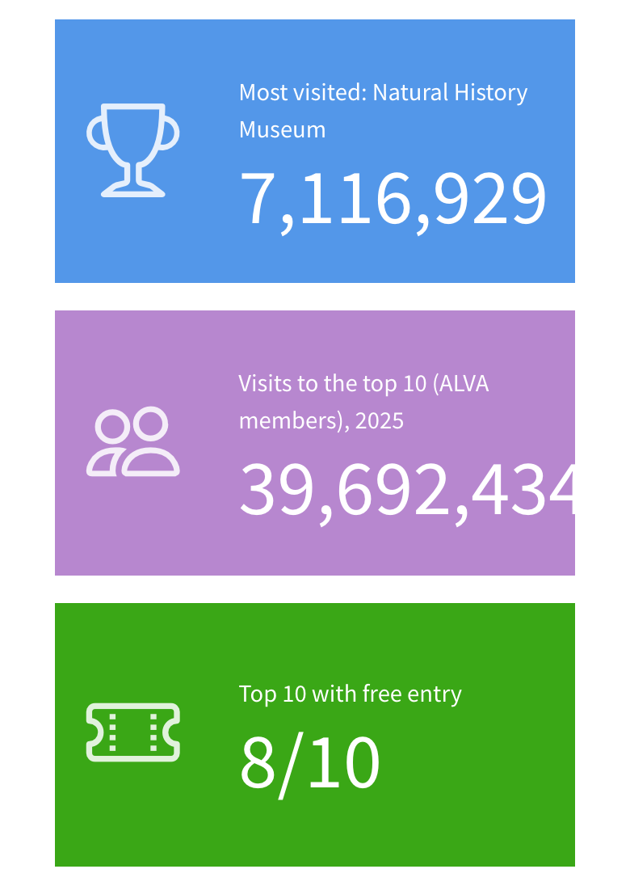
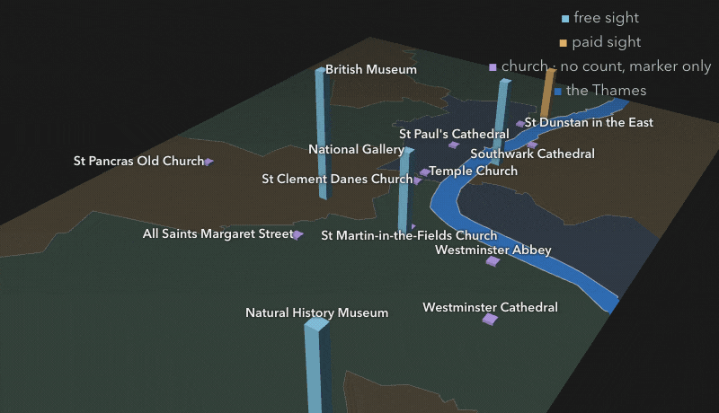
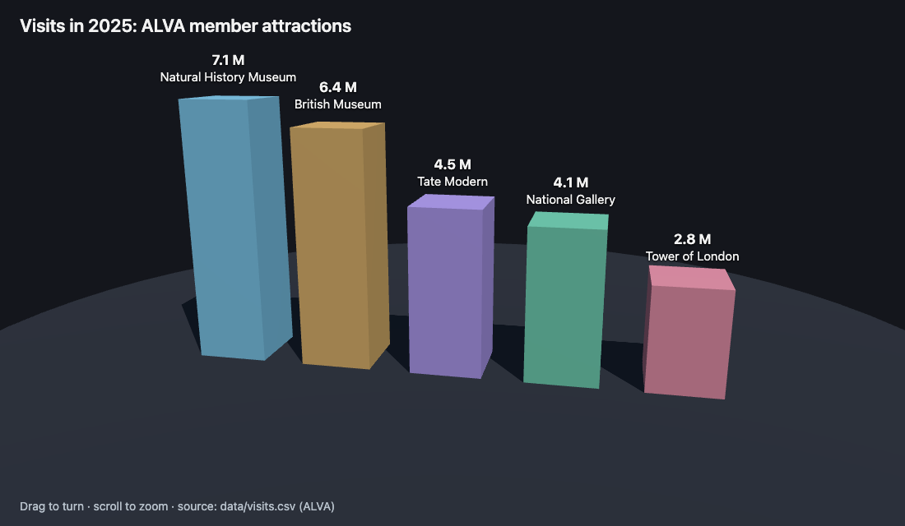

# One Guide, Five Audiences {#sec-audiences}

```{python}
#| label: ch6-setup
import pandas as pd

from scripts.scenes import london_map, scene_html
from scripts.prose import alt_text_holds, number_words, text_holds

visits = pd.read_csv("../examples/london/data/visits.csv")
churches = pd.read_csv("../examples/london/data/churches.csv")
first_year, last_year = int(visits["year"].min()), int(visits["year"].max())
n_churches = len(churches)
WORDS = number_words()


def word(n: int) -> str:
    """A count in words, as prose writes small numbers."""
    return WORDS[n] if n < len(WORDS) else f"{n:,}"

attractions = pd.read_csv("../examples/london/data/attractions.csv")
# The dashboard screenshot's caption and alt text name the most visited attraction, the ten
# attractions and the years of the line chart: stop if the data no longer match them.
alt_text_holds(len(attractions) == 10
               and attractions.loc[attractions["visits_2025"].idxmax(), "attraction"]
               .startswith("Natural History Museum")
               and (first_year, last_year) == (2015, 2025), "fig-london-dashboard")
# The payoff's and the phone dashboard's alt texts name the top attraction and the year.
alt_text_holds(last_year == 2025 and attractions.loc[attractions["visits_2025"].idxmax(),
               "attraction"].startswith("Natural History Museum"),
               "fig-london-audiences, fig-london-dashboard-phone")
# The square advert's alt text names the top attraction and says it is free to enter.
top_row = attractions.loc[attractions["visits_2025"].idxmax()]
alt_text_holds(top_row["attraction"].startswith("Natural History Museum")
               and top_row["admission"].startswith("Free"), "fig-london-social")

# The build-log story quotes the total in the phone-width capture of 2026-11-25
# (media/capture/london_outputs.py, step dashboard), whose last figure ran past the box's edge.
total_visits = f"{attractions['visits_2025'].sum():,}"
text_holds(total_visits == "39,692,434", "the clipped total in the dashboard story")

ldn = london_map()
top_sight = ldn["top"]["place"]
top_sight_m = f"{ldn['top']['visits'] / 1e6:.1f}"
paid_sights = " and the ".join(ldn["paid"]["place"])
```

A manager opens the dashboard between two meetings and gives it a few seconds. A partner
forwards the brief to a colleague without rereading it. Someone walking past the tourist
office takes a flyer, glances at it and puts it in a pocket. Three readers, three glances,
and each must come away with the same facts. Typed into each document by hand, those facts
become three copies; correct one, and the copy that is missed is the one that disagrees in
public.

A correct document that its reader does not use has failed too, so this chapter chooses each
format for how it will be met, and gives every output one test: would that reader read it,
and act on it? It writes all three in one step: a dashboard for managers, a Word brief and its
covering email for partners, and an A5 flyer for walk-ins. None needs another to exist, which
makes them the first job in this book worth splitting across several agents. The dashboard and
the brief compute their visitor numbers from the data; the flyer's price bands and stations
are copied into its text from `data/sights.csv`, a choice @sec-london-change returns to.

::: payoff
{#fig-london-audiences width=50% fig-alt="Three crops, one above another. A blue dashboard value box with a trophy: Most visited: Natural History Museum, and its 2025 visits in large figures. The partner brief's heading, Why London, over one bullet giving the 2025 visits to London's ten most visited ALVA member attractions. The top of the flyer: Visit London, Five sights for one great day."}
:::

::: opener
- Choose a format for each audience, and set it.
- Decide when sub-agents are worth their cost, and prompt them safely.
- Check each output as its reader would use it.
- Judge when a raw Typst block or a 3-D chart earns its place.

Start from
: the end of @sec-compute

You build
: a dashboard, a Word brief and its email, an A5 flyer

Checkpoint
: `checkpoints/04-london-audiences/` (there is no 03)
:::

## Content once, format per audience {#sec-content-once}

Each audience gets the format that suits it, and each format is a setting. Three of the five
audiences in @tbl-audiences are served here, a fourth optionally, and the fifth, visitors, in
@sec-publish.

| Audience | Output | Setting |
|---|---|---|
| Managers | dashboard | `dashboard` |
| Partners | Word brief and email | `docx` |
| Walk-ins | A5 flyer (PDF) | `typst`, `papersize: a5` |
| Social media | square advert | raw Typst page size |
| Visitors | website | `type: website` |

: Each audience's output and the setting that makes it. {#tbl-audiences}

**A dashboard** is a page of charts and key numbers arranged in a grid. In a `.qmd` file with
`format: dashboard`, a level-1 heading starts a page, a level-2 heading starts a row, and each
cell's output becomes a card in that row. The guide's dashboard has two pages; its outline,
without the code, is:

```markdown
# Attractions

## Row {height=25%}

::: {.valuebox icon="trophy" color="primary"}
Most visited: `{{python}} top_name`
:::

## Row

# Churches
```

`# Attractions` and `# Churches` start the two pages, and `{height=25%}` gives the first row a
quarter of the page's height. That row holds the *value boxes*, each showing one key number with
a label and an icon; the next row holds the charts, one card per cell. A value box is written
as a *div*: a block of Markdown between two lines of three colons, whose class in braces,
`.valuebox`, tells Quarto what to make of it. Quarto's other special blocks, such as callouts,
use the same syntax.

It also needs a second data file. `data/visits.csv` holds the yearly visits to the five sights
from `{python} first_year` to `{python} last_year`, from ALVA's annual tables. Two notes travel
with it, from the data's README. The years 2020 and 2021 are pandemic years, not comparable
with the others. And from 2024 the Natural History Museum's count includes its reopened
gardens, so for that museum 2024 and 2025 are not like-for-like with earlier years.
`data/churches.csv` lists the `{python} word(n_churches)` cathedrals and churches on Visit
London's own list, an editorial choice with no visitor numbers.

{#fig-london-dashboard fig-alt="A dashboard titled London attractions dashboard, with Attractions and Churches tabs. Three value boxes: the most visited attraction, the Natural History Museum, with its 2025 visits; the total visits to the ten; and how many of the ten are free to enter. Below, a horizontal bar chart of 2025 visits to London's ten most visited ALVA member attractions, and a line chart of visits per year from 2015 to 2025 for five sights, with a deep dip in 2020 and 2021."}

**A Word brief** turns Markdown headings into Word's heading styles, so the partner's copy has a
navigable outline and working links. Its covering email is not rendered at all: it is a plain
Markdown file whose message sits in a `text` block, to be copied into an email client, with the
brief attached. The email deliberately quotes no visitor numbers: they stay in the brief,
where they are computed and cited, as the project's rules require.

**A flyer** is a one-page Typst PDF on A5 paper. `papersize` accepts any of Typst's paper names
(`a5`, `a4`, `us-letter` and so on), and `margin` sets the margins.

{#fig-london-flyer width=55% .on-light fig-alt="An A5 page titled Visit London, Five sights for one great day, with the photograph of Big Ben, a table of the five sights with their price band and nearest tube station, the Tower of London marked Paid and the others Free, a tip from a local about free museums, and a link to the TfL journey planner."}

## Sub-agents: one lead, many hands {#sec-sub-agents}

The three outputs are independent, which makes them a candidate for *sub-agents*, separate
agent sessions that your agent starts for one task each (@fig-sub-agents). Each sub-agent has its own context, does its task and reports back; your
agent, the *lead*, waits for all of them and then checks the results.

{#fig-sub-agents .on-light fig-alt="Your agent, the lead, reads the prompt and starts three sub-agents at once. Each has its own context and writes only its own files: one writes london-dashboard.qmd, one london-email.qmd and london-email-message.md, one london-flyer.qmd. None of them renders. When all three report back, the lead renders the three files one at a time and checks each. Three tasks take about as long as the slowest one, and use more tokens."}

The gain is time: three independent tasks take about as long as the slowest of them. The cost
is tokens, because each sub-agent does its own reading, reasoning and tool calls. The four
agents offer sub-agents differently (@tbl-sub-agents).

| Agent | Runs sub-agents |
|---|---|
| Claude Code | in parallel, when a prompt asks |
| Codex | when asked (on by default); its documentation warns that parallel edits "can create conflicts" |
| Antigravity | in parallel, but may do the tasks itself |
| OpenCode | in the background: check that every file exists before the lead renders |

: How each agent runs sub-agents, by its documentation. {#tbl-sub-agents}

Two rules make parallel work safe, and the prompt below states both. **Each sub-agent writes
only its own files and renders nothing**, so no two of them touch the same file. **The lead
renders the files one at a time**, because two Quarto renders, or two environment updates by
`uv run`, in the same folder can collide. Sub-agents read `AGENTS.md` too, so the project's
rules still apply to their work.

::: {.story .illustration}
Two helpers are each told to build a page in the same folder. Both finish, and both render at
once. Each render writes its working files under the same names, so one fails, with a message
about a file its report never mentions. The lead, reading two confident summaries, sees only
that an output is missing. Nothing was wrong with either page: the folder was shared and the
renders were not taken in turn. Leave the rendering to the lead, one file at a time.
:::

::: practice
Use sub-agents when tasks are independent, substantial and write different files. Do not use
them for tasks where one needs another's result, for several edits to the same file, or for
small tasks where the overhead of starting and briefing a sub-agent outweighs the work. A
prompt that might run without sub-agents should say what to do then: the prompt below ends its
first sentence with "none? do the items in turn".
:::

::: think
The office also wants the guide in French and Spanish, each a new file made from
`london.qmd`. Is that a job for sub-agents?

Yes: the two translations are independent, substantial and write different files (say
`london-fr.qmd` and `london-es.qmd`), and the lead renders them one at a time. If both first
needed a shared list of place names, write that list first, then split the work.
:::

## One prompt, three audiences {#sec-audiences-do}

The prompt does three things: it says how the work is split, gives each sub-agent its own
files to write, and keeps the rendering for the lead. It comes in two messages. First, the
lead's instructions:

::: {.prompt}
```default
Run three sub-agents in parallel, one per item of my next message (none? do the items in turn). Each reads london.qmd, data/ and images/, hides code, follows AGENTS.md and only writes its own files: no rendering. Then render the three .qmd files yourself, one at a time, and check each. Wait for the items.
```
:::

Then the three items, one per box. Copy the first box and paste it into the agent, then paste
the second and the third after it, and press Enter only when all three are in: numbered 1 to 3,
they arrive as one message. If you sent one alone by mistake, send the other two together; the
lead was told to wait for the items.

::: {.prompt}
```default
1. london-dashboard.qmd (format: dashboard): Attractions page (value boxes: top attraction, total `visits_2025`, number free; Plotly bars by attraction; a Plotly line of visits by `year` from data/visits.csv; end each chart cell with `fig`, assigning `fig = fig.update_layout(…)`); Churches page (data/churches.csv, names linked to `visit_london`).
```
:::

::: {.prompt}
```default
2. london-email.qmd: docx partner brief (2025 numbers as inline code, five sights with official links, getting around, sources); london-email-message.md: its covering email in a text block, no numbers.
```
:::

::: {.prompt}
```default
3. london-flyer.qmd: one A5 Typst page (papersize: a5): Big Ben photo, five sights with price band and nearest tube, local tip.
```
:::

::: {.agent}
waits for the items · starts three sub-agents · waits · renders the three `.qmd` files one at a time
:::

::: {.you}
send the lead's message, then the three items together · approve its commands · open the four outputs
:::

<!-- Dry-run 2026-11-25, verbatim, both messages (the three items as one), in a copy of
checkpoint 02-london-qmd: a Claude Code sub-agent on Sonnet 5.5 and one on Haiku 5.5. Each
waited for the items. Neither could start sub-agents of its own, so both took the prompt's
fallback and did the items in turn; the parallel route was not exercised. Both rendered the
three files one at a time: a dashboard with three value boxes and two Plotly charts, a Word
brief whose figures match data/, and a one-page A5 flyer (Haiku's fitted on its third render).
Both counted "number free" as the admission values starting "Free". Sonnet's first dashboard
render failed because DataFrame.to_markdown needs tabulate; it wrote the table out instead.
data/ and images/ were unchanged. -->

The lead renders `london-dashboard.qmd`, `london-email.qmd`, then `london-flyer.qmd` with
`uv run quarto render`, and reports each sub-agent's progress as it goes. It checks each file
it renders; the office's checks are yours, and the first needs no output at all.

::: think
Three sub-agents have reported success. Before you open anything: what should `git status`
list, exactly?

The four source files the prompt named, `london-dashboard.qmd`, `london-email.qmd`,
`london-email-message.md` and `london-flyer.qmd`, and nothing else: no rendered file, which
`.gitignore` leaves out, and nothing in `data/`, `images/` or `london.qmd`. A fifth entry is a
sub-agent that strayed outside its own files, whatever the lead's summary says.
:::

Then open each output as its reader would: can a manager find the top attraction without
reading a sentence, can a partner forward the brief and its email as they are, and does the
flyer fit on one A5 page?

::: story
<!-- source: book/media/capture/london_outputs.py, step dashboard, and PLAN-improvement.md
section 14 (package M): the dashboard captured at a phone's width on 2026-11-25. -->
When this book captured the finished dashboard at a phone's width, on 2026-11-25, the last
figure of its total, `{python} total_visits`, ran past the value box's edge. Nothing failed:
the render passed, and the number in the source was right. Look at each output at the size its
reader uses, and if a dashboard's readers use phones, ask for big totals in a shorter form,
such as millions.
:::

{#fig-london-dashboard-phone width=50% fig-alt="Three value boxes, one above another, as a phone shows the dashboard. Blue: Most visited: Natural History Museum, with its 2025 visits. Purple: Visits to the top 10 (ALVA members), 2025, whose total runs past the box's right edge, so its last figure is partly cut off. Green: Top 10 with free entry, with how many of the ten are free."}

When all three pass, `git add .` and commit with a message that says why.

::: think
A partner asks for this year's total visits in the covering email itself. Where should the
number go, and why?

In the brief, as inline code, with the email pointing to it. The email is a plain Markdown file
that is never rendered, so a number typed there is a copy that will not follow the data.
:::

"End each chart cell with `fig`" is in the prompt because of a failure seen in practice, the
first row of @tbl-audiences-fixes.

| You see | Ask for |
|---|---|
| a Plotly chart twice in one card, from a cell that calls `fig.show()` and returns the figure | the figure assigned, and the cell ended with `fig` |
| a chart's legend clipped | a horizontal legend with a fixed `entrywidth` |
| the flyer on two pages | a smaller photo |

: Three faults to look for after the renders, and what to ask for. {#tbl-audiences-fixes}

::: tryit
Send both messages and approve the renders.

::: done
you can open a two-page dashboard, a Word brief and its email, and a one-page flyer.
:::

::: catchup
```default
Catch me up: follow ../quarto-workshop/checkpoints/04-london-audiences/README.md
```
:::
:::

## A square advert (optional) {#sec-london-social}

::: {.prompt}
```default
Create london-social.qmd: one 12 cm square Typst page (raw Typst page size) for social media: "Visit London", the Big Ben photo, the top attraction and its `visits_2025`. Hide code, follow AGENTS.md, render it, and check that the PDF is one square page.
```
:::

Typst has no square paper name, so the page size is set in a *raw* Typst block, which Quarto
passes to Typst untouched. The finished advert's photo runs to the edges, so its page has no
margin:

````markdown
```{=typst}
#set page(width: 12cm, height: 12cm, margin: 0cm,
          numbering: none, fill: rgb("#0b2545"))
#set text(fill: white)
```
````

{#fig-london-social width=70% fig-alt="A square advert. A photograph of Big Ben's clock tower fills it, the spire rising past a thin white border inset from the edges. Over the darkened lower part: Visit London in large white letters, a short gold rule, the label Top ALVA member attraction 2025, the Natural History Museum with its 2025 visit count, a gold Free to enter badge on the right, and a small credit line for the visits and the photo."}

Everything on the page is placed by raw Typst, but the facts are still computed: a Python
cell reads `attractions.csv` and prints them as Typst variables
(`#let top-name = "Natural History Museum"`), so a corrected count reaches the advert at the
next render like every other output.

<!-- Tested with Quarto 1.10.20 and its bundled Typst on 2026-11-12. -->

The finished advert has no title and no level-1 heading: either would land on a page of the
default size before the square one, with Quarto 1.10.20 and its bundled Typst. A raw block is
a useful escape hatch, and a costly one: it ties the source to one format, so use it only for
what the format's settings cannot express.

If the advert will not come out as one square page, skip it, or copy the finished
`../quarto-workshop/examples/london/london-social.qmd` into your folder: nothing later depends
on it.

## The sights in three dimensions (optional) {#sec-london-3d}

The guide's data can also be drawn as a map: the five sights as columns as tall as their
`{python} ldn['year']` visits, Visit London's `{python} word(n_churches)` churches as short markers,
and the London boroughs around the Thames (@fig-london-map). The tallest column is the `{python} top_sight`, at
`{python} top_sight_m` million visits; the only paid sight is the `{python} paid_sights`.

::: {.content-visible when-format="html:js"}
::: {#fig-london-map}
```{python}
#| output: asis
print(scene_html("relief", ldn["data"], ldn["alt"], extra=ldn["extra"], fallback=ldn["fallback"],
                 views=[("flat", "Map"), ("tilt", "Tilt: height is visits"),
                        ("focus", "Up close: the five sights")], load_bundle=True))
```

The five sights and Visit London's churches on the London boroughs. Drag to turn, scroll to zoom, and use the buttons to tilt the map and to fly to the sights. Visits: ALVA; places: Wikidata; boroughs: ONS, Open Government Licence v3.0, contains OS data © Crown copyright and database right 2024.
:::
:::

::: {.content-visible when-format="epub"}
{#fig-london-map .anim fig-alt="A 3-D map of central London that tilts and turns: the boroughs in muted tones, the Thames in blue between them, five columns at the five sights, as tall as their visits, the Natural History Museum's tallest, and ten short markers at Visit London's churches."}

::: {.live-link}
Turn the map yourself
[in the website edition](https://project-delphi.github.io/quarto-workshop/book/chapters/06-audiences.html#sec-london-3d), or scan: {.qr}
:::
:::

Every point, height and border is computed from the project's files (coordinates from
`data/places.csv`, from Wikidata, visits and price bands from `visits.csv` and `sights.csv`)
and from the Office for National Statistics' borough boundaries, clipped at the high-water
mark so the tidal Thames shows as the gap between them. A script written for the workshop's
slides, using the three.js library, only draws them; the borough tones encode no data.

### Asking for three.js

You do not need to know three.js to ask for it. Name the library, the data and what you want
to do with the result, and check the numbers:

::: {.prompt}
```default
Create visits-3d.html with `three.js` from a CDN: a labelled 3-D bar per `attraction` in data/visits.csv, as tall as its `visits` in the latest `year`, that I can drag to turn. Put the numbers in the page so it opens by double-click, then check them against the CSV.
```
:::

{#fig-threejs-visits width=60% fig-alt="A 3-D bar chart on a dark floor, drawn by three.js: 2025 visits to five ALVA member attractions. Natural History Museum 7.1 million, British Museum 6.4 million, Tate Modern 4.5 million, National Gallery 4.1 million, Tower of London 2.8 million."}

three.js is a free JavaScript library (MIT License) that draws 3-D scenes with WebGL, the
browser's built-in 3-D graphics, so the reader installs nothing. The prompt asks for the
numbers to be written into the page, because a page opened by double-click cannot read local
files, and the page loads three.js from a content delivery network (CDN), so it needs the
internet, which is why this book, like the workshop's slides, ships its own copy.

::: pitfall
A 3-D chart has to earn its third dimension. Perspective makes bars harder to compare than a plain bar chart:
the near bar looks taller than an equal bar behind it. @fig-ldn-top10 is the better chart for
comparing visits. Use 3-D when the third dimension means something, as height does on a map,
or for delight, and say which.
:::

## Summary {.unnumbered}

::: keyideas
- Each audience's format is a setting: a dashboard, a Word brief, an A5 flyer.
- Outputs whose code reads the data follow it; the flyer's copied facts do not.
- Sub-agents suit independent, substantial tasks that write different files.
- Each sub-agent writes only its own files; the lead renders one at a time.
- Open each output as its reader would: the lead's checks do not replace yours.
:::

The office now has a version of the guide for every reader but one, and all of them sit on
your computer. Visitors need a website: the next chapter publishes one, then changes one
number to test whether every reader really does get the same fact.

## Further reading {.unnumbered}

- Quarto, [Dashboards](https://quarto.org/docs/dashboards/) and
  [dashboard layout](https://quarto.org/docs/dashboards/layout.html) (checked 2026-10-31).
- Quarto, [Typst page layout](https://quarto.org/docs/output-formats/typst.html#page-layout);
  Typst, [page settings](https://typst.app/docs/reference/layout/page/) (checked 2026-11-12).
- Sub-agents in [Claude Code](https://code.claude.com/docs/en/sub-agents),
  [Codex](https://learn.chatgpt.com/docs/agent-configuration/subagents) and
  [Antigravity](https://antigravity.google/docs/subagents?tab=cli) (checked 2026-10-31), and
  [OpenCode](https://opencode.ai/docs/agents/) (checked 2026-11-20).
- [three.js](https://threejs.org/) and its examples gallery (checked 2026-11-06).
