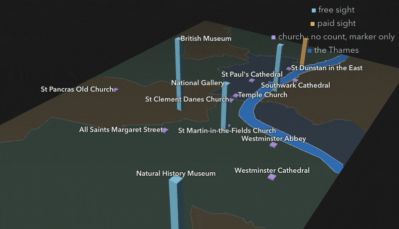
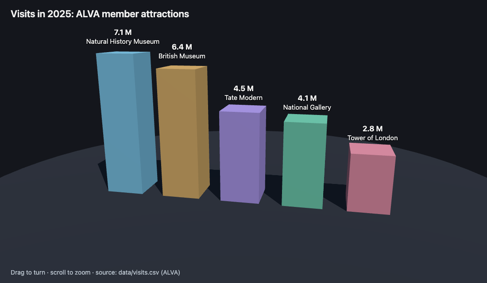

# One Guide, Five Audiences {#sec-audiences}

```{python}
#| label: ch6-setup
import pandas as pd

from scripts.scenes import london_map, scene_html

visits = pd.read_csv("../examples/london/data/visits.csv")
churches = pd.read_csv("../examples/london/data/churches.csv")
first_year, last_year = int(visits["year"].min()), int(visits["year"].max())
n_churches = len(churches)
ldn = london_map()
top_sight = ldn["top"]["place"]
top_sight_m = f"{ldn['top']['visits'] / 1e6:.1f}"
paid_sights = " and the ".join(ldn["paid"]["place"])
```

A tourism office does not have one reader. Managers want to see the numbers at a glance,
partners want a document they can forward, people walking past the office want something to
take away, and visitors want a website. Writing each of those by hand is how the same fact
ends up four ways in four places.

This chapter writes the guide once more, in three new forms at the same time: a dashboard, a
Word brief with its covering email, and a printed flyer. All three read the same data, so one
correction reaches all of them. Because the three are independent, they are also the first
task in this book worth splitting across several assistants working in parallel, and the
chapter explains when that is a good idea and when it is not. It ends with an optional look
at the same data in three dimensions.

## Content once, format per audience {#sec-content-once}

Each audience gets the format that suits it, and each format is a setting:

| Audience | Output | What makes the difference |
|---|---|---|
| Managers | a dashboard | `format: dashboard` |
| Partners | a Word brief, and the email it goes with | `format: docx` |
| Walk-ins | a one-page A5 flyer, as a PDF | `format: typst` with `papersize: a5` |
| Social media (optional) | a 12 cm square advert | a page size set in raw Typst |
| Visitors | a website | `project: type: website` (@sec-publish) |

: The guide's audiences and the setting that makes each output. {#tbl-audiences}

**A dashboard** is a page of charts and key numbers arranged in a grid. In a `.qmd` file with
`format: dashboard`, a level-1 heading starts a page, a level-2 heading starts a row, and each
cell's output becomes a card in that row (Quarto dashboards documentation, checked
2026-10-31). The guide's dashboard has two pages:

```markdown
# Attractions                           <- a page

## Row {height=25%}                     <- a row of value boxes

::: {.valuebox icon="trophy" color="primary"}
Most visited: `{{python}} top_name`
:::

## Row                                  <- a row of charts, one card per cell

# Churches                              <- the second page
```

It also needs a second data file. `data/visits.csv` holds the yearly visits to the five sights
from `{python} first_year` to `{python} last_year`, from ALVA's annual tables. Two notes travel
with it, from the data's README: 2020 and 2021 are pandemic years and not comparable with the
others, and from 2024 the Natural History Museum's count includes its reopened gardens, so
2024 and 2025 are not like-for-like with earlier years for that museum. `data/churches.csv`
lists the `{python} n_churches` cathedrals and churches on Visit London's own list, an
editorial choice with no visitor numbers.

**A Word brief** turns Markdown headings into Word's heading styles, so the partner's copy has a
navigable outline and working links. Its covering email is not rendered at all: it is a plain
Markdown file whose message sits in a `text` block, to be copied into an email client, with the
brief attached. The email deliberately quotes no visitor numbers. The numbers stay in the brief,
where they are computed and cited, as the project's rules require.

**A flyer** is a one-page Typst PDF on A5 paper. `papersize` accepts any of Typst's paper names
(`a5`, `a4`, `us-letter` and so on), and `margin` sets the margins (Quarto's Typst
documentation, checked 2026-10-30).

## Sub-agents: one lead, many hands {#sec-sub-agents}

The three outputs are independent: none needs another to exist. That makes them a candidate for
*sub-agents*, separate assistant sessions that your assistant starts for one task each
(@fig-sub-agents). Each sub-agent has its own context, does its task and reports back; your
assistant, the *lead*, waits for all of them and then checks the results.

{#fig-sub-agents .on-light fig-alt="Your assistant, the lead, reads the prompt and starts three sub-agents at once. Each has its own context and writes only its own files: one writes london-dashboard.qmd, one london-email.qmd and london-email-message.md, one london-flyer.qmd. None of them renders. When all three report back, the lead renders the three files one at a time and checks each. Three tasks take about as long as the slowest one, and use more tokens."}

The gain is time: three independent tasks take about as long as the slowest of them. The cost
is tokens, because each sub-agent does its own reading, reasoning and tool calls. The three
assistants differ in how they offer it (all checked 2026-10-31). Claude Code starts sub-agents
in parallel when a prompt asks for them; its own documentation's example is "Research the
authentication, database, and API modules in parallel using separate subagents". Codex enables
sub-agents by default and starts them when asked, and its documentation warns both that
parallel edits "can create conflicts" and that sub-agent runs use more tokens. Antigravity's
command-line agent can delegate to parallel sub-agents, but its documentation does not say a
prompt can require it, so it may do the tasks itself.

Two rules make parallel work safe, and the prompt below states both. **Each sub-agent writes
only its own files and renders nothing**, so no two of them touch the same file. **The lead
renders the files one at a time**, because two Quarto renders, or two environment updates by
`uv run`, in the same folder can collide. Sub-agents read `AGENTS.md` too, so the project's
rules still apply to their work.

::: practice
Use sub-agents when tasks are independent, substantial and write different files. Do not use
them for tasks where one needs another's result, for several edits to the same file, or for
small tasks where the overhead of starting and briefing a sub-agent outweighs the work. A
prompt that might run without sub-agents should say what to do then: the prompt below ends its
first line with "none? do the items in turn".
:::

## One prompt, three audiences {#sec-audiences-do}

::: {.prompt .long}
```default
Run three sub-agents in parallel, one per item (none? do the items in turn). Each reads london.qmd, data/ and images/, hides code, follows AGENTS.md and only writes its own files: no rendering.
1. london-dashboard.qmd (format: dashboard): Attractions page (value boxes: top attraction, total `visits_2025`, number free; Plotly bars by attraction; a Plotly line of visits by `year` from data/visits.csv; end each chart cell with `fig`, assigning `fig = fig.update_layout(…)`); Churches page (data/churches.csv, names linked to `visit_london`).
2. london-email.qmd: docx partner brief (2025 numbers as inline code, five sights with official links, getting around, sources); london-email-message.md: its covering email in a text block, no numbers.
3. london-flyer.qmd: one A5 Typst page (papersize: a5): Big Ben photo, five sights with price band and nearest tube, local tip.
Then render the three .qmd files yourself, one at a time, and check each.
```
:::

::: {.agent}
starts three sub-agents · waits · `uv run quarto render london-dashboard.qmd`, then `london-email.qmd`, then `london-flyer.qmd`
:::

::: {.you}
approve its commands · watch it report each sub-agent's progress · open the dashboard, the Word brief and its email, and the flyer
:::

The prompt is long because it is three specifications in one, each as concrete as a single
prompt would be: the files to write, the data to read, what goes on each page.

::: pitfall
"End each chart cell with `fig`" is there because of a failure seen in practice: a Plotly chart
appears twice in a dashboard card when the cell both calls `fig.show()` and returns the figure.
Assign the figure, end the cell with its name, and nothing else. If a chart's legend looks
clipped, ask for a horizontal legend with a fixed `entrywidth`; if the flyer spills onto a
second page, ask for a smaller photo.
:::

::: tryit
Paste the prompt and approve the renders.

::: done
you can open a two-page dashboard, a Word brief and its email, and a one-page flyer.
:::

::: catchup
```default
Catch me up: follow ../quarto-workshop/checkpoints/04-london-audiences/README.md
```
:::
:::

## A square advert (optional) {#sec-london-social}

::: {.prompt}
```default
Create london-social.qmd: one 12 cm square Typst page (raw Typst page size) for social media: "Visit London", the Big Ben photo, the top attraction and its `visits_2025`. Hide code, follow AGENTS.md, render it, and check that the PDF is one square page.
```
:::

Typst has no square paper name, so the page size is set in a *raw* Typst block, which Quarto
passes to Typst untouched:

````markdown
```{=typst}
#set page(width: 12cm, height: 12cm, margin: 0.9cm, numbering: none, fill: rgb("#0b2545"))
#set text(fill: white)
```
````

The finished advert has no title and no level-1 heading: either would land on a page of the
default size before the square one. This was tested with Quarto 1.10.20 and its bundled Typst
0.15 on 2026-11-01. A raw block is a useful escape hatch, and a costly one: it ties the source
to one format, so use it only for what the format's settings cannot express.

::: catchup
```default
Catch me up: follow ../quarto-workshop/examples/london/README.md
```
:::

## The sights in three dimensions (optional) {#sec-london-3d}

The guide's data can also be drawn as a map: the five sights as columns as tall as their
`{python} ldn['year']` visits, Visit London's `{python} n_churches` churches as short markers,
and the London boroughs around the Thames (@fig-london-map). Nothing in the project changes:
the scene is drawn from the same files. The tallest column is the `{python} top_sight`, at
`{python} top_sight_m` million visits; the only paid sight is the `{python} paid_sights`.

::: {.content-visible when-format="html:js"}
::: {#fig-london-map}
```{python}
#| output: asis
print(scene_html("relief", ldn["data"], ldn["alt"], extra=ldn["extra"], fallback=ldn["fallback"],
                 views=[("flat", "Map"), ("tilt", "Tilt: height is visits"),
                        ("focus", "Up close: the five sights")], load_bundle=True))
```

The five sights and Visit London's churches on the London boroughs. Drag to turn, scroll to zoom, and use the buttons to tilt the map and to fly to the sights. Visits: ALVA; places: Wikidata; boroughs: ONS, Open Government Licence v3.0, contains OS data © Crown copyright and database right 2024.
:::
:::

::: {.content-visible when-format="epub"}
{#fig-london-map .anim fig-alt="A 3-D map of central London that tilts and turns: the boroughs in muted tones, the Thames in blue between them, five columns at the five sights, as tall as their visits, the Natural History Museum's tallest, and ten short markers at Visit London's churches."}

::: {.live-link}
Turn the map yourself in the website edition, at
<https://project-delphi.github.io/quarto-workshop/book/chapters/06-audiences.html#sec-london-3d>,
or scan: {.qr}
:::
:::

Every point, height and border is computed from the project's files: coordinates from
`data/places.csv` (from Wikidata, CC0), visits from `data/visits.csv`, price bands from
`data/sights.csv`, and borough boundaries from the Office for National Statistics, clipped at
the high-water mark so the tidal Thames appears as the gap between the boroughs on its two
banks. A script written for the workshop's slides, using the three.js library, only draws them.
The borough tones tell neighbours apart and encode no data.

### Asking for three.js

You do not need to know three.js to ask for it. Name the library, the data and what you want
to do with the result, and check the numbers:

::: {.prompt}
```default
Create visits-3d.html with `three.js` from a CDN: a labelled 3-D bar per `attraction` in data/visits.csv, as tall as its `visits` in the latest `year`, that I can drag to turn. Put the numbers in the page so it opens by double-click, then check them against the CSV.
```
:::

{#fig-threejs-visits width=60% fig-alt="A 3-D bar chart on a dark floor, drawn by three.js: 2025 visits to five ALVA member attractions. Natural History Museum 7.1 million, British Museum 6.4 million, Tate Modern 4.5 million, National Gallery 4.1 million, Tower of London 2.8 million."}

three.js is a free JavaScript library (MIT License) that draws 3-D scenes with the browser's
WebGL, so the reader installs nothing. Two details of the prompt matter. It asks for the numbers
to be written into the page, because a page opened by double-click cannot read local files. And
the page loads three.js from a content delivery network (CDN), so it needs the internet to work;
a published page keeps that dependency, which is why this book, like the workshop's slides,
ships its own copy of the library.

::: pitfall
Be honest about 3-D charts. Perspective makes bars harder to compare than a plain bar chart:
the near bar looks taller than an equal bar behind it. @fig-ldn-top10 is the better chart for
comparing visits. Use 3-D when the third dimension means something, as height does on a map,
or for delight, and say which.
:::

## Summary {.unnumbered}

One source of data can feed every audience, each in its own format: a dashboard
(`format: dashboard`, where headings become pages and rows), a Word brief with a plain-text
covering email that quotes no numbers, an A5 Typst flyer, and an optional square advert made
with a raw Typst page size. Independent, substantial tasks that write different files can run as
parallel sub-agents, which saves time at the cost of tokens, provided each writes only its own
files and the lead renders one file at a time. Ask for unfamiliar tools, such as three.js, by
naming the library, the data and the check, and choose 3-D only when the third dimension means
something.

## Further reading {.unnumbered}

- Quarto, [Dashboards](https://quarto.org/docs/dashboards/) and
  [dashboard layout](https://quarto.org/docs/dashboards/layout.html) (checked 2026-10-31).
- Quarto, [Typst page layout](https://quarto.org/docs/output-formats/typst.html#page-layout);
  Typst, [page settings](https://typst.app/docs/reference/layout/page/) (checked 2026-11-12).
- Sub-agents in [Claude Code](https://code.claude.com/docs/en/sub-agents),
  [Codex](https://learn.chatgpt.com/docs/agent-configuration/subagents) and
  [Antigravity](https://antigravity.google/docs/subagents?tab=cli) (checked 2026-10-31).
- [three.js](https://threejs.org/) and its examples gallery (checked 2026-11-06).
