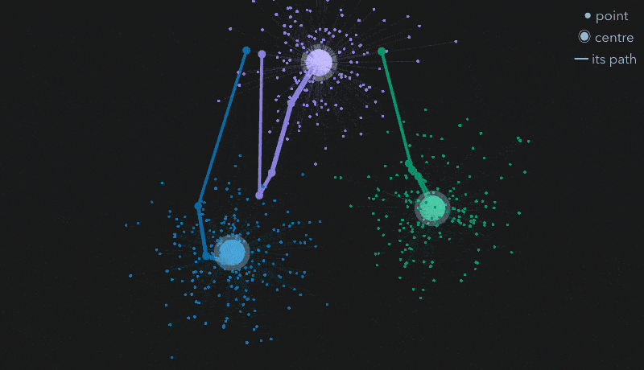
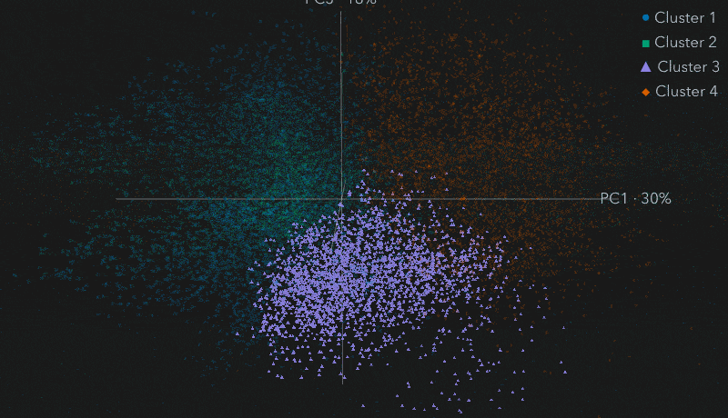
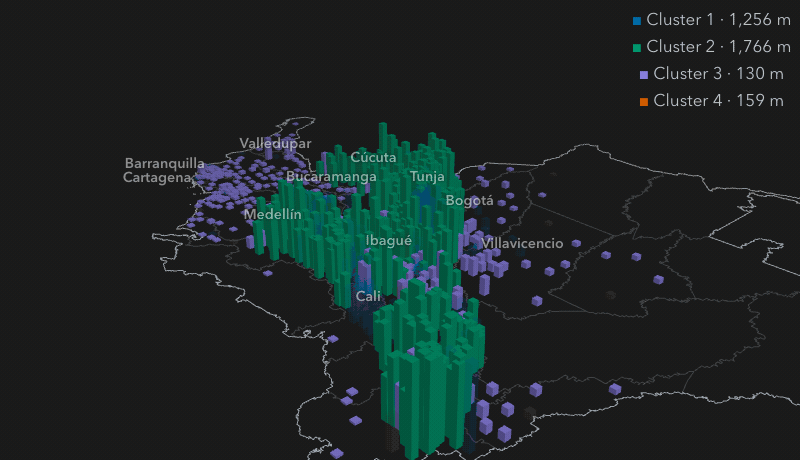

# Finding Kinds of Places: k-Means {#sec-cluster}

```{python}
#| label: ch11-setup
import matplotlib.pyplot as plt
import numpy as np

from scripts import scenes as sc
from scripts import water as w
from scripts.figures import ACCENT, INK, MUTED, style

A = w.A
res = w.res()
s = res["summary"]
k = res["k"]
ktab = res["k_table"].set_index("k")
clusters = res["clusters"]
colors = w.colors()
km = sc.kmeans_toy(A.CLUSTER_COLORS)
cl = sc.cloud(res, A)
rl = sc.relief(res, w.raw(), A)
next_drop = ktab["inertia_drop"].get(k + 1, 0.0)
ORDINAL = dict(enumerate(["first", "second", "third", "fourth", "fifth", "sixth", "seventh",
                          "eighth", "ninth", "tenth"], start=1))


def alt_text_holds(ok: bool, figure: str) -> None:
    """Alt texts are static cell options, so they cannot quote computed values. Stop the
    render when the data no longer match what one says, so that it is rewritten."""
    if not ok:
        raise ValueError(f"the alt text of {figure} no longer matches the data: rewrite it")
```

The water data now have `{python} w.fmt(s["kept"])` prepared rows, each described by nine z-scores.
Nobody can read that many rows. The point of clustering is to turn them into a few *kinds* that
a person can name, compare and act on: these municipal zones are like each other, and unlike those.

This chapter explains k-means, the algorithm the analysis uses, by watching it work on toy data; then
how the number of kinds was chosen and how confident to be in it; then two ways to look at the result,
one statistical and one geographical. It ends with the two routes the workshop offers through the
modelling: use the finished model, or build it.

## k-means in four steps {#sec-kmeans-steps}

k-means needs one number up front: $k$, how many clusters to find. It then repeats two moves:

1. **Drop** $k$ centres at random points.
2. **Assign** every point to its nearest centre.
3. **Move** each centre to the mean of the points assigned to it.
4. **Repeat** 2 and 3 until nothing changes.

Each repetition can only lower the *inertia*, the sum of squared distances from each point to its
centre,

$$\text{inertia} = \sum_{i} \lVert x_i - c_{\ell(i)} \rVert^2 ,$$

where $c_{\ell(i)}$ is the centre point $i$ is assigned to. So the algorithm always stops. It does not
always stop at the best answer: a bad start can trap it in a worse grouping. @fig-kmeans-steps shows
the algorithm on `{python} len(km["toy"])` synthetic points in three groups, which are toy data made up
for the illustration, not the water data.

::: {.content-visible when-format="html:js"}
::: {#fig-kmeans-steps}
```{python}
#| output: asis
print(sc.scene_html("kmeans", km["data"], km["alt"], extra=km["extra"],
                    fallback="The four steps are listed above.", height="520px", load_bundle=True))
```

[`{python} km["first_note"]`]{.k-readout}

k-means on synthetic toy points. The numbered buttons step through the algorithm and "fix" stops the autoplay; "start 1" to "start 3" pick one of three random starts, of which two reach the best grouping and one gets stuck. Drag to turn.
:::
:::

::: {.content-visible when-format="epub"}
{#fig-kmeans-steps .anim fig-alt="A turning cloud of toy points in three groups. Three centres drop in at random, each point takes the colour of its nearest centre, the centres move to the mean of their points leaving trails, and the steps repeat until the colours stop changing."}

::: {.live-link}
Step through it yourself, and try the start that gets stuck, in the website edition:
<https://project-delphi.github.io/quarto-workshop/book/chapters/11-cluster.html#sec-kmeans-steps>,
or scan: {.qr}
:::
:::

```{python}
#| label: fig-kmeans-panels
#| fig-cap: "The same algorithm on the toy points, flattened to two of their three dimensions: the random start, the first assignment, an assignment halfway, and the stable result."
#| fig-alt: "Four small scatter plots of the toy points. In the first, all points are grey and three centres sit at random points. In the second, points are coloured by their nearest centre and the colours split the groups badly. In the third the centres have moved towards the three groups. In the fourth each group has its own colour with its centre in the middle."
#| classes: on-light
run = km["runs"][0]
assigns = [i for i, st in enumerate(run) if st[1] is not None]
picks = [0, assigns[0], assigns[len(assigns) // 2], len(run) - 1]
titles = ["1. random start", "2. first assignment", "halfway", "4. stable"]
toy = km["toy"]
with style():
    fig, axes = plt.subplots(1, 4, figsize=(7.2, 2.1), sharex=True, sharey=True)
    for ax, i, t in zip(axes, picks, titles):
        c, lab, _ = run[i]
        if lab is None:
            ax.scatter(toy[:, 0], toy[:, 1], s=3, color="#b8c2cc")
        else:
            ax.scatter(toy[:, 0], toy[:, 1], s=3, c=[A.CLUSTER_COLORS[j] for j in lab])
        ax.scatter(c[:, 0], c[:, 1], s=60, marker="X", color=INK, edgecolors="white", linewidths=1)
        ax.set_title(t, fontsize=9)
        ax.set_xticks([]); ax.set_yticks([])
    fig.tight_layout()
    plt.show()
```

Different starts can end in different groupings, so the real analysis runs k-means from
`{python} A.N_INIT` starts (scikit-learn's `n_init`) and keeps the one with the lowest inertia. Its starts
are not dropped at random, as in the toy: scikit-learn's default, *k-means++*, chooses the starting
centres one at a time, each with a probability that grows with its distance from the centres already
chosen, which spreads them out and makes a stuck start less likely. A fixed random seed makes the result the same on every render.

::: why
Why cluster at all? A table of thousands of rows becomes a few kinds a person can read and name. Kinds
can be compared and targeted: which places need which help. Clustering needs no labels, so it is a
first look at data nobody has categorised. And odd clusters point to data errors or special cases. What
it cannot do is explain: clusters describe, they do not show causes.
:::

## Choosing k {#sec-choose-k}

k is a *hyperparameter*: a choice made before fitting, not a result of it. The analysis fits k-means for
k from `{python} min(A.K_RANGE)` to `{python} max(A.K_RANGE)` and reads two measures (@fig-k-selection). Inertia always falls as k grows, so the
question is where it stops falling much, the *elbow*. The *silhouette* scores, from −1 to 1, how much
closer each point is to its own cluster than to the next one, on a fixed sample of `{python} w.fmt(A.SILHOUETTE_N)` rows.

```{python}
#| label: fig-k-selection
#| fig-cap: "Choosing k: inertia (left) and silhouette (right) for k = 2 to 8, fitted on all kept rows. The chosen k is marked."
#| fig-alt: "Two line charts over k from 2 to 8. Inertia falls steadily, steeply at first and more gently after k equals 4. The silhouette is highest at k equals 2, then flat near 0.19 to 0.20 from k equals 3 to 7, and lower at 8. The chosen k, 4, is marked on both."
#| classes: on-light
sil = ktab["silhouette"]
alt_text_holds(k == 4 and list(ktab.index) == list(range(2, 9)) and sil.idxmax() == 2
               and sil.loc[3:7].round(2).between(0.19, 0.20).all() and sil.loc[8] < sil.loc[3:7].min(),
               "fig-k-selection")
with style():
    fig, (a1, a2) = plt.subplots(1, 2, figsize=(7.0, 2.7))
    a1.plot(ktab.index, ktab["inertia"] / 1000, marker="o", color=ACCENT)
    a1.set_ylabel("Inertia (thousands)")
    a2.plot(ktab.index, ktab["silhouette"], marker="o", color=ACCENT)
    a2.set_ylabel("Silhouette")
    for a, col, scale in ((a1, "inertia", 1000), (a2, "silhouette", 1)):
        a.scatter([k], [ktab.loc[k, col] / scale], s=120, facecolors="none", edgecolors=INK, linewidths=2)
        a.set_xlabel("k")
        a.set_xticks(ktab.index)
    fig.tight_layout()
    plt.show()
```

The rule, written into `choose_k()` in the analysis script before looking at the answer, has three parts:

- **k = 2 is excluded.** Two clusters mostly split urban from rural rows (their adjusted Rand index with
  the zone is `{python} f"{ktab.loc[2, 'ari_vs_zone']:.2f}"`, where 1 would mean identical), which we
  knew already.
- **The elbow:** take the smallest k from 3 up after which one more cluster cuts inertia by less than
  `{python} f"{A.ELBOW_DROP:.0%}"`. Here that is k = `{python} k`: a `{python} ORDINAL[k + 1]` cluster cuts
  inertia by only `{python} f"{next_drop:.0%}"`.
- **The silhouette check:** k's silhouette must be within `{python} A.SILHOUETTE_TOL` of the best for k ≥ 3. At k = `{python} k`
  it is `{python} f"{ktab.loc[k, 'silhouette']:.3f}"`.

Two more checks follow the fit. **Stability**: refitting with `{python} len(A.STABILITY_SEEDS)` other
seeds gives the same clusters, with an adjusted Rand index of at least `{python} A.floor_to(s["ari_min"])`.
**Ordering**: clusters are numbered by their centre's IRCA, from lowest to highest, so a re-run keeps the
same numbers and colours.

::: pitfall
A silhouette near 0.2 is weak. The kinds overlap: they summarise a continuum rather than separate
islands of data, which is normal for social data. So treat k as a judgement call, and do not force a
number of clusters to make a nicer story. Writing the rule down before seeing the result, as
`choose_k()` does, is what keeps the choice honest.
:::

## A picture of the clusters {#sec-water-pca}

Nine dimensions cannot be drawn. *Principal component analysis* (PCA) finds the directions in which the
data vary most and projects the rows onto them. @fig-wat-pca uses the first two, which keep
`{python} f"{s['pca_variance_pc1']:.0%}"` and `{python} f"{s['pca_variance_pc2']:.0%}"` of the variance.

```{python}
#| label: fig-wat-pca
#| fig-cap: "Each dot is a zone-year on the first two principal components of the nine z-scored features, coloured and shaped by cluster. PCA is only for the picture: k-means used all nine features."
#| fig-alt: "Scatter plot of about eleven thousand dots in four coloured groups that overlap at their edges. Cluster 4 spreads to one side, clusters 1 and 2 to others, and cluster 3 sits in the middle, drawn on top."
#| classes: on-light
alt_text_holds(k == 4 and round(s["kept"], -3) == 11_000, "fig-wat-pca")
with style():
    fig, ax = plt.subplots(figsize=(6.6, 4.0))
    centres = clusters.groupby("cluster")[["pc1", "pc2"]].mean()
    order = (centres ** 2).sum(axis=1).sort_values(ascending=False).index
    handles = {}
    for c in order:
        g = clusters[clusters["cluster"] == c]
        handles[c] = ax.scatter(g["pc1"], g["pc2"], s=4, color=colors[c], alpha=0.55,
                                marker=A.CLUSTER_MARKERS[c - 1], rasterized=True, linewidths=0)
    ax.set_xlabel(f"PC1 ({s['pca_variance_pc1']:.0%} of variance)")
    ax.set_ylabel(f"PC2 ({s['pca_variance_pc2']:.0%} of variance)")
    leg = ax.legend([handles[c] for c in sorted(handles)], [f"Cluster {c}" for c in sorted(handles)],
                    markerscale=4, loc="upper left", bbox_to_anchor=(1.0, 1.0), fontsize=9)
    for h in leg.legend_handles:
        h.set_alpha(1)
    fig.tight_layout()
    plt.show()
```

Overlaps in the picture can be separations in the dimensions it leaves out. Adding a third component,
which keeps another `{python} f"{cl['var3'][2]:.0%}"` of the variance, shows how much (@fig-cloud-3d). On
two components, `{python} f"{cl['same2'].mean():.0%}"` of each zone-year's 15 nearest neighbours are in
its own cluster; on three, `{python} f"{cl['same3'].mean():.0%}"`. Cluster `{python} cl["focus"]`, the most
mixed in two dimensions, `{python} cl["side"]` along the third, which is mostly
`{python} cl["pc3_text"]`.

::: {.content-visible when-format="html:js"}
::: {#fig-cloud-3d}
```{python}
#| output: asis
print(sc.scene_html("cloud", cl["data"], cl["alt"], extra=cl["extra"],
                    fallback="The 2-D picture is the figure above.", height="500px",
                    views=[("flat", "Face on: the 2-D picture"), ("turn", "Turn: PC3 comes forward"),
                           ("pc3", "PC3 upright")]))
```

The zone-years on the first three principal components, coloured and shaped by cluster. Face on, the cloud is the 2-D picture. Drag to turn and scroll to zoom.
:::
:::

::: {.content-visible when-format="epub"}
{#fig-cloud-3d .anim fig-alt="A dense cloud of points in four colours, seen face on as in the 2-D picture, then turning so a third axis comes forward, and finally standing that axis upright, where one cluster separates from the others."}

::: {.live-link}
Turn the cloud yourself in the website edition:
<https://project-delphi.github.io/quarto-workshop/book/chapters/11-cluster.html#fig-cloud-3d>,
or scan: {.qr}
:::
:::

## Where the clusters stand {#sec-relief}

The third component suggested altitude. A map shows it directly (@fig-relief): one column for each of
the `{python} rl["n"]` clustered urban zones in `{python} rl["year"]`, at its municipality's centroid, as
tall as its head town's altitude (one derived SRTM point, exaggerated `{python} rl["exag"]` times) and
coloured by cluster.

::: {.content-visible when-format="html:js"}
::: {#fig-relief}
```{python}
#| output: asis
print(sc.scene_html("relief", rl["data"], rl["alt"], extra=rl["extra"], fallback=rl["fallback"],
                    height="520px", views=[("flat", "Map"), ("tilt", "Tilt: height is altitude"),
                                           ("focus", "Into the highlands")]))
```

Clustered urban zones as columns at their head towns' altitude, coloured by cluster. Labels name the ten most populous department capitals and Tunja. Drag to turn and scroll to zoom.
:::
:::

::: {.content-visible when-format="epub"}
{#fig-relief .anim fig-alt="A map of mainland Colombia seen from above, with coloured columns at municipal centroids, tilting so the columns rise to their head towns' altitude: the tallest columns run along the Andes in the centre and west, the shortest along the Caribbean coast and in the east, and the view then flies into the highlands."}

::: {.live-link}
Explore the map in the website edition:
<https://project-delphi.github.io/quarto-workshop/book/chapters/11-cluster.html#sec-relief>,
or scan: {.qr}
:::
:::

Cluster `{python} rl["high"]`'s urban zones stand highest, with a median altitude of
`{python} f"{rl['alt_med'][rl['high']]:,.0f}"` m, and `{python} f"{rl['region_top'][rl['high']].iloc[0]:.0%}"`
of them are in the DNP region `{python} rl["region_top"][rl["high"]].index[0]`. Cluster
`{python} rl["low"]`'s stand lowest, at `{python} f"{rl['alt_med'][rl['low']]:,.0f}"` m, and
`{python} f"{rl['region_top'][rl['low']].iloc[0]:.0%}"` of them are in `{python} rl["region_top"][rl["low"]].index[0]`.
This shows where the kinds are, not why they differ. Tunja's head town stands at
`{python} f"{rl['tunja_alt']:,.0f}"` m.

## Use the model, or build it {#sec-routes}

From here, the workshop offers two routes through the analysis, and both end with the same `outputs/`
and the same pages:

- **Use it** (the normal route): copy each block's finished `analysis.py` from its checkpoint, run it,
  and spend the time on the pages and publications.
- **Build it** (a challenge): prompt the assistant to write each step of the analysis yourself.

This is a book about publishing, so using the finished model is the normal route, not a fallback:

::: {.prompt}
```default
Copy ../quarto-workshop/checkpoints/07-water-cluster/scripts/analysis.py over scripts/analysis.py (keep mine as scripts/analysis-before-07.py), run it with `uv run python scripts/analysis.py`, and tell me k.
```
:::

::: {.agent}
copies the script, keeping yours · `uv run python scripts/analysis.py` · reports k = `{python} k`
:::

To build it instead (optional):

::: {.prompt}
```default
In scripts/analysis.py, run k-means on the z_ features for k=2–8 (random_state=42, n_init=20); save inertia and silhouette to outputs/k_selection.csv; pick k by the elbow, check silhouette and 5-seed ARI; number clusters by centroid IRCA; save outputs/clusters.parquet (prepared columns + `cluster`, pc1, pc2). Run it; explain k.
```
:::

::: practice
If you build it, your k may differ from `{python} k` when your preparation differs, and that is fine if
the reason is sound. What matters is that the rule for choosing k is written down before you see the
answer, and that the clusters are numbered by a fixed rule (here, centre IRCA), so a re-run keeps the
same numbers and colours.
:::

## The clusters page {#sec-cluster-page}

Both routes then build the project's second page, which only reads `outputs/` and never refits:

::: {.prompt}
```default
Create clusters.qmd that reads outputs/k_selection.csv and outputs/clusters.parquet and shows an elbow plot, silhouette by k and a PCA scatter (pc1, pc2) coloured by cluster, each with a caption and alt text. Render it and tell me about errors.
```
:::

::: {.agent}
writes `clusters.qmd` · `uv run quarto render clusters.qmd`
:::

::: {.you}
open `clusters.html` in your browser
:::

::: tryit
Take one route through the model, then build the clusters page.

::: done
`outputs/clusters.parquet` exists, you can say what k is and why, and `clusters.html` shows the elbow,
the silhouette and the PCA picture.
:::

::: catchup
```default
Catch me up: follow ../quarto-workshop/checkpoints/07-water-cluster/README.md
```
:::
:::

## Summary {.unnumbered}

k-means repeats two moves, assign each point to its nearest centre and move each centre to its points'
mean, until nothing changes; it always lowers inertia but can stall in a worse grouping, so the analysis
uses `{python} A.N_INIT` starts and a fixed seed. k is chosen by a rule written down in advance: k = 2 is excluded as the
urban-rural split, the elbow picks k = `{python} k`, and the silhouette, `{python} f"{ktab.loc[k, 'silhouette']:.2f}"`, says the kinds
overlap. Refits with other seeds agree. PCA gives a picture, not the model; a third component and a
relief map show that altitude separates the kinds geographically. Using the finished model is a
legitimate route: the lesson of this part is how one result feeds every publication.

## Further reading {.unnumbered}

- scikit-learn, [Clustering: k-means](https://scikit-learn.org/stable/modules/clustering.html#k-means)
  and [silhouette analysis](https://scikit-learn.org/stable/auto_examples/cluster/plot_kmeans_silhouette_analysis.html)
  (checked 2026-11-12).
- scikit-learn, [Principal component analysis](https://scikit-learn.org/stable/modules/decomposition.html#pca)
  (checked 2026-11-12).
- Graduate ML, [*But What is K-Means?*](https://youtube.com/shorts/H1kB2FAjePw), a one-minute video
  (checked 2026-11-03).
- `examples/water/references.bib` in the workshop repository: the k-means, silhouette and adjusted Rand
  index papers the finished white paper cites, checked against their publishers' pages.
