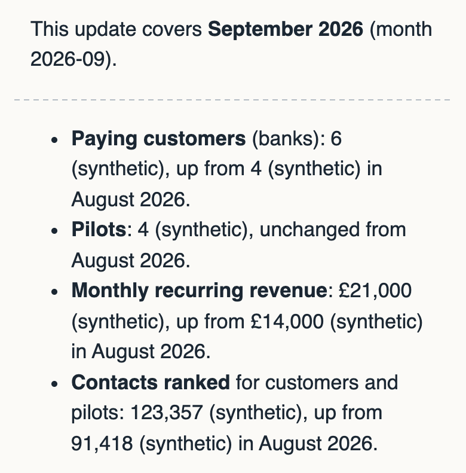
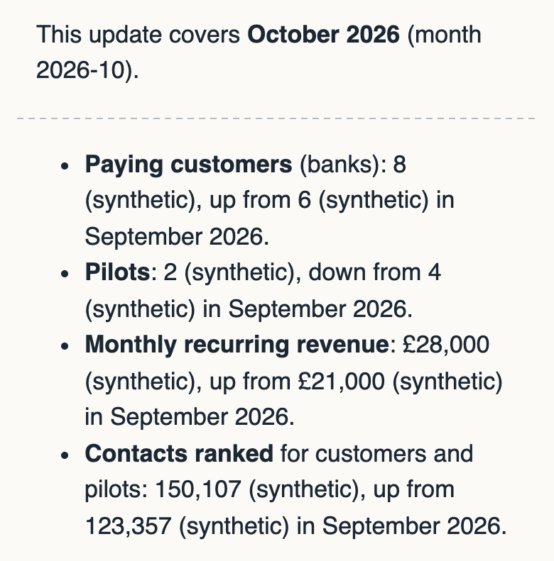

# Reports That Run Themselves {#sec-parameters}

```{python}
#| label: params-setup
# The parameterised documents as this chapter leaves them (checkpoint 19, and the feedback
# example), read from their files: their parameters and defaults, and the values a run renders.
import csv
import re

from scripts import evaluation as ev
from scripts.prose import alt_text_holds, number_words, text_holds

ROOT = ev.PROJECT.parents[1]
CHECKPOINT = ROOT / "checkpoints" / "19-eval-params"
FEEDBACK = ROOT / "examples" / "feedback"
WORD = number_words()


def parameters(path) -> dict:
    """The defaults in a document's cell tagged `parameters`."""
    text = path.read_text()
    cell = re.search(r"```\{python\}\n#\| tags: \[parameters\]\n(.*?)```", text, re.S).group(1)
    return dict(re.findall(r'^(\w+)\s*=\s*"([^"]*)"', cell, re.M))


update, segment, sheet = (parameters(CHECKPOINT / "update.qmd"), parameters(CHECKPOINT / "segment.qmd"),
                          parameters(FEEDBACK / "feedback.qmd"))
with open(CHECKPOINT / "data" / "synthetic_business.csv", newline="") as f:
    months = [row["month"] for row in csv.DictReader(f)]
with open(FEEDBACK / "data" / "gradebook.csv", newline="") as f:
    sections = sorted({row["section"] for row in csv.DictReader(f)})
bands = sorted(set(ev.segments().query("factor == 'age_band'")["segment"]))
n_files = 3 * (len(months) + len(bands))
text_holds(update.get("month") == "latest", "update.qmd's default month, \"latest\"")
MIN_STUDENTS = int(re.search(r"^MIN_STUDENTS = (\d+)", (FEEDBACK / "feedback.qmd").read_text(), re.M).group(1))
FEW = int(re.search(r"^FEW_SUBSCRIBERS = (\d+)", (CHECKPOINT / "src" / "acme_eval" / "params.py").read_text(), re.M).group(1))
# The months the prompts and the text type: one in the data, one outside it.
text_holds("2026-06" in months and "2027-01" not in months, "the months 2026-06 and 2027-01")

# The update as rendered for the last two months, by media/capture/eval_outputs.py (step
# update), which saved the pictures and each month's sentences: if stale, rerun it.
import difflib
import json
from pathlib import Path

captured = json.loads((Path(ev.__file__).resolve().parents[1] / "media" / "figures"
                       / "eval-update-sentences.json").read_text(encoding="utf-8"))
first_month, last_month = captured["months"]
text_holds([first_month, last_month] == months[-2:], "the update's two months, the data's last two")
A, B = (captured["sentences"][m] for m in (first_month, last_month))
FIGURES = ("Paying customers", "Pilots", "Monthly recurring revenue", "Contacts ranked")
alt_text_holds(all(sum(s.startswith(f) and "(synthetic)" in s and " from " in s for s in month) == 1
                   for f in FIGURES for month in (A, B)), "fig-params-update-a and -b")
MONTH_NAMES = "January|February|March|April|May|June|July|August|September|October|November|December"


def wording(s: str) -> str:
    """A sentence without its months and numbers: what is left is its wording."""
    return re.sub(r"\d[\d,.-]*", "#", re.sub(rf"\b({MONTH_NAMES}) \d{{4}}", "M", s))


# Pair the two months' sentences by their wording: the same words (identical, or only their
# figures and months differ), changed words, or a sentence in one month only.
same, refigured, reworded, only_first = [], [], [], []
for op, i1, i2, j1, j2 in difflib.SequenceMatcher(None, [wording(s) for s in A],
                                                  [wording(s) for s in B]).get_opcodes():
    if op == "equal":
        for x, y in zip(A[i1:i2], B[j1:j2]):
            (same if x == y else refigured).append(x)
    elif op == "replace" and i2 - i1 == j2 - j1:
        reworded += list(zip(A[i1:i2], B[j1:j2]))
    elif op == "delete":
        only_first += A[i1:i2]
    else:
        raise ValueError("the update's two months no longer pair as the think box says: rewrite it")
text_holds(len(reworded) == 1 and same and refigured and len(only_first) == 2
           and any("new this month" in s for s in only_first)
           and any("invented for teaching" in s for s in same)
           and any(s.startswith("The model’s figures are real") for s in same),
           "the think box on the update's two months")
customers = next(s for s in B if s.startswith("Paying customers"))
# Every prompt in this chapter was dry-run, verbatim, by Claude Code (Opus 5.5), in copies of
# checkpoint 18 and of the feedback example's data, on 2026-11-18; the traps in
# @tbl-params-traps are the ones those runs, and the build of the finished documents, met.
# On 2026-11-25 (D3) the update prompt was split into two turns; the lead dry-runs them.
```

Much of what an organisation publishes is the same document with different numbers: the
monthly update for investors, one report per customer, region or team. Built by hand, each
copy starts as last month's file, and each is a chance to leave one of last month's figures in
it. Built from one source with a parameter, a value given when the document is rendered, each
copy is the same tested document run on a different value, and a script can make every one of
them and check it.

::: {.story .illustration}
A founder writes this month's update the usual way: open last month's, save it under a new
name, change the figures. Revenue, changed. Customers, changed. The sentence in the third
paragraph that says the month was the best so far is not a figure, so it is not changed.
It goes to every investor. Nobody lied, and nothing in the file was able to object.
:::

This chapter makes Acme's monthly update and a report per customer segment. The update's
business figures are synthetic, and say so on every number; the model's figures beside them
are the real evaluation's.

::: opener
- Explain what a parameter is, where its default lives, and how a value is passed at render
  time.
- Ask for a parameterised document that validates its value and chooses its value-dependent
  words by code, with guards.
- Render one document for every value with a script that names and checks each output.
- Say where the outputs of a parameterised document land in a website project, and why.

Start from
: your `acme-eval` repository at the end of @sec-white-papers, or
  `checkpoints/18-eval-whitepaper/`; for the teachers' section, `examples/feedback/` without
  its `feedback.qmd`.

You build
: `update.qmd`, `segment.qmd` and a script that renders every month and segment; a feedback
  sheet for every section.

Checkpoint
: `checkpoints/19-eval-params/`, and `examples/feedback/`
:::

::: payoff
{#fig-params-update-a width=85% fig-alt="The top of a web page at a phone's width: the sentence saying which month the update covers; then, after a dashed line marking a cut, its four business figures, paying customers, pilots, monthly recurring revenue and contacts ranked, each marked (synthetic) and set against the month before."}

{#fig-params-update-b width=85% fig-alt="The same part of the update for the following month: the month it covers, then the same four business figures, each marked (synthetic) and set against the month before."}
:::

## One document, many values {#sec-params-vocab}

A *parameter* is a value a document is given when it is rendered. Its default lives in the
document, in a cell tagged `parameters`: the finished update's `month` defaults to
"`{python} update["month"]`", which it reads as the last month in its data, so its default
never goes stale. The segment report defaults to `{python} segment["factor"]`
`{python} segment["segment"]`, and the feedback sheet to section `{python} sheet["section"]`.

`quarto render update.qmd -P month:2026-06` replaces the default for one render: Quarto adds
a cell after the parameters cell that sets the new value, and the document runs as before.
That cell is executed through *papermill*, a Python package the project must have: without
it, a render with `-P` stops with "The papermill package is required for processing
--execute-params".

| Ask for | Quarto calls it |
|---|---|
| a value set at render time, with a default | a cell tagged `parameters`: `#| tags: [parameters]` |
| this value, now | `quarto render update.qmd -P month:2026-06` |
| many values from a file | `--execute-params params.yml` |
| an output named by its value | `-M output-file:update-2026-06` |

: Parameters, and what each is called (Quarto 1.10.20, Jupyter engine). {#tbl-params-vocab}

Two rules make a parameterised document safe:

::: cards
Validate the value
: A month or a segment that is not in the data stops the render with a message listing the
  valid ones, rather than producing a report about nothing.

Let code choose the words
: "Up" or "down", "above" or "below", "the first month, so no change": chosen by code from the
  numbers as printed, a word cannot disagree with them. Guard what code cannot choose, such as
  a typed caption.
:::

A guard that repeats the comparison that chose the word can never fail, and protects nothing.
The finished update's guard checks the printed figures instead. A document rendered for a
dozen values is a dozen chances for a typed word to be wrong.

## The investor update {#sec-params-update}

The update comes in two turns: first the document and its parameter, then the sentence that
compares one month with the month before, whose wording code must choose.

::: {.prompt .long}
```default
Run `uv add papermill`, then create update.qmd, a monthly investor update parameterised by `month` (a cell tagged `parameters` whose default is "latest", meaning the last month in data/synthetic_business.csv): that month's business figures, each labelled synthetic, and the release live that month with its real model metrics from outputs/. Stop with a clear message if the month is not in the data. Formats html, docx and typst; render it with `-P month:2026-06` and tell me where the files went.
```
:::

::: {.agent}
`uv add papermill` · writes `update.qmd` · `uv run quarto render update.qmd -P month:2026-06`
:::

::: {.prompt}
```default
In update.qmd, add the change from the month before, its wording chosen by code from the printed numbers and guarded; the first month says there is no earlier one. Render 2026-06 and the first month in the data, and show me both sentences.
```
:::

::: {.agent}
edits `update.qmd` · renders it twice, with `-P month:…`
:::

<!-- Dry-run 2026-11-25, both turns verbatim, in a copy of checkpoint 18-eval-whitepaper with
outputs/ computed: a Claude Code sub-agent on Sonnet 5.5 and one on Haiku 5.5. Both added
papermill with uv, wrote update.qmd with a parameters cell, stopped on a month not in the data,
and rendered 2026-06 to the project's root (the update is not in the site's render list). In
the second turn both compared monthly recurring revenue, chose rose, fell or unchanged by code
with a claim guard, and printed the no earlier month sentence for 2026-01. -->

Check it as an investor would, and as an auditor would. Every business figure says it is
synthetic, here; in your own update, every figure names its source. The model's figures come
from `outputs/` and are the real evaluation's. A month before the first release says so, rather
than inventing a model figure. And a month that is not in the data stops the render: try
`-P month:2027-01`.

::: think
The finished update was rendered for its last two months, `{python} first_month` and
`{python} last_month`, from one source. Between the two, which sentences should differ: the
figures, the change from the month before, the release that was live? Which must not?

`{python} WORD[len(refigured)].capitalize()` differ only in their figures and months. One
changes its words: "`{python} reworded[0][0].rstrip(".")`" becomes
"`{python} reworded[0][1].rstrip(".")`". `{python} WORD[len(only_first)].capitalize()` appear
only in `{python} first_month`, when its release was new. `{python} WORD[len(same)].capitalize()`
are word for word the same, the synthetic label and the method note among them: if those
differed, a parameter would have leaked into text it should not reach.
:::

Here is the mechanism, in the finished update. Its parameters cell:

```{python}
#| label: params-mechanism
#| output: asis
# The finished update's own lines, printed from checkpoint 19's update.qmd (never retyped): its
# parameters cell, and the lines of change() that choose "up" or "down" and guard the choice.
source = (CHECKPOINT / "update.qmd").read_text()
cell = re.search(r"```\{python\}\n(#\| tags: \[parameters\]\n.*?)```", source, re.S).group(1)
chooser = re.search(r"\n( +printed_now, printed_before = .*?\n)\n", source, re.S).group(1)
chooser = "\n".join(line[4:] for line in chooser.splitlines())
text_holds(len(cell.splitlines()) <= 10 and len(chooser.splitlines()) <= 10
           and "params.direction" in chooser and "claim(" in chooser
           and all(f'return "{w}"' in (CHECKPOINT / "src" / "acme_eval" / "params.py").read_text()
                   for w in ("up", "down", "unchanged")), "the update's printed lines")
# Its comments' alignment spaces are collapsed, which a phone cannot wrap.
print("```python\n" + re.sub(r"(?<=\S) {3,}", "  ", cell) + "```")
```

And the lines of its `change()` that choose the word for one figure, from the two figures as
printed, and guard the choice:

```{python}
#| output: asis
print(f"```python\n{chooser}\n```")
```

`params.direction()` compares the two printed numbers and returns "up", "down" or
"unchanged"; the guard then checks the printed text, so a word and the figures beside it can
never disagree. The update writes the word into its sentence, and a month with no month before
it says so instead. For `{python} last_month`, it wrote "`{python} customers.rstrip(".")`".

::: pitfall
The update is not in the site's `render` list, and should not be: it is not a public page. So
Quarto renders it beside its source, not in `_site/`, and the batch script moves each file
into `reports/`.
:::

## One report per segment {#sec-params-segment}

The same pattern makes the per-customer, per-region or per-team report: one document, one
parameter per dimension.

::: {.prompt}
```default
Create segment.qmd: a one-page report for one customer segment, parameterised by `factor` (age_band or job) and `segment` (default 60+), with the best release's metrics for that segment from outputs/segments.csv against the whole list, wording guarded, and a note when the segment has few subscribers. Render it with `-P factor:job -P segment:student`.
```
:::

A segment's numbers deserve more caution than the whole list's: a segment with few subscribers
has wide, noisy rates. The finished report adds its note below `{python} FEW` subscribers, a
named setting, `FEW_SUBSCRIBERS`, in the project's code; the right threshold is your call, and
belongs in a setting like that, not in a sentence.

## Every value, checked {#sec-params-all}

::: {.prompt}
```default
Write scripts/render_params.py: render update.qmd for every month in data/synthetic_business.csv and segment.qmd for every age band, in html, docx and typst, each file named by its value, into reports/; check that every file exists and contains its value; print a table.
```
:::

For the finished project that is `{python} WORD[len(months)]` months and
`{python} WORD[len(bands)]` age bands in three formats: `{python} f"{n_files:,}"` files, each
named by its value and each checked for it. The check is what makes a batch trustworthy: one
file that silently shows the default month, because a value was not passed, would otherwise
go out with the rest.

| What you see | The fix |
|---|---|
| The PDF check for the age band "18-29" fails | the PDF gives the hyphen back as a soft hyphen: normalise dashes before comparing |
| Self-contained HTML is far larger than the PDF | send the PDF, and keep the HTML for the site |

: Met while testing the batch, 2026-11-18. {#tbl-params-traps}

::: catchup
```default
Catch me up: follow ../quarto-workshop/checkpoints/19-eval-params/README.md
```
:::

::: tryit
Make the update, the segment report and the batch script.

::: done
`render_params.py` reports every file present and showing its value, a month outside the data
stops the update with a list of valid months, and every business figure in the update says
where it comes from.
:::
:::

## For teachers: a sheet per section (optional) {#sec-params-feedback}

The same method serves a teacher with several sections of one course: one feedback sheet per
section, from one gradebook. The example's gradebook is synthetic,
`{python} WORD[len(sections)]` sections of students identified only by number.

::: {.prompt .long}
```default
Create feedback.qmd: one feedback sheet per section of data/gradebook.csv, parameterised by `section`, with that section's mean and spread for each assignment against the course, a chart with alt text, every sentence labelled synthetic and its wording guarded, and no student identifiers. Then write scripts/render_sections.py to render feedback-<section>.pdf for every section and check each one. Run it.
```
:::

Marks are personal data, so the sheet shows section totals only, and stops if any group it
describes has fewer than `{python} MIN_STUDENTS`. With real marks, @sec-ai-policy and
your institution's data policy come first: build on a synthetic gradebook with the same
columns, and render the real one yourself.

## Summary {.unnumbered}

::: keyideas
- A parameter is a value given at render time; its default lives in a cell tagged
  `parameters`, and `-P name:value` replaces it, through papermill.
- Validate every value, let code choose every word that depends on it from the numbers as
  printed, and guard what code cannot choose.
- Name every output by its value, and render and check them all with one script.
- A parameterised document left out of a site's render list renders beside its source; move
  its outputs where they belong.
- Label synthetic figures on every number, and keep personal data to group totals.
:::

## Further reading {.unnumbered}

- Quarto, [Parameters](https://quarto.org/docs/computations/parameters.html) (checked
  2026-11-18).
- papermill, [documentation](https://papermill.readthedocs.io/) (checked 2026-11-18).
