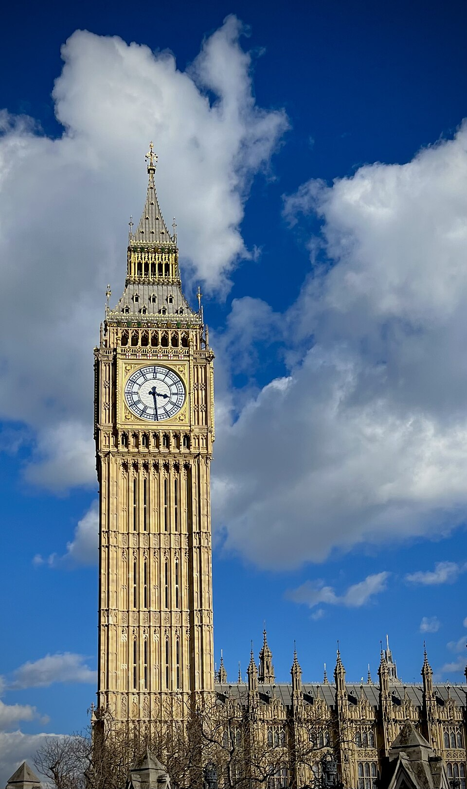
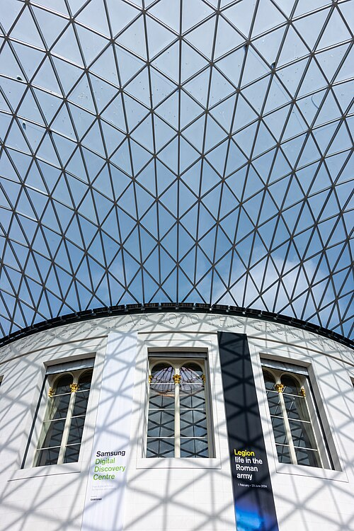
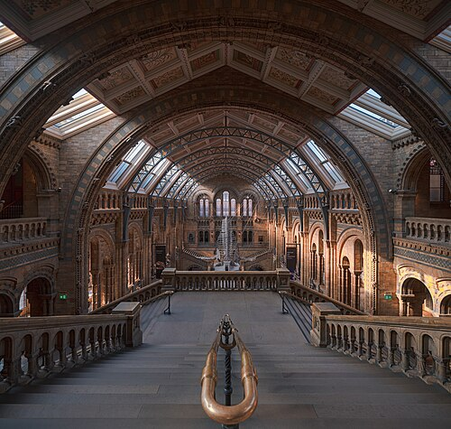
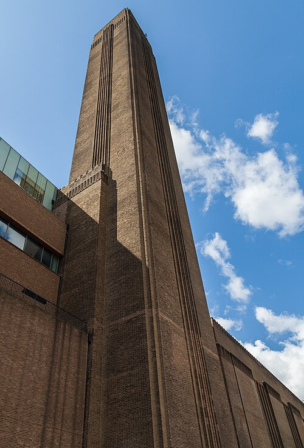
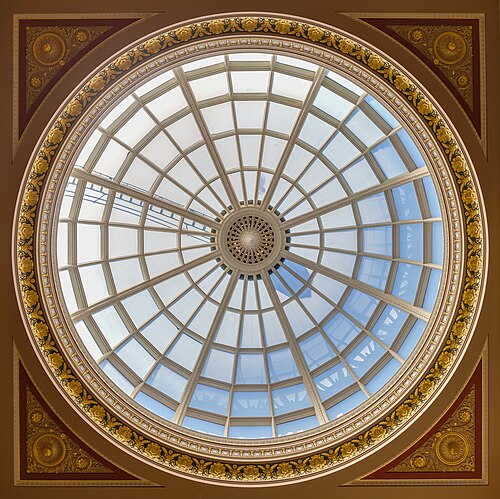
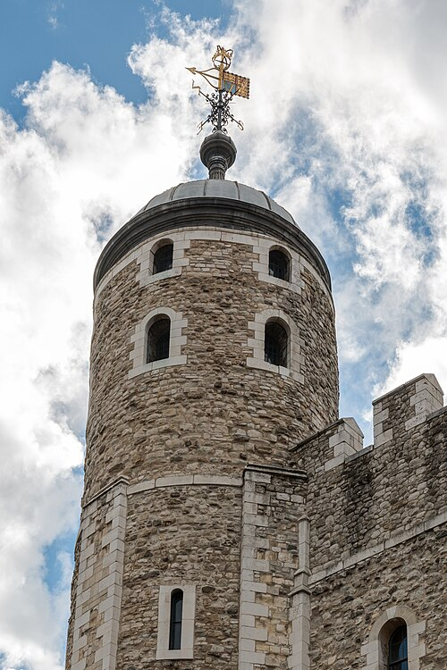

Welcome to **London**: free museums, royal history and *riverside walks*.

## Five sights to start with

1. British Museum
2. Natural History Museum
3. Tate Modern
4. National Gallery
5. Tower of London

## Getting around

- 🚇 Tube
- 🚌 Bus
- 🚲 Santander Cycles

## Plan your visit

Plan your route with the [TfL Journey Planner](https://tfl.gov.uk/plan-a-journey/).

{width=30% fig-alt="Big Ben's clock tower and the Palace of Westminster against a blue sky with white clouds."}

> **Tip from a local:** many big museums are free. Book a free timed ticket to skip the queue.

## Sights at a glance

| Photo | Sight | Area | Price band | Nearest tube | More |
|---|-----|-----|---|-----|----|
| {height=60} | British Museum | Bloomsbury | Free | Tottenham Court Road | [Read more](https://www.britishmuseum.org/visit) |
| {height=60} | Natural History Museum | South Kensington | Free | South Kensington | [Read more](https://www.nhm.ac.uk/visit.html) |
| {height=60} | Tate Modern | Bankside | Free | Southwark | [Read more](https://www.tate.org.uk/visit/tate-modern) |
| {height=60} | National Gallery | Trafalgar Square | Free | Charing Cross | [Read more](https://www.nationalgallery.org.uk/visiting) |
| {height=60} | Tower of London | Tower Hill | Paid | Tower Hill | [Read more](https://www.hrp.org.uk/tower-of-london/visit/) |

Photos via Wikimedia Commons: British Museum, Mike Peel; Tate Modern and National
Gallery, Diego Delso; Tower of London, Dietmar Rabich
([CC BY-SA 4.0](https://creativecommons.org/licenses/by-sa/4.0/)); Natural History
Museum, Julian Herzog ([CC BY 4.0](https://creativecommons.org/licenses/by/4.0/)).

## Before you go

```text
[ ] Contactless card or Oyster card
[ ] Free museum tickets booked
[ ] Comfortable shoes and an umbrella
```

## Visitor numbers

```{python}
import pandas as pd

attractions = pd.read_csv("data/attractions.csv")
top = attractions.loc[attractions["visits_2025"].idxmax()]
top_name = top["attraction"]
top_visits = f"{top['visits_2025']:,}"
total_visits = f"{attractions['visits_2025'].sum():,}"
```

Most visited in 2025: the `{python} top_name`, with `{python} top_visits` visits.
London's ten most visited ALVA member attractions drew `{python} total_visits` visits.

```{python}
#| label: fig-top10
#| echo: false
#| fig-cap: "Visits in 2025 to London's ten most visited ALVA member attractions."
#| fig-alt: "Horizontal bar chart of 2025 visits to ten London attractions, longest bar at the top: the Natural History Museum is highest and Royal Museums Greenwich lowest."
ax = attractions.sort_values("visits_2025").plot.barh(
    x="attraction", y="visits_2025", legend=False, color="#1f6f8b")
ax.set_xlabel("Visits in 2025")
ax.set_ylabel("")
ax.xaxis.set_major_formatter(lambda x, pos: f"{x / 1e6:.0f}M")
ax.figure.tight_layout()
```

Source: [ALVA, visits made in 2025](https://www.alva.org.uk/details.cfm?p=423)
(retrieved 2026-10-30). Only ALVA members are counted.
