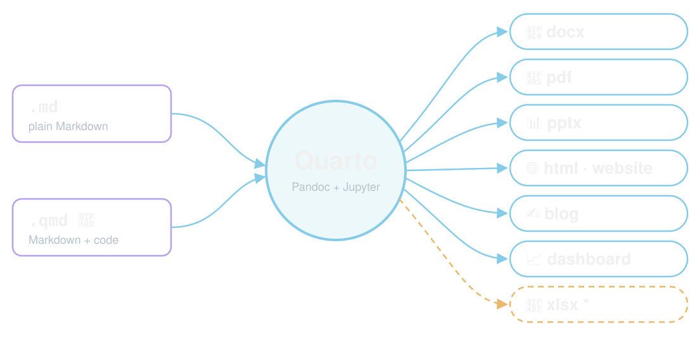

## 🎯 Objective · 🏁 Outcome {#objective}

::: {.goal}
[🎯 Objective]{.goal-label}

Create **reproducible content** you can **share with the world**, using Quarto.
:::

. . .

::: {.goal .goal-outcome}
[🏁 Outcome]{.goal-label}

Plain-text Markdown becomes

::: {.chips}
[📄 docx]{} [📕 pdf]{} [📊 pptx]{} [🎞️ revealjs]{} [📖 epub ⭐]{} [🌐 website]{} [✍️ blog]{} [📈 dashboard]{}
:::

🤖 with the code written by your coding assistant
:::

[🌍 [¿Prefieres leer en español? La extensión Google Translate traduce estas diapositivas; el código no cambia.]{lang="es"} ·
[Google Translate](https://chromewebstore.google.com/detail/google-translate/aapbdbdomjkkjkaonfhkkikfgjllcleb)]{.source}

::: {.notes}
Audience: people comfortable with files and a terminal, new to Quarto. Prerequisites:
Quarto, Python, Git, a GitHub account and one coding assistant installed (setup slide).
Completion: a published London dashboard URL and a published water-quality site.
The slides are the course resource: participants can follow them alone. Most steps
are done by prompting the coding assistant; the green boxes are the few things people
type themselves.
:::

## 🗓️ Agenda {#agenda}

| ⏱️ | Block | Min |
|---|---|--:|
| 0:00 | 👋 Welcome · 🎯 objective · 🏁 outcome | 5 |
| 0:05 | 🧭 What is Quarto? | 5 |
| 0:10 | 🛠️ Setup check · 🧰 boxes · 🗣️ prompting | 5 |
| 0:15 | 🇬🇧 Part 1 · London: Markdown → HTML, rules, environment | 20 |
| 0:35 | 🧪 Part 1 · `.md` → `.qmd`: YAML, code, docx + PDF | 10 |
| 0:45 | 🗂️ Part 1 · Four audiences, 🤖 sub-agents in parallel | 10 |
| 0:55 | 🌍 Part 1 · Publish to GitHub Pages | 10 |
| 1:05 | ☕ Break · 🛟 catch up | 10 |
| 1:15 | 💧 Part 2 · Colombia water quality and infant mortality | 125 |
| 3:20 | 🏁 Done | |

: {tbl-colwidths="[10,80,10]"}

[🏠 before the workshop: install, setup check, 🧪 test run, 📖 [Markdown in Y minutes](https://learnxinyminutes.com/markdown/) · ⭐ = optional, self-paced]{.source}

::: {.notes}
Section dividers show the same start times. Part 2 has its own agenda slide.
The total is 200 minutes, with a 10-minute break between the parts. Part 1 demonstrates
rather than requires the pptx, epub and revealjs exports (⭐), and builds its four audience
versions with one prompt that runs sub-agents in parallel. The break is paid for by Part 2:
its ePub is ⭐, and the Cluster block is 15 minutes because the normal 📤 route copies the
finished k-means step. The break also absorbs a slow publish: anyone whose London
site is not live yet finishes it then, with help. Installing the tools, the setup check,
the test run and reading Markdown in Y minutes are pre-work (🏠), which frees the time for
Part 1's first block: participants meet the assistant, the project rules, the preview and
the Python environment there, which is when recovery takes longest. The 🏠 exercises
(setup check 4 min, test run 5 min, Markdown 5 min) are timed for home: collect each
participant's test-run confirmation before the day and contact anyone who has not sent
one. In the room, the 0:10 block only asks who has a failing check (pair them with a
neighbour) before the boxes and prompting slides. Exercise times never fill a block: the
rest is for showing results and fixing a failed command. ⭐ slides are optional and
self-paced. These are planning estimates; rehearse with a stopwatch and change the agenda,
the section clocks and README together.
:::

# 🧭 What is Quarto? {#what-is-quarto}

[⏱️ 0:05]{.clock}

## Quarto = Markdown → anything {#quarto-hub}

{fig-alt="Two inputs, a .md Markdown file and a .qmd file with code in Python, R, bash, SQL, MATLAB, Java, JavaScript or C, flow into Quarto, shown by its four-quadrant logo, which combines Pandoc with Jupyter and knitr. Quarto produces four groups of formats: documents (html, pdf, docx, odt and, highlighted, epub); presentations (revealjs, pptx, beamer); the web (website, blog, dashboard); and more (Markdown, Jupyter notebooks, JATS, wikis)." width="92%"}

[📚 [All Quarto output formats](https://quarto.org/docs/output-formats/all-formats.html) ·
Quarto logo: Posit, PBC]{.source}

::: {.notes}
Pandoc converts the Markdown. Code cells run in Jupyter (Python) or knitr (R), and their
results are inserted. Quarto's principal languages are Python, R, Julia and Observable
JavaScript (`{ojs}` cells, run in the reader's browser); Jupyter kernels add many more,
such as MATLAB or Java (https://quarto.org/docs/faq/,
https://quarto.org/docs/computations/ojs.html). knitr's engines run `{sql}`, `{c}` and
`{bash}` cells (https://pkg.yihui.org/rmarkdown-book/language-engines.html); in Jupyter,
`!` lines run shell commands
(https://quarto.org/docs/computations/execution-options.html#shell-commands). Today we
use Python only. The official
list groups documents (HTML, PDF, MS Word, OpenDocument, ePub), presentations (Revealjs,
PowerPoint, Beamer), Markdown flavours, wikis and more (Jupyter, JATS, RTF, …):
https://quarto.org/docs/output-formats/all-formats.html. ePub is the e-book format:
https://quarto.org/docs/reference/formats/epub.html. Websites and blogs
(https://quarto.org/docs/websites/) and dashboards (https://quarto.org/docs/dashboards/)
are built from the same files. All checked 2026-10-30. The Quarto logo is a Posit, PBC
trademark, used here to refer to Quarto (https://quarto.org/trademark.html).
:::

# 🛠️ Setup {#setup}

[⏱️ 0:10]{.clock}

## 🪟 Windows? Work inside Ubuntu {#wsl}

::: {.cards .tips}
::: {}
[🐧]{.big}

**Install inside Ubuntu**

Quarto, gh, uv and the assistant, in the WSL terminal
:::
::: {}
[🏠]{.big}

**Keep folders in `~`**

not under `/mnt/c`, which is slower
:::
::: {}
[📂]{.big}

**`explorer.exe .`**

opens this folder in Windows
:::
::: {}
[➕]{.big}

**Second tab: Ctrl+Shift+D**

`cd` to your folder, for `quarto preview`
:::
:::

::: {.notes}
macOS and Linux users skip this slide. On Windows, install WSL with Ubuntu
(`wsl --install`, https://learn.microsoft.com/windows/wsl/install) and do everything in
the Ubuntu terminal: installers for Windows (PowerShell) put the tools where WSL cannot
use them. Microsoft recommends keeping project files in the Linux file system, e.g.
`/home/<user>/london-guide`, not `/mnt/c/...`, and opening the current folder in File
Explorer with `explorer.exe .` (https://learn.microsoft.com/windows/wsl/filesystems).
Windows browsers reach servers started in WSL at `localhost`, so Ctrl+click the URL that
`quarto preview` prints (https://learn.microsoft.com/windows/wsl/networking). In Windows
Terminal, Ctrl+Shift+D duplicates the tab with the same profile
(https://learn.microsoft.com/windows/terminal/customize-settings/actions); the new tab starts
in the profile's starting folder unless the shell reports its folder
(https://learn.microsoft.com/windows/terminal/tutorials/new-tab-same-directory), so `cd` to
the project first. Checked 2026-10-30; the new-tab folder
2026-10-31.
:::

## 🧩 No coding assistant yet? {#install-assistant}

[🏠 before the workshop]{.pace}

::: {.you .installers}
::: {}
**✳️ Claude Code**

`claude` · [setup](https://code.claude.com/docs/en/setup)
:::

```bash
curl -fsSL https://claude.ai/install.sh | bash
```

::: {}
**🌀 Codex**

`codex` · [CLI guide](https://learn.chatgpt.com/docs/codex/cli)
:::

```bash
curl -fsSL https://chatgpt.com/codex/install.sh | sh
```

::: {}
**♊ Antigravity**

`agy` · Gemini · [docs](https://antigravity.google/docs/getting-started?tab=cli)
:::

```bash
curl -fsSL https://antigravity.google/cli/install.sh | bash
```
:::

Pick one · install, open a new terminal tab, then start it with its command (`claude`, `codex` or `agy`)

[Install commands checked 2026-10-30. Windows: run them in Ubuntu (WSL).]{.source}

::: {.notes}
Do this before the workshop. Sign in with an account that has access to the tool.
Claude Code installer: https://code.claude.com/docs/en/setup. Codex standalone installer
for macOS and Linux: https://learn.chatgpt.com/docs/codex/cli, which also lists Windows,
`npm install -g @openai/codex` and Homebrew. Google's Antigravity CLI (`agy`):
https://antigravity.google/docs/getting-started?tab=cli, which also lists PowerShell and
CMD installers for Windows. It replaced Gemini CLI for unpaid-tier and Google One users on
18 June 2026 (https://www.geminicli.com/docs/get-started/installation); existing Gemini CLI
settings are migrated on first launch (https://antigravity.google/docs/cli/gcli-migration/).
All checked 2026-10-30. Start the assistant inside the exercise folder, and never run two
assistants writing to one folder.
:::

## 🛠️ Setup check {#setup-check}

[🏠 before the workshop]{.pace} 🪟 on Windows, in the Ubuntu (WSL) terminal

::: {.you}
```bash
quarto check
uv --version
gh auth status
claude --version
git config --global user.name "Your Name"
git config --global user.email "you@example.com"
cd ~ && git clone https://github.com/project-delphi/quarto-workshop.git
```
:::

No `uv`? [Install uv](https://docs.astral.sh/uv/getting-started/installation/) · No `gh`? [Install the GitHub CLI](https://cli.github.com/), then `gh auth login` · 🤖 Codex: `codex --version` · Antigravity: `agy --version`

### Exercise · ⏱️ 4 min

::: {.done}
`quarto check` and `uv --version` run, `gh auth status` says "Logged in", and `~/quarto-workshop/checkpoints/` exists.
:::

::: {.notes}
`quarto check` reports Pandoc and Typst. Its Python and Jupyter lines may show "(None)":
each project gets its own Python environment from uv, by a prompt in each part, so there is
nothing to install for Python now. uv also downloads a Python if the computer has none.
Install uv with `curl -LsSf https://astral.sh/uv/install.sh | sh` (on Windows, inside
Ubuntu) or `brew install uv`: https://docs.astral.sh/uv/getting-started/installation/
(checked 2026-10-30). Do not debug kernels on stage. A fresh Git has no identity and `git commit`
fails, hence `git config`: use the name and email of your GitHub account (or its
noreply address). The cloned workshop repository supplies the checkpoints and the
water data. `gh auth status` must show a logged-in account before publishing.
PDFs use `format: typst`, bundled with Quarto, so no LaTeX is needed:
https://quarto.org/docs/output-formats/typst.html. GitHub CLI install and `gh auth login`:
https://cli.github.com/ (both checked 2026-10-30).
:::

## 🧪 Test run: assistant → Quarto → PDF {#test-run}

[🏠 before the workshop]{.pace}

::: {.you}
```bash
mkdir -p ~/quarto-test && cd ~/quarto-test
claude    # or: codex, agy
```
:::

::: {.prompt}
```default
Run `uv init --bare` and `uv add ipykernel nbclient nbformat pyyaml`. Create hello.qmd (html and typst formats): a Python cell computing `6 * 7` and an inline-code sentence showing it. Render it with `uv run quarto render hello.qmd`; check hello.html and hello.pdf both say 42.
```
:::

🤷 no need to understand `hello.qmd` yet: Part 1 explains every piece

### Exercise · ⏱️ 5 min

::: {.done}
`hello.html` and `hello.pdf` say 42, and you told the organiser.
:::

::: {.notes}
The setup check proves the tools are installed; this proves they work together, which is
what the first hour needs: the assistant is signed in, can write a file and run commands
you approve, uv builds a project environment, Quarto runs Python through it, and Typst
writes a PDF. It also fills uv's cache, so Part 1's environment step is quicker. Use
`codex` or `agy` instead of `claude` if that is your assistant. Ask participants to confirm
before the day (a reply to the invitation is enough) and follow up with anyone who has not,
or whose run failed: these are the problems that otherwise surface in the tightest block.
Tested 2026-10-31 with Quarto 1.6.40 and uv in an empty folder (commands run by hand, not
through an assistant). The folder is disposable: delete `~/quarto-test` afterwards. It uses
YAML, a code cell and inline code before their slides on purpose: it is a black-box check
that the tools work together, not a lesson, and the slide says Part 1 explains it.
:::

## 📖 Markdown in Y minutes {#read-markdown}

[🏠 before the workshop]{.pace}

👉 [learnxinyminutes.com/markdown](https://learnxinyminutes.com/markdown/) · 🇪🇸 [en español](https://learnxinyminutes.com/es/markdown/)

::: {.cards style="grid-template-columns: repeat(5, 1fr);"}
::: {}
[\#]{.big}

`#` headings
:::
::: {}
[✳️]{.big}

`*emphasis*` · `**bold**`
:::
::: {}
[📋]{.big}

`-` and `1.` lists
:::
::: {}
[🔗]{.big}

`[link](url)`

``
:::
::: {}
[🧮]{.big}

`| tables |` · ```` ``` ```` code fences
:::
:::

### Exercise · ⏱️ 5 min

::: {.done}
you can name the Markdown for a heading, a link and a table.
:::

::: {.notes}
Pre-work, like the setup check: read it at home, no typing. In the room, ask who has not read it;
Part 1's first block uses exactly these constructs, one per slide, so nobody is blocked.
Page checked 2026-10-30.
:::

## 🧰 Three boxes, three roles {#three-boxes}

[👀 An example: you will paste prompts like this from Part 1 on.]{.source}

::: {.prompt}
```default
Create london.md with a level-1 heading "Visit London" and one welcome paragraph.
```
:::

::: {.agent}
writes `london.md` · may run `quarto render london.md`
:::

::: {.you}
approve its commands · open `london.html` in your browser
:::

::: {.notes}
Violet: paste this prompt into your coding assistant (use the copy button).
Amber: what the assistant will probably run; you do not repeat it. Green: the few
things you type or click yourself, such as accounts, publishing and opening files. The
assistant occupies its terminal, so type green commands (such as `quarto preview`) in a
second terminal tab opened in the same folder.
The prompts are examples, not transcripts: assistants vary, so check the result.
:::

## 🗣️ How to prompt your coding assistant {#how-to-prompt}

::: {.cards .tips}
::: {}
[🎯]{.big}

**Be specific**

file names, columns, chart types
:::
::: {}
[☝️]{.big}

**One step at a time**

one task per prompt
:::
::: {}
[✅]{.big}

**Ask it to run & check**

"…render it and tell me about errors"
:::
::: {}
[👀]{.big}

**Check what changed**

you are responsible for the result
:::
:::

🌍 ¿Español? Your first prompt can be: `Responde siempre en español; deja el código y los nombres de archivo en inglés.`

::: {.notes}
A good prompt names the file, the content, the output and a completion check. Browser
translation translates the prompts on the slides, and the copy button copies the
translation; the file names, columns, options and commands in them stay in English, so
the assistant still finds them. You may also write your own prompts in Spanish.
Short follow-ups work once the conversation has context. Ask the assistant to show
what it changed; read the diff before moving on.
:::



# ☕ Break {#break}

[⏱️ 1:05]{.clock}

::: {.bigline}
☕ 10 min · back at **1:15** for 💧 Part 2
:::

🛟 London site not live yet? Ask for help now, or paste the 🚀 Publish slide's **Catch me up**

::: {.notes}
Ten minutes, and a real break: say when it ends. It is also the room's catch-up point.
Anyone whose site is not live yet finishes publishing with help, or pastes the publish
slide's catch-up prompt, which copies the finished London project; its README then names the
publish slide and the next one. Everyone starts Part 2 together at 1:15 from an empty
`water-quality/` folder, so nobody carries a Part 1 problem into Part 2.
:::



# 🏁 Done {#done}

[⏱️ 3:20]{.clock}

## 🙌 What you built {#what-you-built}

::: {.cards}
::: {}
[🇬🇧]{.big}

London guide: html · docx · pdf · dashboard · email · flyer · ad · live site (⭐ pptx · revealjs · epub)
:::
::: {}
[💧]{.big}

Water analysis: report (docx · pdf · ⭐ epub) · slides (pptx · revealjs) · blog · dashboard · live site
:::
::: {}
[🔁]{.big}

One source, many outputs, rebuilt with one command
:::
:::

📚 [Quarto guide](https://quarto.org/docs/guide/) ·
[Dashboards](https://quarto.org/docs/dashboards/) ·
[Typst](https://quarto.org/docs/output-formats/typst.html) ·
[GitHub Pages](https://quarto.org/docs/publishing/github-pages.html)

➡️ Next: [AI workflows: promotion experiments and sales outcomes](ai-workflows.qmd)

::: {.notes}
Documentation links checked 2026-10-30. Ask each team which output they would build
first for their own work.
:::
