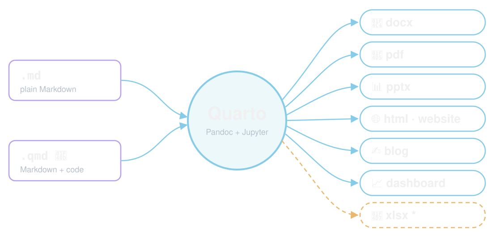

## 🤖 AI Usage Statement for These Slides {#ai-use-deck}

> These slides were written with **Claude Code** (Claude Opus 5.5, Sonnet 5.5, Opus 5 and Fable 5.1),
> which drafted slides, Quarto files and code and re-rendered the deck.
> The author directed the work, reviewed and ran the code, and takes full responsibility for the content.

. . .

🏷️ Tool + version · 🛠️ Tasks · ✅ Checks · 🙋 Accountability · [📜 what a statement needs](#ai-policy)

::: {.notes}
This is the statement for this repository, written the way the workshop asks participants to
write theirs (see the AI-use slides in Setup). The tool and models are read from the
`Co-Authored-By` lines of the commit history, checked 2026-11-05: Claude Code with Claude
Opus 5.5 (most commits), Sonnet 5.5, Opus 5 and Fable 5.1. The author edits this slide if
the history is incomplete (for example, another assistant, such as Codex, used without a
trailer), and updates the model list when new commits use other models. The data in the
worked examples are public sources named in `data/README.md`, not AI output, and the rules
in `AGENTS.md` require every number to be computed from the input data. The author confirms
the "reviewed and ran" claim before teaching.
:::

## 🎯 Objective · 🏁 Outcome {#objective}

::: {.goal}
[🎯 Objective]{.goal-label}

Publish **reproducible content** with **Quarto**, written by a coding assistant you **direct and check**.
:::

. . .

::: {.goal .goal-outcome}
[🏁 Outcome]{.goal-label}

Plain-text Markdown becomes

::: {.chips}
[📄 docx]{} [📕 pdf]{} [📊 pptx]{} [🎞️ revealjs]{} [📖 epub ⭐]{} [🌐 website]{} [✍️ blog]{} [📈 dashboard]{}
:::

🤖 with the code written by your coding assistant

🔁 change an input, rebuild, and explain what updated
:::

[🌍 [¿Prefieres leer en español? La extensión Google Translate traduce estas diapositivas; el código no cambia.]{lang="es"} ·
[Google Translate](https://chromewebstore.google.com/detail/google-translate/aapbdbdomjkkjkaonfhkkikfgjllcleb)]{.source}

::: {.notes}
Audience: people comfortable with files and a terminal, new to Quarto. Prerequisites:
Quarto, Python, Git, a GitHub account and one coding assistant installed (setup slide).
Completion: a published London dashboard URL, a published water-safety site, and for each
project an explanation of which outputs update when an input changes.
The slides are the course resource: participants can follow them alone. Most steps
are done by prompting the coding assistant; the green boxes are the few things people
type themselves.
:::

## 🌍 Expected Outcomes {#expected-outcomes}

Create and publish **online content** like these examples:

::: {.cards .outcomes}
::: {}
[🇬🇧]{.big}

**[London guide](https://project-delphi.github.io/london-guide/)**

Travel guide · dashboard · flyer
:::
::: {}
[💧]{.big}

**[Colombian water safety](https://project-delphi.github.io/water-quality/)**

Analysis · report · blog
:::
:::

🧩 Both sites, and **[these slides](https://github.com/project-delphi/quarto-workshop)**, are built with Quarto.

🔗 Finish with **your own shareable websites**.

::: {.notes}
Say it out loud: this deck is itself a Quarto Reveal.js website, written in Markdown
and rendered from source, the same way participants will build theirs.
Open the two linked examples to show the workshop's expected outcomes: online content
that other people can visit and explore. Part 1 builds and publishes a London guide;
Part 2 builds and publishes a Colombian water-safety analysis site. Participants
finish with their own working public URLs, alongside the downloadable formats on the
previous slide. Use these examples as a preview of the destination; the steps follow
throughout the workshop.
:::

## 🗓️ Agenda {#agenda}

::: {style="font-size: 0.88em"}

| ⏱️ | Block | Min |
|---|---|--:|
| 0:00 | 👋 Welcome · 🎯 objective · 🏁 outcome | 5 |
| 0:05 | 🧭 What Is Quarto? | 5 |
| 0:10 | 🛠️ Setup Check · 🧰 boxes · 🗣️ prompting | 5 |
| 0:15 | 🇬🇧 Part 1 · London: Markdown → HTML, rules, environment | 20 |
| 0:35 | 🧪 Part 1 · `.md` → `.qmd`: YAML, code, docx + PDF | 10 |
| 0:45 | 🗂️ Part 1 · Three audiences, 🤖 sub-agents in parallel | 9 |
| 0:54 | 🌍 Part 1 · Publish to GitHub Pages | 11 |
| 1:05 | 🔁 Part 1 · Change an Input, Rebuild, Explain | 5 |
| 1:10 | ☕ Break · 🛟 catch up | 10 |
| 1:20 | 💧 Part 2 · Colombia Water Safety and Infant Mortality | 120 |
| 3:20 | 🏁 Done | |

: {tbl-colwidths="[10,80,10]"}

:::

[🏠 before the workshop: install, setup check, 🧪 test run, 📖 [Markdown in Y minutes](https://learnxinyminutes.com/markdown/) · ⭐ = optional, self-paced]{.source}

::: {.notes}
Section dividers show the same start times. Part 2 has its own agenda slide.
The total is 200 minutes, with a 10-minute break between the parts. Part 1 demonstrates
rather than requires the pptx, epub and revealjs exports and the square social ad (⭐), and
builds its three audience versions with one prompt that runs sub-agents in parallel. Each
part ends with a task that has no supplied prompt: change an input, rebuild and explain
which outputs update. London's takes 5 minutes before the break; Part 2 pays for them
(120 instead of 125 minutes) because its dashboard and ePub are ⭐ and its Cluster block is
15 minutes, the normal 📤 route copying the finished k-means step. The break also absorbs a slow publish: anyone whose London
site is not live yet finishes it then, with help. Installing the tools, the setup check,
the test run and reading Markdown in Y minutes are pre-work (🏠), which frees the time for
Part 1's first block: participants meet the assistant, the project rules, the preview and
the Python environment there, which is when recovery takes longest. The 🏠 exercises
(setup check 4 min, test run 5 min, Markdown 5 min) are timed for home: collect each
participant's test-run confirmation before the day and contact anyone who has not sent
one. In the room, the 0:10 block only asks who has a failing check (pair them with a
neighbour) before the boxes and prompting slides. Exercise times never fill a block: the
rest is for showing results and fixing a failed command. ⭐ slides are optional and
self-paced. These are planning estimates; rehearse with a stopwatch and change the agenda,
the section clocks and README together.
:::

# 🧭 What Is Quarto? {#what-is-quarto}

[⏱️ 0:05]{.clock}

## Quarto = Markdown → Anything {#quarto-hub}

{fig-alt="Two inputs, a .md Markdown file and a .qmd file with code in Python, R, bash, SQL, MATLAB, Java, JavaScript or C, flow into Quarto, shown by its four-quadrant logo, which combines Pandoc with Jupyter and knitr. Quarto produces four groups of formats: documents (html, pdf, docx, odt and, highlighted, epub); presentations (revealjs, pptx, beamer); the web (website, blog, dashboard); and more (Markdown, Jupyter notebooks, JATS, wikis)." width="92%"}

[📚 [All Quarto output formats](https://quarto.org/docs/output-formats/all-formats.html) ·
Quarto logo: Posit, PBC]{.source}

::: {.notes}
Pandoc converts the Markdown. Code cells run in Jupyter (Python) or knitr (R), and their
results are inserted. Quarto's principal languages are Python, R, Julia and Observable
JavaScript (`{ojs}` cells, run in the reader's browser); Jupyter kernels add many more,
such as MATLAB or Java (https://quarto.org/docs/faq/,
https://quarto.org/docs/computations/ojs.html). knitr's engines run `{sql}`, `{c}` and
`{bash}` cells (https://pkg.yihui.org/rmarkdown-book/language-engines.html); in Jupyter,
`!` lines run shell commands
(https://quarto.org/docs/computations/execution-options.html#shell-commands). Today we
use Python only. The official
list groups documents (HTML, PDF, MS Word, OpenDocument, ePub), presentations (Revealjs,
PowerPoint, Beamer), Markdown flavours, wikis and more (Jupyter, JATS, RTF, …):
https://quarto.org/docs/output-formats/all-formats.html. ePub is the e-book format:
https://quarto.org/docs/reference/formats/epub.html. Websites and blogs
(https://quarto.org/docs/websites/) and dashboards (https://quarto.org/docs/dashboards/)
are built from the same files. All checked 2026-10-30. The Quarto logo is a Posit, PBC
trademark, used here to refer to Quarto (https://quarto.org/trademark.html).
:::

## 🚫🤖 Quarto Is Not AI {#quarto-not-ai}

::: {.cards}
::: {}
[⚙️]{.big}

**Traditional software**

same input → same output, every time
:::
::: {.fragment}
[📚]{.big}

**Built for publishing**

quality documents, slides and websites
:::
::: {.fragment}
[🤖]{.big}

**The assistant is separate**

it writes the files · Quarto turns them into formats
:::
:::

. . .

🔁 No AI inside Quarto: it follows your source exactly

::: {.notes}
Participants sometimes assume Quarto is an AI tool because the workshop uses a coding
assistant. It is not: Quarto is open-source publishing software (built on Pandoc, with
Jupyter or knitr running code) that reads Markdown and code and writes the same outputs
every time for the same inputs and data. It does not generate text, code or figures by
itself and sends nothing to an AI service. The coding assistant is a separate tool that
writes and edits the source files on request; Quarto then renders them. That split matters
for trust: the assistant can make mistakes, so you check its files, while a render is
repeatable. Code cells you add run whatever code they contain, so if a cell calls an AI
service, that is your code, not Quarto. See https://quarto.org/ (not yet re-checked for
this slide).
:::

## 🔁 Reproducible: Same Source, Same Result {#reproducible}

::: {.cards .tips}
::: {}
[📄]{.big}

**One source**

text + code + data in plain files
:::
::: {.fragment}
[🧮]{.big}

**Numbers are computed**

never typed or pasted in
:::
::: {.fragment}
[▶️]{.big}

**One command**

`quarto render` rebuilds everything
:::
::: {.fragment}
[🕰️]{.big}

**Versioned with git**

every change saved · `uv.lock` pins the tools
:::
:::

. . .

✏️ Change one value in the data → render → **table, chart and sentence all update**

🏷️ `git` (set up next) records which version of the files produced which result

::: {.check}
💬 You correct one number in the data. What do you retype in the report?
:::

::: {.notes}
Reproducible means that someone else, or you in six months, can rebuild the same results
from the same files with one command, and that you can see where every number came from. It
is the reason for the workshop's structure. The report is source, not a pasted result: its
figures, tables and numbers in sentences are computed by code cells and inline code from
the data files, so changing an input and re-rendering updates every output without
retyping (the "change an input, rebuild, and explain what updated" outcome). Reproducibility
depends on versioning: git, the version control tool installed in Setup, saves a numbered
snapshot (a commit) of the source, data and settings together with a message saying what
changed and why. Any earlier snapshot can be restored, two versions compared, and a result
tied to the exact files that made it; without versions, "the same source" is whatever
happens to be on the disk today. GitHub then keeps a shared copy, and the same history
backs the AI usage statement: you can show what the assistant changed and what you
reviewed. The project's `pyproject.toml` and `uv.lock` are versioned too: they pin the
Python packages, so a participant's machine and a colleague's give the same environment. This matters most with a coding assistant: it may
write code that looks right and is not, so we ask it to compute from the data and then
render and check, and anyone can re-run the render to confirm. Reproducible does not mean
correct: a wrong analysis reproduces perfectly, so we still check results against their
sources. Good answer to the check: nothing; fix the data and re-render.
:::

# 🛠️ Setup {#setup}

[⏱️ 0:10]{.clock}

## 🧭 Setup Map: 6 Steps {#setup-map}

[🏠 before the workshop]{.pace}

| 🧭 | Do this | ✅ It worked when |
|:-:|---|---|
| 1 | 🪟 Ubuntu · **Windows only** | `wsl -l -v` shows VERSION 2 |
| 2 | 📁 Move around the terminal | `pwd` prints your home folder |
| 3 | 🔧 Ubuntu tools · 🧩 coding assistant | `curl` and `git` run · it starts, signed in |
| 4 | 🐧 Assistant installs the tools | it prints every version |
| 5 | 🛠️ Setup check | every check says OK |
| 6 | 🧪 Test run | `hello.pdf` says 42 |

. . .

🍎 🐧 **Mac and Linux start at step 2** · 🧭 = do it · 📖 = reading · 📶 stable internet · 🆘 stuck → ask an AI chat, then Discord

::: {.notes}
Participants said the setup slides were hard to follow, mostly on Windows (workshop of
2026-11-05): they could not tell which slides to do and which to read, or where they were.
Every slide that must be done carries a "🧭 Step n/6" pill, every reading slide a "📖 reading"
pill, and the reading slides about AI policy come after the test run. Steps 1 and 3 hold more
than one slide: step 1 is the Ubuntu install, its stuck-table, the file-location slide and
the copy-and-paste slide; step 3 is the basic-tools slide (Ubuntu only) and the assistant
installation. Each step has an observable check, which is the row's last column. Ask Windows
participants for the `wsl -l -v` output before the day (step 1), since WSL needs an
administrator account, a restart and sometimes BIOS access.
:::

## 📶 You Need a Stable, Fast Internet Connection {#internet}

[🏠 before the workshop]{.pace}

::: {.cards .tips}
::: {}
[⬇️]{.big}

**Big downloads**

Ubuntu, Quarto, the assistant, Python packages, data
:::
::: {.fragment}
[☁️]{.big}

**The assistant is online**

every reply needs the connection · it stops when the Wi-Fi drops
:::
::: {.fragment}
[🏠]{.big}

**Do setup at home**

wired or strong Wi-Fi · avoid hotels, trains, firewalled work networks
:::
:::

. . .

🔌 Plugged in · 📵 No VPN or proxy if you can · 🧪 Test run done at home = ready

::: {.notes}
Almost every setup step downloads something: the Ubuntu image (several hundred megabytes),
Quarto, uv and the Python packages, the assistant itself, and the workshop data. The coding
assistant also sends every request to a model over the internet, so a poor connection shows
up as long pauses, timeouts and half-finished installs, which participants often take for
their own mistakes. Ask everyone to do the setup on a reliable connection, and to bring a
phone hotspot as a fallback. Company networks with a proxy or TLS inspection often block
downloads: raise it before the day. In the room, check that the venue Wi-Fi copes with every
participant downloading at once, and say what to do if it does not.
:::

## 🆘 Error? Ask an AI Chat {#ask-ai-chat}

[🏠 before the workshop]{.pace} [🆘 when stuck]{.pace}

::: {.cards .tips}
::: {}
[📋]{.big}

**Copy**

the command you ran + the **full** error text
:::
::: {.fragment}
[🌐]{.big}

**Paste into a web chat**

Gemini, Claude or ChatGPT in your browser, with your system (Windows + Ubuntu, or Mac)
:::
::: {.fragment}
[🔧]{.big}

**Try the fix**

one suggestion at a time · read it before you run it
:::
::: {.fragment}
[🔁]{.big}

**Still failing?**

paste the new error · then Discord `#help`
:::
:::

. . .

🔒 No passwords, keys or private data in the paste

::: {.notes}
Installs fail before the coding assistant works, and sometimes the assistant itself is what
fails, so the participant needs a second route that does not depend on it: a free web chat in
the browser (Gemini, Claude or ChatGPT). Good habits: paste the exact command and the whole
error, say the operating system (for WSL: Windows with Ubuntu on WSL), say what step of the
deck you are on, and try one suggested fix at a time. Read each command before running it:
a chat can be wrong, and never run a command that deletes things or asks for
administrator rights without understanding why. Remove passwords, tokens, API keys and
private data first (the AI-policy slide later explains why). If two suggestions fail, post the error and
what you tried in Discord. This is the same habit the workshop teaches with the assistant:
you direct, check and take responsibility. The room rule remains: two minutes stuck, ask.
:::

## 💬 Discord: Our Workshop Room {#discord}

[🏠 before the workshop]{.pace} [💬 get help]{.pace}

::: {.cards .tips}
::: {}
[🔗]{.big}

**Join the server**

open the invite link from the organiser · pick a name we know
:::
::: {.fragment}
[#️⃣]{.big}

**Text channels**

one topic each, like `#help` · type, paste, share screenshots
:::
::: {.fragment}
[🔊]{.big}

**Voice channels**

click to join, click to leave · mute until you speak
:::
::: {.fragment}
[📣]{.big}

**Tag someone**

type `@` and their name · they get a notification
:::
:::

. . .

🆘 Stuck? Post in the help channel: what you ran, the error, a screenshot

::: {.notes}
Discord is where the organiser and participants talk during the workshop: questions, error
screenshots and links go in the text channels, and the voice channels are for the group and
for pairing. Send the invite link with the pre-work, and ask people to join before the day
so that problems with accounts or the app show up early. A server is the whole workshop
space; it holds channels. Text channels are named with a `#`, voice channels have a speaker
icon. Discord runs in the browser, as a desktop app and on a phone. Also useful: reply to a
message to answer it, add a reaction to say "seen" without noise, and mute channels you do
not need. When someone is stuck, ask for the exact command, the full error text and a
screenshot, and remember the room rule: two minutes stuck, then catch up. The organiser
supplies the real invite link and channel names for each run; this deck does not publish
a link.
:::

## 🔁 Discord ↔ WhatsApp {#discord-whatsapp}

[🏠 before the workshop]{.pace} [💬 get help]{.pace}

| 💬 Discord | 📱 WhatsApp |
|---|---|
| Server | Community |
| Text channel | Group chat |
| Voice channel | Group call you can join and leave |
| `@name` tag | `@name` mention |
| Reply to a message | Reply to a message |
| Direct message | Chat with one person |
| Invite link | Group invite link |
| Reaction | Reaction |

. . .

⚠️ Unlike a WhatsApp group, a Discord server has **many channels**: pick the right one

::: {.notes}
Use this for participants who know WhatsApp but not Discord. The mapping is approximate: a
server is closest to a WhatsApp Community, which also holds several groups, and a text channel
is closest to one group chat. A voice channel is always open: you join to talk and leave when
done, with no call to start or answer. Discord also has threads (a side conversation under
one message) and roles, which have no close WhatsApp equivalent. WhatsApp features and names
change, so check the right-hand column against the app before teaching.
:::

## 🪟 Windows Only: Start Ubuntu {#wsl-start}

[🏠 before the workshop]{.pace} [🧭 Step 1/6]{.pace} 🍎 🐧 skip → [step 2](#terminal-basics)

::: {.cards .tips style="grid-template-columns: repeat(3, 1fr);"}
::: {}
[🛡️]{.big}

**PowerShell as admin**

Start → PowerShell → right-click → Run as administrator
:::
::: {.fragment}
[⌨️]{.big}

**`wsl --install -d Ubuntu`**

press Enter · wait until it says it finished
:::
::: {.fragment}
[🔁]{.big}

**Restart the computer**

then open "Ubuntu" · pick a username + password (typing shows nothing)
:::
:::

🆘 Error, hang or no admin rights? → [Ubuntu won't install?](#wsl-stuck)

### Exercise · ⏱️ 15 min

::: {.done}
`wsl -l -v` (in PowerShell) lists Ubuntu with VERSION 2, and an Ubuntu window is open at a prompt ending in `$`.
:::

::: {.notes}
Windows only; macOS and Linux users skip the Windows slides and open their own terminal. Participants found this step the hardest at the workshop of 2026-11-05, so it has its own exercise and a stuck-table slide. Do this at home: it needs a
download, a restart and the first Ubuntu start, which do not fit the 0:10 block. It needs
Windows 10 build 19041 or later, or Windows 11. Installing WSL needs an
administrator PowerShell once (Start menu, type PowerShell, right-click, Run as
administrator); `wsl --install -d Ubuntu` installs the Ubuntu distribution and participants
must restart the computer when it finishes
(https://learn.microsoft.com/windows/wsl/install). If it hangs at 0.0%, try
`wsl --install --web-download -d Ubuntu`. `wsl -l -v` must show VERSION 2. If it fails with
error 0x80370102, virtualization is off in the BIOS (Task Manager → Performance → CPU shows
"Virtualization: Enabled" when it is on), and without administrator rights it cannot be
installed at all: such participants cannot use this route, so collect them before the day
and pair them with a neighbour (no native Windows route is supported). Afterwards Ubuntu opens from the Start
menu, or type `wsl` in any PowerShell window; `exit` returns. The first Ubuntu start asks
for a Linux username and password (typing the password shows nothing: that is normal).
Every later step happens in Ubuntu, as a normal user, not as admin. The terminal opens in
your home folder `~`; the next slide teaches moving around. Written from Microsoft's documentation, checked 2026-11-03 and not yet tried on a
Windows machine: try it before teaching.
:::

## 🆘 Ubuntu Won't Install? {#wsl-stuck}

[🏠 before the workshop]{.pace} [🧭 Step 1/6]{.pace}

| 👀 You see | 🔧 Do |
|---|---|
| Stuck at 0.0% | `wsl --install --web-download -d Ubuntu` |
| Error `0x80370102` | virtualization is off in the BIOS: tell the organiser |
| A list of options, no install | Windows is too old: update Windows, then retry |
| "Access denied", no admin account | tell the organiser **before the day** |
| "Already exists", or it finished | open "Ubuntu" from the Start menu |
| Ubuntu closes or will not start | restart the computer, open "Ubuntu" again |

. . .

📸 Post the exact error text and a screenshot in Discord `#help`

::: {.notes}
The commands and errors come from Microsoft's WSL install and troubleshooting pages
(https://learn.microsoft.com/windows/wsl/install,
https://learn.microsoft.com/windows/wsl/troubleshooting), written from documentation and
not yet reproduced on a Windows machine except where participants reported them. Without
administrator rights or BIOS access, WSL cannot be installed: such participants pair with a
neighbour for the day, so collect them before it. `wsl -l -v` must list Ubuntu with
VERSION 2; if it says VERSION 1, `wsl --set-version Ubuntu 2` converts it. A company laptop may
block the download: try another network (a phone hotspot). Ask for the error text and a
screenshot rather than a description, since the same symptom has several causes.
:::

## 🪟 Windows Only: Work Inside Ubuntu {#wsl}

[🏠 before the workshop]{.pace} [🧭 Step 1/6]{.pace} 🍎 🐧 Mac and Linux: skip to [📁 Move Around](#terminal-basics)

::: {.cards .tips}
::: {}
[🐧]{.big}

**Install inside Ubuntu**

the assistant first, then it installs the rest
:::
::: {}
[🏠]{.big}

**Keep folders in `~`**

prompt shows `/mnt/c`? Run `cd ~`
:::
::: {}
[📂]{.big}

**`explorer.exe .`**

opens this folder in Windows
:::
::: {}
[➕]{.big}

**Second tab: Ctrl+Shift+D**

`cd` to your folder, for `quarto preview`
:::
:::

::: {.notes}
macOS and Linux users skip this slide. On Windows, install WSL with Ubuntu
(`wsl --install -d Ubuntu`, then restart, https://learn.microsoft.com/windows/wsl/install) and do everything in
the Ubuntu terminal: installers for Windows (PowerShell) put the tools where WSL cannot
use them. Microsoft recommends keeping project files in the Linux file system, e.g.
`/home/<user>/london-guide`, not `/mnt/c/...`, and opening the current folder in File
Explorer with `explorer.exe .` (https://learn.microsoft.com/windows/wsl/filesystems).
Windows browsers reach servers started in WSL at `localhost`, so Ctrl+click the URL that
`quarto preview` prints (https://learn.microsoft.com/windows/wsl/networking). In Windows
Terminal, Ctrl+Shift+D duplicates the tab with the same profile
(https://learn.microsoft.com/windows/terminal/customize-settings/actions); the new tab starts
in the profile's starting folder unless the shell reports its folder
(https://learn.microsoft.com/windows/terminal/tutorials/new-tab-same-directory), so `cd` to
the project first. Checked 2026-10-30; the new-tab folder
2026-10-31.
:::

## 📋 Windows Only: Copy and Paste in the Terminal {#terminal-copy-paste}

[🏠 before the workshop]{.pace} [🧭 Step 1/6]{.pace} 🍎 🐧 Mac and Linux: skip to [📁 Move Around](#terminal-basics)

::: {.cards .tips}
::: {}
[🖱️]{.big}

**Mouse**

select text → right-click copies · right-click again pastes
:::
::: {.fragment}
[🐧]{.big}

**Ubuntu (WSL)**

Ctrl+Shift+C copy · Ctrl+Shift+V paste
:::
::: {.fragment}
[🟦]{.big}

**PowerShell**

Ctrl+C copy · Ctrl+V paste
:::
::: {.fragment}
[☰]{.big}

**Older console window**

title bar right-click → Edit → Copy / Paste
:::
:::

::: {.fragment .bigline}
⚠️ Ctrl+C with nothing selected stops a running command
:::

::: {.notes}
In Windows Terminal (the default on current Windows 11) the mouse works as listed: with
text selected, right-click copies it; with nothing selected, right-click pastes. Ctrl+Shift+C
and Ctrl+Shift+V work in every profile, so teach those first for Ubuntu. In PowerShell,
Ctrl+C copies only while text is selected, otherwise it interrupts, and Ctrl+V pastes. The
Edit menu is in the title-bar menu of the older console window, not Windows Terminal, where
the command palette (Ctrl+Shift+P) lists copy and paste actions. Pasting several lines runs
them: read prompts before pressing Enter. Settings differ by version and can be remapped
(https://learn.microsoft.com/windows/terminal/customize-settings/actions). Written from
Microsoft's documentation, checked 2026-11-03 and not yet tried on a Windows machine: try it before teaching. Prompts in this
deck have a copy button, which avoids selecting by hand.
:::

## 📁 Move Around the Terminal {#terminal-basics}

[🏠 before the workshop]{.pace} [🧭 Step 2/6]{.pace}

::: {.cards .tips}
::: {}
[📍]{.big}

**`pwd`**

where am I?
:::
::: {.fragment}
[👀]{.big}

**`ls`**

what is here?
:::
::: {.fragment}
[🆕]{.big}

**`mkdir name`**

make a folder
:::
::: {.fragment}
[🚪]{.big}

**`cd name`**

go in · `cd ..` goes up
:::
:::

. . .

```text
$ pwd
/home/ana
$ mkdir demo
$ ls
demo
$ cd demo
$ pwd
/home/ana/demo
$ cd ..
```

::: {.check}
💬 After `cd ..`, what would `pwd` print?
:::

::: {.notes}
Everyone, on every system: the rest of the workshop happens in a terminal. The terminal
opens in your home folder, written `~` (here `/home/ana`; on a Mac `/Users/ana`). `pwd`
prints the current folder, `ls` lists it, `mkdir name` creates a folder, `cd name` enters
it, `cd ..` goes up one level and `cd` alone returns home. Lines starting with `$` are what
you type, the others are the answers; do not type the `$`. Tab completes names, and the up
arrow recalls the previous command. Later slides ask you to run
`mkdir -p london-guide && cd london-guide`: this is that (`-p` makes no fuss if the folder
exists). Good answer to the check: `/home/ana`. Try the example in `~/quarto-test` or any
scratch folder, then delete `demo` with `rmdir demo`.
:::

## 🧠 Model + 🔧 Harness = 🤖 Assistant {#model-harness}

[🏠 before the workshop]{.pace} [📖 reading]{.pace}

::: {.cards .tips}
::: {}
[🧠]{.big}

**Model**

reads and writes text, asks for tools
:::
::: {}
[🔧]{.big}

**Harness**

files, commands, permissions
:::
::: {}
[🤖]{.big}

**Coding assistant**

model + harness in your terminal
:::
:::

. . .

📏 **Bigger, newer model → usually better on hard tasks**

🪶 Small models: fast, cheap, may stumble on multi-step work

✅ **Enough today:** Haiku or Sonnet on **medium** · Sol on **low**

::: {.check}
💬 Which would you pick to fix a typo, and which to join two datasets?
:::

::: {.notes}
The model is the language model (for example Claude, GPT or Gemini). The harness is the
program around it: it gives the model tools to read and write files, run commands and
search, asks you to approve actions, and feeds results back in a loop. Assistants such as the three on the next slide are harnesses; many can run several models, so the same harness behaves
differently with a different model, and the same model behaves differently in a different
harness. Size and quality matter per task: larger, more recent models usually follow
longer instructions, plan multi-step work, and recover from errors better, while small
models are quicker and cheaper and are often enough for short, well-specified edits such as
fixing a typo or reformatting a table. Hard tasks here, such as joining datasets or
debugging a failed render, reward the stronger model. Quality is not only size: training
and recency matter too, and no model is always right, so check its work (the "you
direct and check" rule). Good answer to the check: a small model for the typo, the
strongest available for the join. If a prompt keeps failing, try a stronger model inside
your assistant (see its documentation for how). Model names and availability change
often; do not name versions on stage. For this workshop the prompts are short and
well specified, so Haiku or Sonnet with the effort (reasoning) setting on medium, or
ChatGPT's Sol on low, is sufficient; try a stronger model or higher effort only if a prompt keeps failing.
:::

## 🔧 Ubuntu First: Basic Tools {#basic-tools}

[🏠 before the workshop]{.pace} [🧭 Step 3/6]{.pace} 🍎 Mac · other Linux: skip to [🧩 the assistant](#install-assistant)

::: {.you}
```bash
sudo apt update && sudo apt install -y curl git
```
:::

🔑 `sudo` asks for your Ubuntu password · typing shows nothing · press Enter

🐧 Ubuntu or Debian only (it uses `apt`)

🔎 Check: `curl --version` and `git --version` both print a version

::: {.notes}
Ubuntu in WSL and most Linux systems need these two tools before anything else:
`curl` downloads the installers on the next slides, and `git` is used from the setup check on.
They are installed here, by the participant, because an assistant cannot type the `sudo`
password and the previous version of the deck sent participants into a hand-off from
inside the assistant. `sudo` asks for the Linux password chosen at the first Ubuntu start;
nothing is shown while typing. On a new Ubuntu the first `apt update` can take a minute. macOS
includes both tools (git may ask to install the Xcode command line tools). Not yet run on a
clean Ubuntu in WSL: run it once before teaching.
:::

## 🧩 Install a Coding Assistant First {#install-assistant}

[🏠 before the workshop]{.pace} [🧭 Step 3/6]{.pace}

::: {.you .installers}
::: {}
**✳️ Claude Code**

`claude` · [setup](https://code.claude.com/docs/en/setup)
:::

```bash
curl -fsSL https://claude.ai/install.sh | bash
```

::: {}
**🌀 Codex**

`codex` · [CLI guide](https://learn.chatgpt.com/docs/codex/cli)
:::

```bash
curl -fsSL https://chatgpt.com/codex/install.sh | sh
```

::: {}
**♊ Antigravity**

`agy` · Gemini · [docs](https://antigravity.google/docs/getting-started?tab=cli)
:::

```bash
curl -fsSL https://antigravity.google/cli/install.sh | bash
```
:::

Pick one · install, open a new tab, start it (`claude`, `codex` or `agy`) · 🔑 needs a paid plan or API key · sign-in prints a URL: copy it in **one piece** into your Windows browser (a line break inside it breaks the link)

[Install commands checked 2026-10-30. Windows: run them in Ubuntu (WSL).]{.source}

::: {.notes}
Do this before the workshop. Sign in with an account that has access to the tool: Claude
Code needs a Pro, Max, Team, Enterprise or Console account (https://code.claude.com/docs/en/setup),
Codex a ChatGPT sign-in or an API key (https://learn.chatgpt.com/docs/auth), Antigravity a
Google account. WSL cannot open a browser: Claude Code and Antigravity print a URL, which you
copy into the Windows browser, then paste the code back; if Codex's browser sign-in fails,
`codex login --device-auth` (first enable device codes in ChatGPT security settings).
Sign-up and email verification can take hours, so do not leave them for the day. Account
and sign-in details checked 2026-11-03; they change often, so re-check them before teaching.
Claude Code installer: https://code.claude.com/docs/en/setup. Codex standalone installer
for macOS and Linux: https://learn.chatgpt.com/docs/codex/cli, which also lists Windows,
`npm install -g @openai/codex` and Homebrew. Google's Antigravity CLI (`agy`):
https://antigravity.google/docs/getting-started?tab=cli, which also lists PowerShell and
CMD installers for Windows. It replaced Gemini CLI for unpaid-tier and Google One users on
18 June 2026 (https://www.geminicli.com/docs/get-started/installation); existing Gemini CLI
settings are migrated on first launch (https://antigravity.google/docs/cli/gcli-migration/).
All checked 2026-10-30. Start the assistant inside the exercise folder, and never run two
assistants writing to one folder.
:::

## 📂 Your Root Folder = The Assistant's World {#root-folder}

[🏠 before the workshop]{.pace} [📖 reading]{.pace}

::: {.cards .tips}
::: {}
[📍]{.big}

**Start it in a folder**

that folder is its **root**: it reads, edits and runs commands there
:::
::: {.fragment}
[🤝]{.big}

**"Trust this folder?"**

answer yes only for a folder you chose for the work
:::
::: {.fragment}
[🚧]{.big}

**Not `~`, not Documents**

a small project folder keeps everything else out of reach
:::
::: {.fragment}
[🔄]{.big}

**New project?**

`/exit` · `cd` to its folder · start the assistant again
:::
:::

. . .

🏠 `pwd` before you start: it prints the root

::: {.notes}
When a coding assistant starts it treats the current folder as its root, the default world it
works in: it reads and edits the files there and in the folders below, and runs commands
from there. The first time you start one in a folder it asks whether you trust that folder
(the wording differs between Claude Code, Codex and Antigravity). Trusting it means
you allow the assistant to read the files and, with your approvals, change them and run
commands there, so trust only folders you created for the work, never a folder with other
people's projects, private documents or keys such as `~`, `~/.ssh` or Documents. Project
instructions in the folder, such as `AGENTS.md`, are also read and followed, which is
another reason to trust only your own folders. Starting inside the project folder means
paths in prompts are short (`data/london.csv`), the project's `AGENTS.md` is found, and
a mistake stays inside one folder you can restore. It is not a guaranteed boundary: approve
each command by reading it, because a command can still name a path outside the root. To
work in another folder, leave with `/exit`, `cd` there and start again. Never run two
assistants writing to one folder. The setup steps use `~/setup` for the install prompt and
each part uses its own project folder. Written from general behaviour of these tools, not
yet checked against each tool's documentation: verify before teaching.
:::

## 🐧 Let the Assistant Install the Tools {#install-tools}

[🏠 before the workshop]{.pace} [🧭 Step 4/6]{.pace} 🪟 Windows: in the Ubuntu terminal

::: {.you}
```bash
mkdir -p ~/setup && cd ~/setup && claude    # or: codex, agy
```
:::

::: {.prompt}
```default
Check which of `git`, `curl`, `uv`, `quarto` (1.10 or newer) and the GitHub CLI `gh` are missing on this computer. Install only those, using each tool's official method for my system. Never run `sudo` yourself: print each `sudo` command alone in a code block, then wait until I paste its output. Then print every version.
```
:::

🔑 Approve its commands · it prints a `sudo` command? Run it in a **second terminal tab**, paste the output back · finished? open a new tab

::: {.notes}
The assistant now does what a block of install commands did before, so the slide holds one
prompt. It must be installed first (previous slide), which is why that slide comes before
this one. An assistant cannot type a `sudo` password, so the prompt asks it to hand those
commands back; the participant pastes them at the Ubuntu prompt, where `sudo` asks for the
Linux password chosen at the first start (typing shows nothing). Behind the prompt the
assistant normally runs `sudo apt update && sudo apt install -y curl git`, uv's installer
(https://docs.astral.sh/uv/getting-started/installation/, `~/.local/bin`, so only a new
shell sees it), the Quarto `.deb` from the GitHub release page (Quarto has no Ubuntu apt
package, https://quarto.org/docs/download/) and the GitHub CLI (Ubuntu's own `gh` package
is discouraged, https://github.com/cli/cli/blob/trunk/docs/install_linux.md). On macOS it
uses Homebrew or the same official installers. Needs Quarto 1.10 or later. Behind a
corporate proxy the downloads can fail: tell the organiser before the day. Not yet tried
on a Windows machine with an assistant: run it once in a fresh Ubuntu before teaching.
:::

## ⌨️ Steer the Assistant: /model · /clear · /exit {#slash-commands}

[🏠 before the workshop]{.pace} [📖 reading]{.pace}

::: {.cards .tips}
::: {}
[🧠]{.big}

**`/model`**

bigger model + higher effort = more credits · Haiku or Sonnet on **medium**
:::
::: {.fragment}
[🧹]{.big}

**`/clear`**

task done? **saves credits** · files stay
:::
::: {.fragment}
[👋]{.big}

**`/exit`** · `/quit`

leave the assistant · type `claude` to return
:::
:::

. . .

💸 **Every reply re-reads the whole chat**: a long conversation costs more tokens each turn

🔁 Next task → `/clear` · 🪫 Prompt keeps failing → `/model`, higher effort · 👋 Done for today → `/exit`

::: {.check}
💬 One task is finished and an unrelated one starts. Which command first?
:::

::: {.notes}
Slash commands are typed at the assistant's prompt, not in the shell, and they differ a
little between assistants: `/model` opens a picker for the model and, where the assistant
offers it, the effort (reasoning) level. Higher effort thinks longer: slower and dearer, but
better on multi-step work; medium is enough here. Cost follows tokens, and three things
raise them: a bigger model costs more per token, a higher effort writes more thinking tokens
per reply, and a longer conversation is sent back to the model with every new message, so
each later reply costs more than the first (prompt caching makes repeated context cheaper,
not free, and the cache expires). So the habit is: small model, medium effort, one task per
conversation, `/clear` as soon as a task is done. Plans with usage limits or API credits
drain faster with long chats, big models and high effort; many assistants show usage with a
command or status line (type `/` to look). These cost mechanics are written from general knowledge, not yet checked against each provider's pricing pages or dated: verify before teaching. `/clear` drops the conversation so old
instructions and files read earlier stop steering the assistant and stop using up its
context window; nothing on disk changes, and the project's `AGENTS.md` is read again. Use it
between tasks, and when the assistant seems confused. `/exit` ends the session (`/quit` does
the same in assistants that offer it; Ctrl+C twice or Ctrl+D also leave). Starting it again
in the folder begins a new session, and the files persist. Good answer to the check:
`/clear`, because the new task needs none of the old chat. Type `/` alone to list the
commands of your assistant. Command names written from memory and not yet checked against the official lists
(https://code.claude.com/docs/en/slash-commands, https://learn.chatgpt.com/docs/codex/cli):
check them in each assistant (`/` lists them) before teaching, since they change often.
:::

## 🛠️ Setup Check {#setup-check}

[🏠 before the workshop]{.pace} [🧭 Step 5/6]{.pace} 🪟 on Windows, in the Ubuntu (WSL) terminal

::: {.prompt}
```default
Print the versions of `quarto` (1.10 or newer), `uv`, `gh` and this assistant, and run `quarto check`. If `git config --global user.name` or `user.email` is unset, ask me for my name and my GitHub email, then set them. Clone https://github.com/project-delphi/quarto-workshop.git to `~/quarto-workshop` (if it exists, `git pull` only when its working tree is clean) and list its `checkpoints/`. Run `gh auth status`. Run every check even if one fails, then report each as OK or not.
```
:::

::: {.you}
```bash
gh auth login    # only if not "Logged in"
```
:::

🔧 Missing a tool? Rerun the 🐧 install prompt (no assistant? 🧩 install it first) · `gh auth login`: GitHub.com → HTTPS → Yes → web browser, copy the code, open github.com/login/device in Windows · it needs you, not the assistant

### Exercise · ⏱️ 4 min

::: {.done}
`quarto --version` says 1.10 or newer, `uv --version` runs, `gh auth status` says "Logged in", and `~/quarto-workshop/checkpoints/` exists.
:::

::: {.notes}
Quarto 1.10 or newer is needed (current 1.11.x); older ones fail on the London white paper
and the Typst PDF settings. `quarto check` reports Pandoc and Typst. Its Python and Jupyter lines may show "(None)", or
"Jupyter is not available" with an install hint to ignore:
each project gets its own Python environment from uv, by a prompt in each part, so there is
nothing to install for Python now. uv also downloads a Python if the computer has none.
Install uv with `curl -LsSf https://astral.sh/uv/install.sh | sh` (on Windows, inside
Ubuntu) or `brew install uv`: https://docs.astral.sh/uv/getting-started/installation/
(checked 2026-10-30). Do not debug kernels on stage. A fresh Git has no identity and `git commit`
fails, hence `git config`: use the name and email of your GitHub account (or its
noreply address). The prompt asks for the identity only when `git config user.name` is unset; it makes the assistant ask for them, so the participant types their own, and
you should check the answers are theirs, not placeholders. If `~/quarto-workshop` already exists, the prompt updates it with `git pull`
instead of cloning, so the checkpoints and catch-up steps are current. `gh auth login` stays
a typed command: it is an interactive browser sign-in the assistant cannot complete. Start
the assistant first (`claude`, `codex` or `agy`) in `~/setup`. The cloned workshop
repository supplies the checkpoints and the
water data. `gh auth status` must show a logged-in account before publishing.
PDFs use `format: typst`, bundled with Quarto, so no LaTeX is needed:
https://quarto.org/docs/output-formats/typst.html. GitHub CLI install and `gh auth login`:
https://cli.github.com/ (both checked 2026-10-30).
:::

## 🧪 Test Run: Quarto → PDF {#test-run}

[🏠 before the workshop]{.pace} [🧭 Step 6/6]{.pace}

::: {.you}
```bash
mkdir -p ~/quarto-test && cd ~/quarto-test
claude    # or: codex, agy
```
:::

::: {.prompt}
```default
Run `uv init --bare` and `uv add ipykernel nbclient nbformat pyyaml`. Create hello.qmd (html and typst formats): a Python cell computing `6 * 7` and an inline-code sentence showing it. Render it with `uv run quarto render hello.qmd`; check hello.html and hello.pdf both say 42.
```
:::

🤷 Part 1 explains `hello.qmd` · ⚠️ "Kernel is running over TCP": harmless

### Exercise · ⏱️ 5 min

::: {.done}
`hello.html` and `hello.pdf` say 42, and you told the organiser.
:::

::: {.notes}
The setup check proves the tools are installed; this proves they work together, which is
what the first hour needs: the assistant is signed in, can write a file and run commands
you approve, uv builds a project environment, Quarto runs Python through it, and Typst
writes a PDF. It also fills uv's cache, so Part 1's environment step is quicker. Use
`codex` or `agy` instead of `claude` if that is your assistant. Ask participants to confirm
before the day (a reply to the invitation is enough) and follow up with anyone who has not,
or whose run failed: these are the problems that otherwise surface in the tightest block.
Every render prints `[IPKernelApp] WARNING | Kernel is running over TCP without encryption`;
in the dry run of 2026-11-01 (ipykernel 7.4) it came with every successful render and changed
nothing in the output. Tested 2026-10-31 with Quarto 1.6.40 (participants now get 1.11.x; the Quarto 1.10 or newer rule stands, so re-run it once) and uv in an empty folder
(commands run by hand, not
through an assistant). The folder is disposable: delete `~/quarto-test` afterwards. It uses
YAML, a code cell and inline code before their slides on purpose: it is a black-box check
that the tools work together, not a lesson, and the slide says Part 1 explains it.
:::

## 📜 Using AI in Research: Say It, Own It {#ai-policy}

[🏠 before the workshop]{.pace} [📖 reading]{.pace}

::: {.cards .tips}
::: {}
[🚫]{.big}

**Never an author**

AI cannot be accountable
:::
::: {.fragment}
[🔍]{.big}

**You verify everything**

code, numbers, references
:::
::: {.fragment}
[🔒]{.big}

**Keep private data out**

unpublished or sensitive work stays out of public tools
:::
::: {.fragment}
[📝]{.big}

**Disclose the use**

tool + version · task · your checks
:::
:::

. . .

⚖️ Never generate or alter **primary data or images**: that is misconduct

::: {.notes}
Publishers' policies differ, so read the one for your journal, course or employer before
submitting. The common core, from the summary supplied for this deck (not yet checked
against each publisher's own policy page: do that before teaching, and record the date):
AI tools are not listed as authors because they cannot take responsibility; the authors
verify AI output, including facts and references, and answer for plagiarism; unpublished
manuscripts, review reports, participant data and proprietary work are not uploaded to
public AI tools. Where to disclose depends on the use. Basic copyediting (grammar, spelling)
is usually exempt. Drafting or translating text goes in the acknowledgements or a
declaration, with the tool and version. Data analysis and coding go in the Methods, with
enough detail to reproduce them. Explanatory diagrams are disclosed in the caption or
declaration. Generating or altering primary research images or raw data is prohibited.
Publishers also differ in form: some ask for a separate AI declaration with the submission,
some for a note in the cover letter, and some ban AI-generated images outright. This
workshop is a reason to practise: you direct an assistant, so you will have something to
disclose. The next slide shows a statement.
:::

## 📝 Example: An AI Usage Statement {#ai-statement}

[🏠 before the workshop]{.pace} [📖 reading]{.pace}

> During the preparation of this work, the author used Claude Code (Claude Sonnet 5.5) to write
> Quarto files and Python code for the London guide. The author ran all code, checked every
> figure against its source, and takes full responsibility.

. . .

🏷️ **Tool + version** · 🛠️ **What it did** · ✅ **What you checked** · 🙋 **You are accountable**

::: {.check}
💬 Which of these needs a statement: fixing a typo, or computing a table?
:::

::: {.notes}
Adapt it: name your own assistant and model exactly as your assistant names them, with the version, say which tasks
it performed, and keep the last sentence. Put it in the acknowledgements, a declarations
section or the Methods, as the venue asks. Other common forms, from the supplied
summary: for translation, name the tool and say you reviewed the translated sections
so the meaning was preserved; for a diagram made with a generative tool, say which figure,
which tool and version, that you edited and labelled it, and that it fabricates no primary
data; and, optionally, a statement that no AI tools were used. Good answer to the check:
a typo fix is basic copyediting and is usually exempt; computing a table is analysis and
belongs in the Methods, with enough detail to reproduce it, which here is the code and the
`AGENTS.md` that the project keeps.
:::

## 📖 Markdown in Y Minutes {#read-markdown}

[🏠 before the workshop]{.pace}

👉 [learnxinyminutes.com/markdown](https://learnxinyminutes.com/markdown/) · 🇪🇸 [en español](https://learnxinyminutes.com/es/markdown/)

::: {.cards style="grid-template-columns: repeat(5, 1fr);"}
::: {}
[\#]{.big}

`#` headings
:::
::: {}
[✳️]{.big}

`*emphasis*` · `**bold**`
:::
::: {}
[📋]{.big}

`-` and `1.` lists
:::
::: {}
[🔗]{.big}

`[link](url)`

``
:::
::: {}
[🧮]{.big}

`| tables |` · ```` ``` ```` code fences
:::
:::

### Exercise · ⏱️ 5 min

::: {.done}
you can name the Markdown for a heading, a link and a table.
:::

::: {.notes}
Pre-work, like the setup check: read it at home, no typing. In the room, ask who has not read it;
Part 1's first block uses exactly these constructs, one per slide, so nobody is blocked.
Page checked 2026-10-30.
:::

## 🧰 Three Boxes, Three Roles {#three-boxes}

[👀 An example: you will paste prompts like this from Part 1 on.]{.source}

::: {.prompt}
```default
Create london.md with a level-1 heading "Visit London" and one welcome paragraph.
```
:::

::: {.agent}
writes `london.md` · may run `quarto render london.md`
:::

::: {.you}
approve its commands · open `london.html` in your browser
:::

::: {.notes}
Violet: paste this prompt into your coding assistant (use the copy button).
Amber: what the assistant will probably run; you do not repeat it. Green: the few
things you type or click yourself, such as accounts, publishing and opening files. The
assistant occupies its terminal, so type green commands (such as `quarto preview`) in a
second terminal tab opened in the same folder.
The prompts are examples, not transcripts: assistants vary, so check the result.
:::

## 🧪 Prompts Are Engineered · 🔍 Ask When Unsure {#prompts-engineered}

::: {.cards .tips}
::: {}
[🧪]{.big}

**Engineered prompts**

designed with AI to reduce errors
:::
::: {}
[❓]{.big}

**Don't understand it?**

ask an AI or search the docs
:::
::: {}
[🔍]{.big}

**Dig deeper**

what it does, why, when to use it
:::
:::

. . .

::: {.prompt}
```default
Explain what a Markdown table is and when to use it. Then name the official docs page where I can verify your answer.
```
:::

::: {.notes}
The prompts in this deck were written with AI assistance and refined to reduce the chance
of errors, but they are not magic and assistants vary. Whenever a concept, option or command
is unfamiliar (a YAML key, a Markdown construct, a Python call), do not just paste and move
on: ask your assistant, or read the official documentation, to understand what it does,
why it is used and where else it applies. Understanding the details lets you spot when a
result is wrong and adapt the prompts to your own work. The prompt above is an example of
such a question; use it on any term in the deck.
:::

## 🗣️ How to Prompt Your Coding Assistant {#how-to-prompt}

::: {.cards .tips}
::: {}
[🎯]{.big}

**Be specific**

file names, columns, chart types
:::
::: {}
[☝️]{.big}

**One step at a time**

one task per prompt
:::
::: {}
[✅]{.big}

**Ask it to run & check**

"…render it and tell me about errors"
:::
::: {}
[👀]{.big}

**Check what changed**

you are responsible for the result
:::
:::

🌍 ¿Español? Your first prompt can be: `Responde siempre en español; deja el código y los nombres de archivo en inglés.`

::: {.notes}
A good prompt names the file, the content, the output and a completion check. Browser
translation translates the prompts on the slides, and the copy button copies the
translation; the file names, columns, options and commands in them stay in English, so
the assistant still finds them. You may also write your own prompts in Spanish.
Short follow-ups work once the conversation has context. Ask the assistant to show
what it changed; read the diff before moving on.
:::



# ☕ Break {#break}

[⏱️ 1:10]{.clock}

::: {.bigline}
☕ 10 min · back at **1:20** for 💧 Part 2
:::

🛟 London site not live yet? Ask for help now, or paste the 🚀 Publish slide's **Catch me up**

::: {.notes}
Ten minutes, and a real break: say when it ends. It is also the room's catch-up point.
Anyone whose site is not live yet finishes publishing with help, or pastes the publish
slide's catch-up prompt, which copies the finished London project; its README then names the
publish slide and the next one. Everyone starts Part 2 together at 1:20 from an empty
`water-quality/` folder, so nobody carries a Part 1 problem into Part 2.
:::



# 🏁 Done {#done}

[⏱️ 3:20]{.clock}

## 🙌 What You Built {#what-you-built}

::: {.cards}
::: {}
[🇬🇧]{.big}

London guide: html · docx · pdf · dashboard · email · flyer · live site (⭐ ad · pptx · revealjs · epub)
:::
::: {}
[💧]{.big}

Water analysis: report (docx · pdf · ⭐ epub) · slides (pptx · revealjs) · blog · live site (⭐ dashboard)
:::
::: {}
[🔁]{.big}

One source, many outputs, rebuilt with one command: you can say which ones a changed input updates
:::
:::

📚 [Quarto guide](https://quarto.org/docs/guide/) ·
[Dashboards](https://quarto.org/docs/dashboards/) ·
[Typst](https://quarto.org/docs/output-formats/typst.html) ·
[GitHub Pages](https://quarto.org/docs/publishing/github-pages.html)

➡️ Next: [AI workflows: promotion experiments and sales outcomes](ai-workflows.qmd)

::: {.notes}
Documentation links checked 2026-10-30. Ask each team which output they would build
first for their own work.
:::
